# AITester Blueprint 4x

Plan directeur pour l’automatisation des tests assistée par l’IA.

<a name="contents"></a>

[Version originale en anglais](README.md)

> Traduction partielle. Le texte des chapitres 01 à 05 est traduit. Le corps des chapitres 06 à 15 est principalement en anglais. Les libellés explicatifs des schémas Mermaid et les commentaires pédagogiques des exemples sont traduits dans l’ensemble du document.

## Sommaire

- [Vue d’ensemble](#overview)
- [Chapitres](#chapters)
  - [Chapitre 01 — Les bases des LLM](#chapter-01-llm-basics)
  - [Chapitre 02 — Ingénierie des prompts](#chapter-02-prompt-engineering)
    - [La suite de 54 skills de prompts pour la QA](#the-54-skill-qa-prompt-suite)
    - [Installer un skill](#install-a-skill)
  - [Chapitre 03 — Générateur local de cas de test](#chapter-03-local-test-case-generator)
    - [Fonctionnalités](#features)
    - [Structure des fichiers](#file-structure)
    - [Lancer l’application](#running-the-app)
    - [Variables d’environnement](#environment-variables)
    - [Flux de données](#data-flow)
  - [Chapitre 04 — JobKit AI](#chapter-04-jobkit-ai)
  - [Chapitre 05 — Job Tracker AI](#chapter-05-job-tracker-ai)
    - [Fonctionnalités](#features-1)
    - [Technologies utilisées](#tech-stack)
    - [Modèle de données](#data-model)
    - [Lancer l’application](#running-the-app-1)
    - [Transitions d’état](#state-flow)
  - [Chapitre 06 — Image de marque et skills LinkedIn](#chapter-06-branding-and-linkedin-skills)
    - [Livrables générés](#what-it-produces)
    - [Structure des fichiers](#file-structure-1)
    - [Installer le skill](#install-the-skill)
    - [Étapes de production du kit](#pack-pipeline)
    - [Principes de la ligne éditoriale](#voice-spine)
    - [Progression des accroches](#hook-ladder)
  - [Chapitre 07 — Agents IA](#chapter-07-ai-agents)
    - [Le protocole B.L.A.S.T.](#the-blast-protocol)
    - [Architecture A.N.T. à trois couches](#ant-3-layer-architecture)
    - [Exécuter l’agent](#running-the-agent)
    - [Conception contre les hallucinations](#anti-hallucination-design)
    - [Retours d’expérience sur le développement](#field-notes-from-the-build)
  - [Chapitre 08 — Agents n8n](#chapter-08-n8n-agents)
    - [Le duo d’agents Jira (01, 02)](#the-jira-agent-pair-01-02)
    - [Changer de modèle avec Ollama en local ou Groq (03)](#swapping-the-brain-local-ollama-and-groq-03)
    - [Tri des anomalies dans Google Sheets (04)](#bug-triage-into-google-sheets-04)
    - [Workflow d’analyse des causes racines d’une anomalie en production (05)](#production-bug-rca-pipeline-05)
    - [Chaîne de création de contenu pour les réseaux sociaux (06)](#social-media-content-chain-06)
    - [Génération de publications planifiées avec validation humaine (07)](#scheduled-post-generator-with-human-approval-07)
    - [Rapport d’anomalie à partir d’une capture d’écran (08)](#screenshot-to-bug-reporter-08)
    - [Interface de signalement d’anomalies à partir d’une capture d’écran (09)](#screenshot-to-bug-reporter-ui-09)
    - [À retenir pour la suite](#cross-chapter-takeaway)
  - [Chapitre 09 — Langflow](#chapter-09-langflow)
    - [Les workflows de tri des anomalies](#the-bug-triage-flows)
    - [Appeler un workflow depuis sa propre interface](#calling-a-flow-from-your-own-ui)
  - [Chapitre 10 — Les bases du RAG](#chapter-10-rag-basics)
    - [Les cinq étapes](#the-five-stages)
    - [L’étape souvent oubliée](#the-step-everyone-skips)
    - [Deux modes d’exécution](#running-it-two-ways)
  - [Chapitre 11 — Mise en œuvre du RAG](#chapter-11-rag-implementation)
    - [Deux workflows, une même leçon](#two-workflows-one-lesson)
    - [Pourquoi créer un document par ligne](#why-one-document-per-row)
  - [Chapitre 12 — QABuddy, un RAG hybride pour la QA](#chapter-12-qabuddy-hybrid-rag-for-qa)
    - [Cinq décisions](#five-decisions)
    - [Mesurer la recherche hybride](#hybrid-retrieval-measured)
    - [Pourquoi le top-k ne peut pas prouver une absence](#top-k-cannot-prove-absence)
  - [Chapitre 13 — Les bases du MCP](#chapter-13-mcp-basics)
    - [Outils, ressources et prompts](#tools-resources-and-prompts)
    - [Plus de 25 idées d’applications du MCP en QA](#25-mcp-ideas-for-qa)
  - [Chapitre 14 — Développer des serveurs MCP avec le vibe coding](#chapter-14-mcp-servers-by-vibe-coding)
    - [Les données avant les outils](#data-first-then-tools)
    - [Les 21 outils](#the-21-tools)
    - [Se connecter depuis un client MCP](#connect-from-any-mcp-client)
    - [Partager le serveur avec les apprenants via un tunnel](#sharing-it-with-students-over-a-tunnel)
    - [TestSkill Finder MCP — 100 skills QA pour tout LLM](#testskill-finder-mcp-100-qa-skills-for-any-llm)
    - [Fonctionnement de la recherche de skills](#how-skill-search-works)
    - [Fichiers du chapitre](#files-in-this-chapter)
  - [Chapitre 15 — Python et PyTest](#chapter-15-python-and-pytest)
    - [Les exercices abordés jusqu’ici](#the-exercises-so-far)
    - [Règles de nommage des identifiants](#identifier-rules)
    - [Littéraux et commentaires (ex_03)](#literals-and-comments-ex_03)
    - [Types de données, saisie et fonctions intégrées (ex_04)](#data-types-input-and-built-ins-ex_04)
    - [Opérateurs (ex_05)](#operators-ex_05)
    - [Conditions (ex_06)](#conditions-ex_06)
    - [Structure match-case (ex_07)](#match-case-ex_07)
    - [Boucles for et range() (ex_08)](#for-loops-and-range-ex_08)
    - [While, break, continue et pass (ex_09)](#while-break-continue-and-pass-ex_09)
    - [Fonctions (ex_10)](#functions-ex_10)
    - [Portée locale, globale et englobante (ex_11)](#scope-local-global-and-nested-ex_11)
    - [Décorateurs (ex_12)](#decorators-ex_12)
    - [Conversion de types (ex_12)](#type-conversion-ex_12)
    - [Expressions lambda (ex_13)](#lambda-expressions-ex_13)
    - [Listes (ex_14)](#lists-ex_14)
    - [Tuples (ex_14)](#tuples-ex_14)
    - [Ensembles et ensembles immuables (ex_15)](#sets-and-frozensets-ex_15)
    - [Fonctions map et filter (ex_16)](#map-and-filter-ex_16)
    - [Dictionnaires (ex_17)](#dictionaries-ex_17)
    - [Classes et objets (ex_18)](#classes-and-objects-ex_18)
    - [Constructeurs (ex_18)](#constructors-ex_18)
    - [Variables dans une classe (ex_18)](#variables-in-a-class-ex_18)
    - [Encapsulation (ex_18)](#encapsulation-ex_18)
    - [Héritage (ex_18)](#inheritance-ex_18)
    - [Polymorphisme, surcharge et redéfinition (ex_18)](#polymorphism-overloading-and-overriding-ex_18)
    - [Abstraction (ex_18)](#abstraction-ex_18)
    - [Membres statiques (ex_18)](#static-members-ex_18)
    - [Exceptions (ex_18)](#exceptions-ex_18)
    - [Le module os (ex_18)](#the-os-module-ex_18)
    - [Modules et packages (ex_18)](#modules-and-packages-ex_18)
    - [Les bases de PyTest (ex_18)](#pytest-basics-ex_18)
    - [Comparaison de pip et uv (ex_18)](#pip-vs-uv-ex_18)
  - [Chapitres 16 à 21 — À venir](#chapters-16-21-coming-next)
- [Licence](#license)

<a name="overview"></a>

## Vue d’ensemble

Dans la formation AITester Blueprint 4x, nous aborderons notamment les sujets suivants :
- Agents IA
- MCP
- RAG
- Évaluation des LLM
- LangChain
- Langflow
- ATAN
- Et bien d’autres sujets pour apprendre à utiliser l’IA dans les activités de test

<a name="chapters"></a>

## Chapitres

<a name="chapter-01-llm-basics"></a>

### Chapitre 01 — Les bases des LLM
Concepts essentiels des grands modèles de langage et bases de l’intelligence artificielle.

<a name="chapter-02-prompt-engineering"></a>

### Chapitre 02 — Ingénierie des prompts

Le modèle RICE-POT pour structurer les prompts, un framework de tests Salesforce avec Selenium
basé sur le modèle Page Object Model (POM), ainsi qu’une
[suite de 54 skills de prompts pour la QA](chapter_02_Prompt_Eng/prompt_templates/README.md).

<a name="the-54-skill-qa-prompt-suite"></a>

#### La suite de 54 skills de prompts pour la QA

Chaque skill est un dossier qui contient un fichier `SKILL.md` avec un en-tête YAML. Placez le dossier dans
`~/.claude/skills/` ou `~/.codex/skills/`, puis appelez le skill par son nom. 36 skills proviennent de
[skillmasterclass](https://github.com/PramodDutta/skillmasterclass/tree/d8c5108d5ae524b10a5a1c695cdee8cfc018be7b/skillmasterclass/skills)
et ont été renforcés pour la gestion des identifiants, l’autorisation d’exécution, l’isolation réseau et
le masquage des données sensibles dans les preuves. Les 18 nouveaux couvrent les tests d’API, la sécurité et les garde-fous de l’IA, ainsi que les livrables de test.

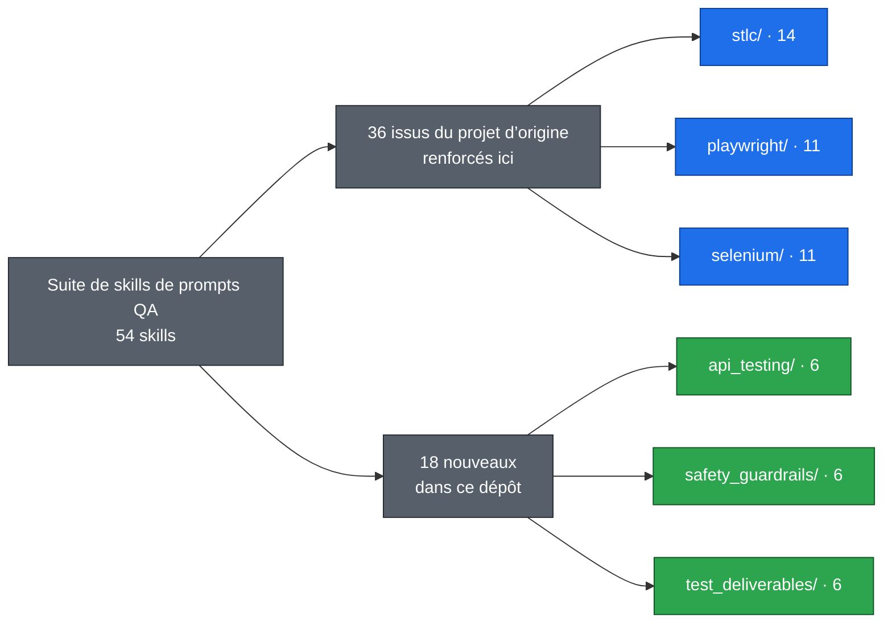

Place de chaque groupe dans le cycle de vie des tests.

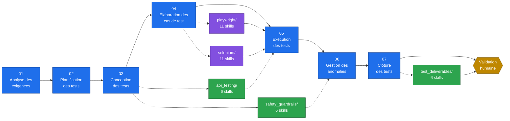

La suite impose une validation humaine. Les skills fondent leurs conclusions sur les preuves fournies,
indiquent comme inconnus les éléments qui restent à vérifier et s’arrêtent pour une revue humaine
avant de finaliser un plan, un ensemble de cas de test, une anomalie, un rapport ou une décision de mise en production.

<details>
<summary><b>STLC · 14 skills</b> — De l’analyse des exigences à la clôture des tests</summary>

| Skill | Rôle |
| --- | --- |
| `jira-requirement-analyzer` | Évaluer si un ticket Jira est prêt à partir d’une liste de contrôle et signaler les lacunes, ambiguïtés, risques et questions à clarifier |
| `test-plan-generator` | Récupérer un ticket et remplir le modèle standard de plan de test, puis soumettre le résultat à une revue humaine |
| `test-scenario-designer` | Déduire des scénarios positifs, négatifs, aux limites et multi-rôles, et les relier à chaque critère d’acceptation |
| `api-test-designer` | Définir la couverture d’un contrat ou d’un endpoint d’API pour le cas nominal, le schéma, l’authentification, les cas négatifs, les limites et l’idempotence |
| `test-case-writer` | Détailler les scénarios approuvés en préconditions, étapes ordonnées, résultats attendus et données requises |
| `test-data-generator` | Produire pour chaque champ ou scénario des jeux de données étiquetés, valides, invalides, aux limites et synthétiques |
| `automation-script-generator` | Préparer un dossier de transmission indépendant du framework pour un cas approuvé et orienter le choix entre Playwright et Selenium |
| `test-execution-tracker` | Consigner le statut de chaque cas (réussi, échoué, bloqué ou non exécuté) avec ses preuves, puis synthétiser l’avancement du cycle |
| `regression-suite-selector` | Relier une modification aux tests qui l’exercent et prioriser leur exécution selon les risques |
| `bug-reporter` | Transformer un échec observé en rapport d’anomalie structuré et reproductible |
| `bug-triage-assistant` | Regrouper les doublons probables, proposer une gravité et une priorité et orienter le traitement du backlog d’anomalies |
| `rca-analyzer` | Appliquer les cinq pourquoi et le diagramme d’Ishikawa pour distinguer la cause racine du symptôme et proposer des actions correctives |
| `test-coverage-analyzer` | Construire une vue de traçabilité et signaler les critères d’acceptation non testés, les zones peu couvertes et les tests sans exigence associée |
| `test-closure-reporter` | Synthétiser les métriques du cycle, les faits marquants et les risques, puis proposer un avis de mise en production |

</details>

<details>
<summary><b>Playwright · 11 skills</b> — Suite d’automatisation TypeScript</summary>

| Skill | Rôle |
| --- | --- |
| `pw-test-generator` | Générer un fichier de test TypeScript à partir d’un cas détaillé et approuvé |
| `pw-page-object-builder` | Créer une classe POM avec des locators `getByRole` ou `getByTestId`, des méthodes d’action et un `PATH` statique |
| `pw-locator-fixer` | Remplacer les sélecteurs XPath, les classes CSS et les sélecteurs nth-child fragiles et fournir une correspondance avant et après |
| `pw-fixture-designer` | Concevoir des fixtures typées pour l’authentification, les données initiales et les objets de page, avec une portée et un nettoyage adaptés |
| `pw-network-mocker` | Simuler les réponses et les erreurs avec `page.route` pour éliminer l’instabilité du serveur dans les tests |
| `pw-api-tester` | Tester un endpoint via le contexte de requête pour le cas nominal, le schéma, l’authentification, les cas négatifs et les limites |
| `pw-visual-regression` | Configurer `toHaveScreenshot` avec des masques, des seuils et une stratégie de captures de référence |
| `pw-accessibility-auditor` | Intégrer les contrôles `@axe-core/playwright` et trier les écarts selon la politique fournie |
| `pw-trace-analyzer` | Lire la chronologie d’un `trace.zip` pour isoler l’action qui échoue et recommander une correction |
| `pw-flaky-debugger` | Identifier les problèmes de concurrence, les attentes fixes et l’état partagé, puis proposer des corrections déterministes |
| `pw-ci-configurator` | Générer un workflow GitHub Actions avec répartition des tests, rapports blob et HTML, et artefacts |

</details>

<details>
<summary><b>Selenium · 11 skills</b> — Suite d’automatisation Java, TestNG et Maven</summary>

| Skill | Rôle |
| --- | --- |
| `se-test-generator` | Générer un test Java avec Selenium 4 et TestNG à partir d’un cas approuvé, avec des attentes explicites |
| `se-page-object-builder` | Créer une classe POM Java avec `@FindBy` ou des locators explicites et `WebDriverWait` |
| `se-locator-strategist` | Remplacer les XPath absolus fragiles par `By.id`, des sélecteurs CSS ou des locators relatifs Selenium 4 |
| `se-wait-fixer` | Remplacer `Thread.sleep` et les mélanges d’attentes implicites et explicites par `WebDriverWait` ou `FluentWait` |
| `se-driver-manager` | Configurer Selenium Manager ou WebDriverManager avec des options de navigateur et une fabrique sûre en concurrence |
| `se-framework-scaffolder` | Créer la structure d’un projet Maven et TestNG avec test de base, package POM, chargement de configuration, journalisation et rapports |
| `se-data-driven-designer` | Concevoir des tests pilotés par des données via `@DataProvider`, Excel, CSV ou JSON pour les valeurs valides, invalides et aux limites |
| `se-cross-browser-runner` | Paramétrer l’exécution sous Chrome, Firefox et Edge dans `testng.xml` ou à l’aide d’une fabrique |
| `se-grid-configurator` | Configurer le hub et les nœuds Selenium Grid 4 ou Docker, puis intégrer `RemoteWebDriver` pour les exécutions parallèles |
| `se-report-integrator` | Intégrer Allure ou ExtentReports avec des écouteurs, des captures en cas d’échec et la journalisation des étapes |
| `se-flaky-debugger` | Diagnostiquer les `StaleElementReferenceException` et les problèmes de synchronisation, puis définir un nombre limité de relances |

</details>

<details>
<summary><b>Tests d’API · 6 skills</b> — Nouveautés de ce dépôt</summary>

| Skill | Rôle |
| --- | --- |
| `api-contract-validator` | Comparer les requêtes et réponses observées à un contrat OpenAPI et signaler les écarts |
| `api-collection-builder` | Transformer les cas approuvés en collection exécutable pour Postman/Newman ou Bruno |
| `api-workflow-tester` | Concevoir des séquences d’appels avec état couvrant les cycles de vie, traitements asynchrones, événements et callbacks |
| `api-authorization-boundary-tester` | Établir une matrice d’accès fondée sur la politique pour vérifier les permissions sur les objets, l’isolation entre locataires et les limites de privilèges |
| `api-resilience-tester` | Planifier des tests de résilience à périmètre défini pour les délais, relances, réponses 429, doublons et reprises |
| `api-performance-test-planner` | Définir des charges, seuils et conditions d’arrêt, avec une trame facultative pour k6 ou JMeter |

</details>

<details>
<summary><b>Sécurité et garde-fous de l’IA · 6 skills</b> — Nouveautés de ce dépôt</summary>

| Skill | Rôle |
| --- | --- |
| `ai-threat-modeler` | Cartographier les actifs, les frontières de confiance, la mémoire, la recherche documentaire, les outils, les abus possibles et les risques résiduels |
| `prompt-injection-resilience-tester` | Évaluer la résistance aux injections directes et indirectes, le respect de la hiérarchie des instructions et la protection des données leurres |
| `sensitive-data-leakage-tester` | Vérifier la présence de fuites à l’aide de marqueurs synthétiques dans les prompts, le contexte, la recherche documentaire, les caches, les journaux et la conservation des données |
| `ai-agent-tool-safety-tester` | Vérifier les listes d’outils autorisés, le moindre privilège, les validations, les simulations, l’idempotence et le retour arrière |
| `content-safety-guardrail-evaluator` | Mesurer les acceptations dangereuses, les refus appropriés, les refus excessifs et la couverture de la politique sur plusieurs tours |
| `ai-fairness-bias-evaluator` | Évaluer l’équité par sous-groupes, par paires contrefactuelles et par groupes croisés, avec des données synthétiques ou utilisées avec consentement |

</details>

<details>
<summary><b>Livrables de test · 6 skills</b> — Nouveautés de ce dépôt</summary>

| Skill | Rôle |
| --- | --- |
| `review-test-deliverables` | Contrôler la qualité d’un livrable QA et préciser l’emplacement des constats avant la revue par les pairs |
| `maintain-test-traceability` | Tenir à jour une matrice de traçabilité versionnée reliant exigences, cas, exécutions, anomalies et preuves |
| `draft-test-status-brief` | Rédiger un point QA quotidien ou hebdomadaire à partir de données d’exécution et de risques validées à la date du bilan |
| `assemble-release-decision-record` | Relier les preuves aux critères de sortie et consigner la décision, les dérogations et les conditions de mise en production |
| `curate-test-evidence-bundle` | Inventorier les preuves existantes, calculer leurs empreintes et les versionner dans un manifeste partageable |
| `prepare-qa-audit-handoff` | Indexer les livrables selon la liste des contrôles d’audit, avec les responsables et la chaîne de conservation |

</details>

<a name="install-a-skill"></a>

#### Installer un skill

```bash
skill_source=chapter_02_Prompt_Eng/prompt_templates/api_testing/api-contract-validator
skill_destination="$HOME/.codex/skills/api-contract-validator"

if [ -e "$skill_destination" ]; then
  echo "Skill already exists; compare and back it up before an explicitly approved update."
  exit 1
fi

mkdir -p "$(dirname "$skill_destination")"
cp -R "$skill_source" "$skill_destination"
```

Appelez ensuite le skill par son nom, par exemple `$api-contract-validator`. Les 18 nouveaux skills incluent aussi
un fichier `agents/openai.yaml` pour que Codex charge leurs métadonnées.

<a name="chapter-03-local-test-case-generator"></a>

### Chapitre 03 — Générateur local de cas de test

Application Streamlit à deux écrans qui génère des cas de test à partir de tickets Jira à l’aide d’un LLM local, avec un service cloud en secours.

<a name="features"></a>

#### Fonctionnalités

- Interface de chat pour saisir la clé d’un ticket Jira et obtenir des cas de test structurés
- Récupération des détails du ticket (résumé, description et critères d’acceptation) via l’API REST de Jira
- Génération des cas de test avec Ollama par défaut (`gemma3:1b` sur `localhost:11434`)
- Bascule automatique vers l’API cloud Groq lorsque Ollama est indisponible
- Page de réglages pour configurer les identifiants Jira, le fournisseur du LLM et la clé API Groq
- Stockage des identifiants dans `.env` pour l’initialisation et dans `config.json` à l’exécution
- Modèle de prompt contre les hallucinations avec des règles de formatage strictes

<a name="file-structure"></a>

#### Structure des fichiers

```
chapter_03_Local_TC_Generator/
├── src/
│   ├── app.py                 # Main Streamlit chat screen
│   ├── pages/
│   │   └── settings.py        # Settings screen (Jira + LLM config)
│   ├── config_store.py        # Settings persistence (.env -> config.json)
│   ├── jira_client.py         # Jira REST API wrapper
│   ├── llm_client.py          # Ollama + Groq orchestrator with fallback
│   ├── requirements.txt       # Python dependencies
│   ├── .env                   # Credentials (git-ignored)
│   └── config.json            # Runtime settings (git-ignored)
├── templates/
│   └── testcase_creator.md    # Test case generation template
└── src/
    ├── Finetune_Prompt.md     # Original design prompt
    ├── Prompt.md              # Project requirements
    └── plan.md                # Implementation plan
```

<a name="running-the-app"></a>

#### Lancer l’application

```bash
cd chapter_03_Local_TC_Generator/src
pip install -r requirements.txt
streamlit run app.py
```

<a name="environment-variables"></a>

#### Variables d’environnement

Initialisez ces variables dans `chapter_03_Local_TC_Generator/src/.env`, un fichier ignoré par Git :

```
JIRA_URL=https://your-org.atlassian.net
JIRA_EMAIL=you@example.com
JIRA_API_TOKEN=your-jira-api-token
GROQ_API_KEY=your-groq-api-key
OLLAMA_MODEL=gemma3:1b
```

<a name="data-flow"></a>

#### Flux de données

```
User types "create test cases for JIRA-102"
  -> app.py parses JIRA-102 via regex
  -> jira_client.py fetches ticket from Jira REST API
  -> templates/testcase_creator.md loaded and merged with ticket content
  -> llm_client.py tries Ollama first, falls back to Groq
  -> Test cases rendered as a formatted markdown table in chat
```

<a name="chapter-04-jobkit-ai"></a>

### Chapitre 04 — JobKit AI

Une boîte à outils qui adapte les CV aux offres d’emploi exportées depuis LinkedIn.
Le skill `resume-tailor` lit une offre et produit une spécification
structurée (`.specs/*.json`) avec les compétences à mettre en avant, les écarts avec le profil recherché et
le contenu de chaque rubrique, puis génère un document `.docx` mis en forme dans `output/`.

**Questions et réponses sur l’utilisation**
- **Quand l’utiliser ?** Pour adapter les mots-clés, l’ordre et les points forts du CV à un poste précis.
- **Qu’est-ce que l’outil remplace ?** Les retouches manuelles dans Word et les devinettes sur les termes que les recruteurs recherchent.
- **À quoi faire attention ?** La spécification signale les écarts, comme les années d’expérience manquantes ou les affirmations non vérifiées. Traitez tous les marqueurs `[confirm ...]` avant tout envoi.

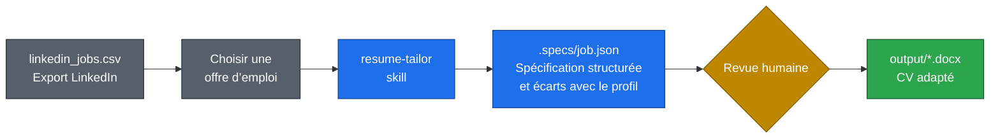

Le dépôt contient deux exemples détaillés, avec les spécifications et les fichiers DOCX générés,
pour un poste de responsable de l’automatisation des tests chez Accenture et un poste de responsable d’équipe QA logicielle chez Mouser Electronics.

<a name="chapter-05-job-tracker-ai"></a>

### Chapitre 05 — Job Tracker AI

Un tableau Kanban local pour suivre les candidatures. Il comporte six colonnes, des postes à envisager
aux candidatures refusées, avec glisser-déposer entre les étapes. Les données sont stockées dans
IndexedDB, dans le navigateur, et restent sur la machine.

<a name="features-1"></a>

#### Fonctionnalités

- Tableau Kanban à six statuts. À envisager, candidature envoyée, relance, entretien, offre et refus
- Glisser-déposer entre les colonnes avec dnd-kit, à la souris ou au clavier
- Fenêtre d’ajout et de modification avec entreprise, poste, URL LinkedIn, CV utilisé, fourchette salariale, date de candidature, statut et notes
- Saisie semi-automatique à partir des noms de CV déjà utilisés
- Recherche par entreprise ou poste et tri de la date de candidature du plus récent au plus ancien ou inversement
- Indicateurs en haut de page pour le total de candidatures, les entretiens et les offres
- Export et import des sauvegardes JSON. Après confirmation, l’import remplace les données existantes
- Choix du thème clair ou sombre conservé dans localStorage
- Confirmation de suppression, notifications et fermeture des fenêtres avec Échap

<a name="tech-stack"></a>

#### Technologies utilisées

| Couche | Technologie |
| --- | --- |
| Interface | React 18 + Vite |
| Styles | Tailwind CSS 3 (`darkMode: 'class'`) |
| Glisser-déposer | @dnd-kit/core + @dnd-kit/sortable |
| Stockage | IndexedDB via `idb` |
| Icônes | lucide-react |

<a name="data-model"></a>

#### Modèle de données

Chaque candidature est un enregistrement dans le magasin d’objets `jobs` de la base IndexedDB
`job-tracker-ai`. La clé est `id`, avec des index sur `status` et `dateApplied`.

```js
{
  id: 'uuid',
  company: 'Accenture',
  role: 'Test Automation Lead',
  linkedInUrl: 'https://linkedin.com/jobs/...',
  resumeUsed: 'QA_Lead_Resume',
  dateApplied: '2026-08-23',
  salaryRange: '',
  notes: '',
  status: 'applied',   // wishlist | applied | follow-up | interview | offer | rejected
  createdAt: '...',
  updatedAt: '...',
}
```

<a name="running-the-app-1"></a>

#### Lancer l’application

```bash
cd chapter_05_JobTrackerAI
npm install
npm run dev        # http://localhost:5173
```

<a name="state-flow"></a>

#### Transitions d’état

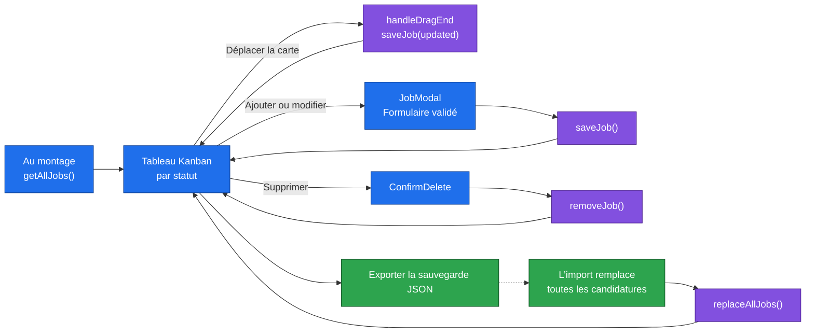

**Questions et réponses sur l’utilisation**
- **Quand l’utiliser ?** Pendant une recherche active, quand plusieurs candidatures se trouvent à des étapes différentes.
- **Qu’est-ce que l’outil remplace ?** Le tableur. Pour changer un statut, déplacez la carte. La recherche et les indicateurs sont intégrés.
- **À quoi faire attention ?** Les données sont stockées dans IndexedDB dans ce navigateur. Exportez-les avant d’effacer les données du site ou de changer de machine. L’import remplace l’ensemble des données.

<a name="chapter-06-branding-and-linkedin-skills"></a>

### Chapitre 06 — Image de marque et skills LinkedIn

A Claude/Codex skill that turns any content seed into a publish-ready pack in
The Testing Academy voice. Drop in a title, rough bullets, a screenshot, a URL,
a thread, or a spoken dump. The skill returns a Medium article, a LinkedIn post,
LinkedIn image prompts, and a Medium cover prompt.

The voice spec, deliverable formats, and a full worked example live in
[chapter_06_Branding_LinkedinSkills/README.md](chapter_06_Branding_LinkedinSkills/README.md).

<a name="what-it-produces"></a>

#### Livrables générés

| File | Job |
| --- | --- |
| `pack-1-medium-article.md` | 2,500 to 3,200 word Medium draft |
| `pack-2-linkedin-post.md` | Hook ladder, 220 to 260 word post, first-comment blocks |
| `pack-3-linkedin-image-prompts.md` | Style C v2 tweet-screenshot cards |
| `pack-4-medium-image-prompt.md` | Style A 16:9 cyber infographic cover |

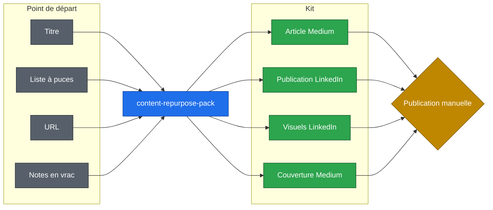

<a name="file-structure-1"></a>

#### Structure des fichiers

```
chapter_06_Branding_LinkedinSkills/
├── files.zip                         # original archive
├── content-repurpose-pack.skill      # packaged bundle
└── content-repurpose-pack/
    ├── SKILL.md                      # pipeline and hook protocol
    └── references/
        ├── brand-voice.md            # Hook / Story / Offer, 13 threads
        ├── deliverable-specs.md      # exact formats for the four files
        └── worked-example.md         # one full input-to-output pass
```

<a name="install-the-skill"></a>

#### Installer le skill

```bash
skill_source=chapter_06_Branding_LinkedinSkills/content-repurpose-pack
skill_destination="$HOME/.claude/skills/content-repurpose-pack"

if [ -e "$skill_destination" ]; then
  echo "Skill already exists; compare and back it up before an explicitly approved update."
  exit 1
fi

mkdir -p "$(dirname "$skill_destination")"
cp -R "$skill_source" "$skill_destination"
```

For Codex, use `$HOME/.codex/skills/content-repurpose-pack`. Then invoke it by
name, such as `$content-repurpose-pack`.

<a name="pack-pipeline"></a>

#### Étapes de production du kit


<a name="voice-spine"></a>

#### Principes de la ligne éditoriale

Same three beats on LinkedIn and Medium. Only the word budget changes. The usual
miss is a great Hook and Story with no Offer.


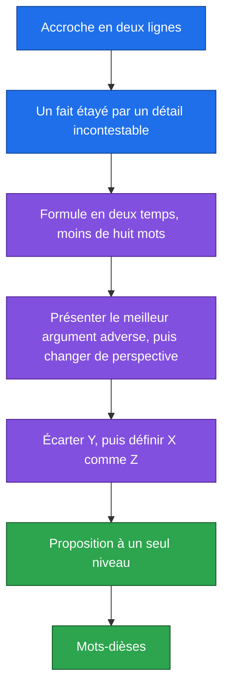

Offer rotation: four posts on a belief or a question, then one free asset, and a
product link only for real launches.


<a name="hook-ladder"></a>

#### Progression des accroches

When the ask is controversial, the skill returns three labelled variants instead
of sanitizing or refusing.

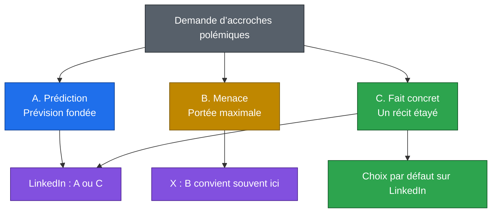

**Q&A - why use this?**
- **Q: When do I reach for it?** A: When a seed needs to become a Medium + LinkedIn + image pack in this voice, not a generic rewrite.
- **Q: What does it replace?** A: Re-prompting from scratch for length, banned phrases, first-comment splits, and image specs.
- **Q: What's the gotcha?** A: A pack with no receipt is the biggest quality drop. Supply a real story, or accept a composite flagged for anonymization. No em dashes, anywhere.

<a name="chapter-07-ai-agents"></a>

### Chapitre 07 — Agents IA

A **Test Plan Agent**: give it a Jira ID, get back a formal 14-section test plan
where every claim traces to a real field on the ticket. Built with the
**B.L.A.S.T.** protocol on the **A.N.T.** 3-layer architecture.

**Why:** the naive version (paste a ticket into a chat window, ask for a test plan)
hallucinates acceptance criteria, produces a different shape every run, and gives you
no way to tell which step went wrong when the output is bad.

**Q&A - why use this?**
- **Q: When do I reach for it?** A: When a story needs a review-ready test plan and you need every scope decision defensible to a reviewer.
- **Q: What does it replace?** A: Hand-writing the same 14 sections per ticket, and the re-prompting loop when a chat model drifts from your template.
- **Q: What's the gotcha?** A: It will refuse a thin ticket rather than invent one, returning a gap report instead. That is the design, not a bug: 2 of 4 real tickets were refused in testing.

<a name="the-blast-protocol"></a>

#### Le protocole B.L.A.S.T.

Five phases with hard gates. Nothing enters `tools/` until Discovery Questions are
answered, the data schema is frozen, and the blueprint is approved.

```mermaid
flowchart LR
    P0["Protocole 0<br/>Initialiser la mémoire"] --> GATE{{"Contrôles A/B/C<br/>Attendre la validation"}}
    GATE --> B["B - Plan directeur<br/>5 questions de cadrage<br/>Figer le schéma"]
    B --> L["L - Connexions<br/>Vérifier chaque connexion<br/>avant la logique"]
    L --> A["A - Architecture<br/>Procédures, puis outils"]
    A --> S["S - Présentation<br/>Modèle figé<br/>Contrôles de sortie"]
    S --> T["T - Déclenchement<br/>Interface graphique et CLI"]

    classDef src fill:#57606a,stroke:#24292f,color:#fff
    classDef gate fill:#bf8700,stroke:#7a5600,color:#fff
    classDef ai fill:#1f6feb,stroke:#0b3d91,color:#fff
    classDef out fill:#2da44e,stroke:#0f5323,color:#fff
    class P0 src
    class GATE gate
    class B,L,A ai
    class S,T out
```

Four memory files carry the project state: `task_plan.md` (phases and checklists),
`findings.md` (research and constraints), `progress.md` (a timestamped log of what was
done, what errored, what the result was), and `LLM.md` (the constitution: schemas,
18 behavioural rules, 10 architectural invariants).

<a name="ant-3-layer-architecture"></a>

#### Architecture A.N.T. à trois couches

The premise: **LLMs are probabilistic, business logic must be deterministic.** So the
pipeline is seven steps and exactly one of them calls a model.

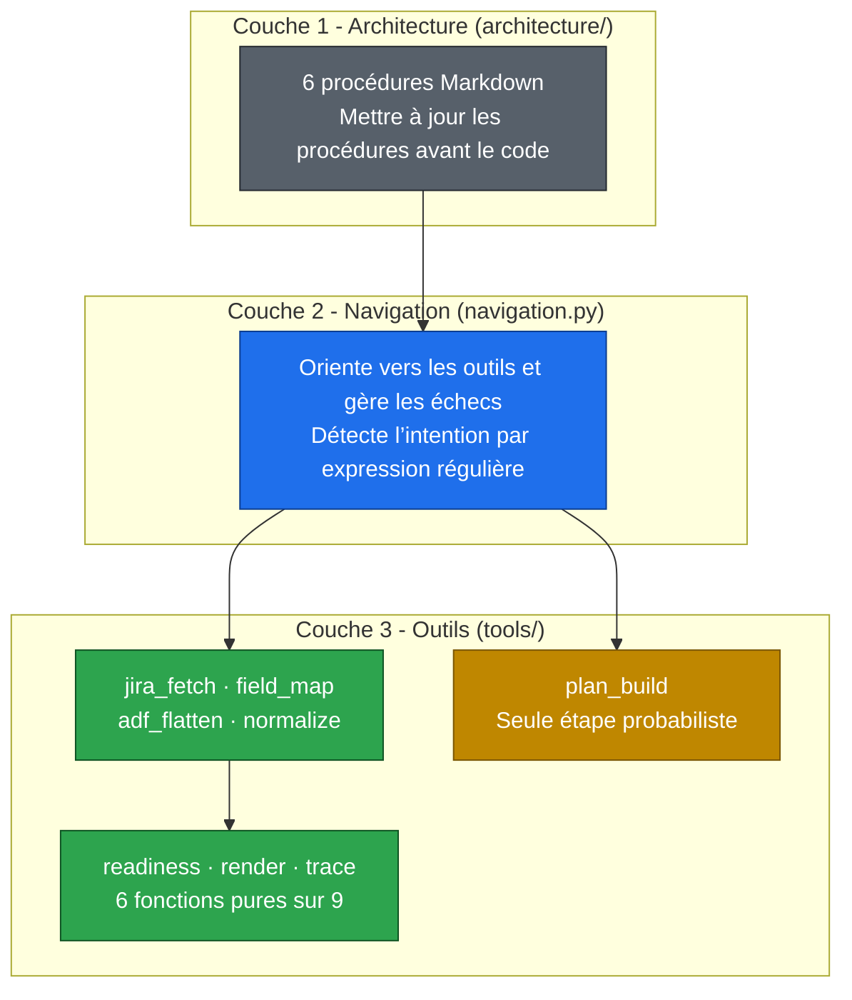

The pipeline, end to end:

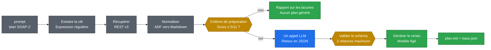

<a name="running-the-agent"></a>

#### Exécuter l’agent

```bash
cd chapter_07_AI_Agents/Test-Plan-Agent-Blast
pip install -r requirements.txt
cp .env.example .env          # or use the Settings page
streamlit run app.py          # UI on :8501
```

Open **Settings** first: add the Jira URL, email and API token plus an LLM key
(DeepSeek or Groq, both OpenAI-compatible), then press both **Test connection**
buttons. The CLI mirrors the UI:

```bash
python run.py SOAP-1                    # generate a plan
python run.py "make a plan for VWO-49"  # natural language, same result
python run.py --health                  # prove both connections
python run.py --dry-run SOAP-1          # fetch + normalize, no LLM call
```

Exit codes: `0` ok, `2` bad input, `3` auth, `4` not found, `5` rate limited,
`6` schema violation, `7` LLM failure.

<a name="anti-hallucination-design"></a>

#### Conception contre les hallucinations

The model returns **JSON, not markdown**. `render.py` owns the format, so the model
never sees the template and cannot drift from it. Two schema fields do the real work:

```json
{
  "scope": [{
    "type": "Error Handling",
    "rationale": "Assert the 400 response names the offending field.",
    "justified_by": "FR-03: the system must reject requests missing sISBN."
  }],
  "assumptions": [{
    "field": "environment.url",
    "assumed_value": "QA environment (URL not specified in ticket)",
    "why": "Ticket does not provide a concrete environment URL"
  }]
}
```

`justified_by` is required on every scope entry and must name the ticket fact that put
it there. A model that cannot fill it has just admitted the entry is padding, and the
schema rejects the response. That turns "please do not hallucinate" from a hopeful
instruction into a structural constraint. Anything filled without ticket evidence lands
in `assumptions[]` and renders into the deliverable, not into a debug log.

<a name="field-notes-from-the-build"></a>

#### Retours d’expérience sur le développement

Three findings that only surfaced by running it against a live Jira and a live model:

| Finding | Why it matters |
|---|---|
| **Jira answers 404, not 401**, on `/issue/{key}` when auth is bad | It hides issue existence from unauthenticated callers, so an expired token presents as a *missing ticket*. The fix is to call `/myself` on a 404 to disambiguate. |
| **Groq counts `max_tokens` against the TPM limit** | The reservation is billed, not the completion. A 2,669-token prompt with `max_tokens: 8000` reads as 10,669 against an 8,000 cap. Check the reservation before slimming the payload. |
| **`config.json` silently shadowed `.env`** | Saving credentials in the UI wrote them to `config.json`, which outranks `.env`, so later edits to `.env` were ignored with no indication. Settings now shows the source of every value. |

<a name="chapter-08-n8n-agents"></a>

### Chapitre 08 — Agents n8n

Nine n8n workflows plus the prompt files that drive them. The chapter walks the same
Jira-agent idea from chapter 07 across a visual low-code canvas, then pushes past it
into multi-tool agents (Jira + Google Sheets), local models, a deterministic RCA
pipeline, a LinkedIn content chain, a scheduled poster that stops for human approval
before it publishes, a screenshot-to-bug-report intake, and a custom React UI
(`ui_screenshotbugAIAgent/`) deployed on Vercel that wraps workflow 09 behind a
branded, paste-friendly front end.

**Why:** an agent loop drawn on a canvas is legible to people who will not read a call
stack. It also makes the failure modes visible: you can see exactly where the LLM is
allowed to decide, and where a plain node does the work.

```
chapter_08_n8n/
├── 01_Raw_BugTriage.prompt.md        # the persona-only triage prompt (v1)
├── 02_ModifiedBugTriagePrompt.prompt.md  # v2: same persona + tool-calling contract
├── 03_RCA_AI_Agent.prompt.md         # the meta-prompt that generated workflow 05
├── Agents/
│   ├── 01_FetchJIRATicket_AIAgent.json   # 9 nodes: chat/schedule -> agent -> Jira get
│   ├── 02_CreateJIRATicket_AIAgent.json  # 9 nodes: same shape, Jira create
│   ├── 03_FetchJIRACreateTCAIAgent_Local_LLM_ollama.json  # 6 nodes: local Ollama / Groq brain
│   ├── 04_BugTriageAIAgent.json          # 12 nodes: Jira + Google Sheets, two tools
│   ├── 05_RCA_Chatgpt_Jira_Production_Bug_RCA_Automation.json  # 35 nodes: full RCA pipeline
│   ├── 06_Social_Media_AIAgent.json      # 15 nodes: topic -> post -> image -> review -> LinkedIn
│   ├── 07_Social_Post_Generator (Gemini+ Upload Post).json  # 14 nodes: scheduled post + Telegram approval
│   ├── 08_Screenshot_To_Bug_Reporter_AIAgent.json  # 11 nodes: screenshot -> vision -> Jira bug
│   ├── 09_Screenshot_To_Bug_Reporter_AIAgent_UI.json  # webhook variant for the custom UI
│   ├── Plan.md                       # model research + design notes for 08
│   ├── Prompt.md                     # the build prompt that produced 08 and 09
│   └── screenshot-bug-reporter-live-run.png  # a real run: VWO-125 filed from a login error
└── resources/
    ├── Jira_Bug_Triage_Sample.xlsx   # the triage sheet the agent writes into
    └── VWO-49_RCA.doc                # a sample RCA output
```

Import any file through **n8n > Workflows > Import from File**, then attach your own
credentials. n8n stores credentials by reference, so the exported JSON carries no secrets.
Workflow 07 is the one exception worth knowing about: it calls the Gemini image endpoint
through a raw HTTP Request node, so the key travels in a plain header parameter rather
than a credential. That value ships as the placeholder `YOUR_GEMINI_API_KEY`. Replace it
on import, or better, move it into a Header Auth credential (see the Q&A under 07).

<a name="the-jira-agent-pair-01-02"></a>

#### Le duo d’agents Jira (01, 02)

The starting shape: a trigger, a brain, a memory, and exactly one Jira tool. A chat
message like "fetch PROJ-12" or "raise a bug for the login page" becomes a real Jira
API call.

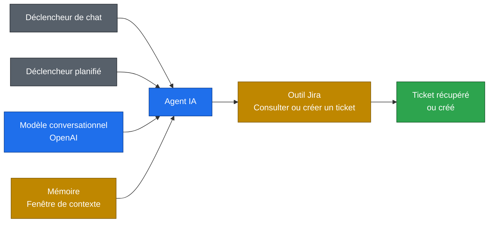

**Q&A - why use this?**
- **Q: When do I reach for it?** A: When the workflow should be editable by someone who does not write Python, or when it needs to run on a schedule without hosting your own app.
- **Q: What does it replace?** A: The glue code around auth, retries and scheduling.
- **Q: What's the gotcha?** A: The agent decides *when* to call the Jira tool, so a vague prompt can create the wrong ticket. Chapter 07's approach (deterministic fetch, one bounded LLM step) trades that flexibility for repeatability.

<a name="swapping-the-brain-local-ollama-and-groq-03"></a>

#### Changer de modèle avec Ollama en local ou Groq (03)

The same fetch agent with the OpenAI node replaced. Two model nodes sit in the file:
an **Ollama Chat Model** (wired in, runs on your own machine) and a **Groq Chat Model**
(parked, swap the connection to use it). Memory is dropped, so the run is stateless.

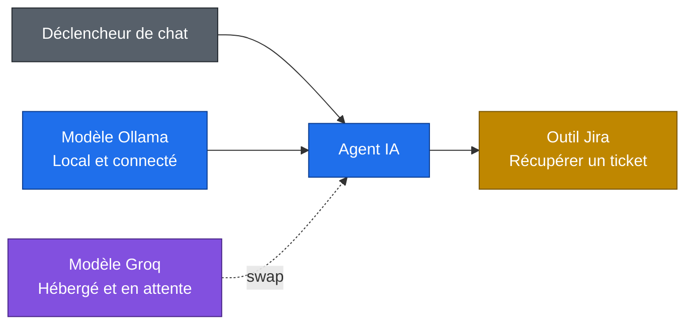

**Q&A - why use this?**
- **Q: Why bother running locally?** A: Ticket text is company data. A local model keeps it on your machine, and the token bill goes to zero.
- **Q: What breaks?** A: Small local models are weaker at tool calling. They will describe the Jira call instead of making it. Groq is the middle ground: hosted and fast, but still not OpenAI-grade at multi-step tool use.
- **Q: How do I decide?** A: Start on a hosted model to prove the workflow, then downgrade the brain and see if the tool calls survive.

<a name="bug-triage-into-google-sheets-04"></a>

#### Tri des anomalies dans Google Sheets (04)

The first genuinely multi-tool agent: it reads **many** Jira issues, triages each one,
and writes a row per issue into a Google Sheet keyed on `jira_key`. Four brains are
present in the file (OpenAI wired in, Groq and DeepSeek parked) so you can A/B the
triage quality on the same prompt.

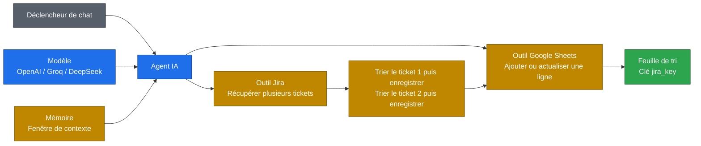

The two prompt files next to it are the interesting part, because they are the same
prompt one revision apart:

| | `01_Raw_BugTriage.prompt.md` | `02_ModifiedBugTriagePrompt.prompt.md` |
|---|---|---|
| Length | 72 lines | 370 lines |
| Covers | Persona, severity vs priority, S0-S4 and P0-P4 scales, category taxonomy, triage checklist, rules of the desk | All of that, **plus** the tool contract |
| Missing | Any mention of the tools | - |
| Adds | - | Mandatory execution order, pagination and dedup rules, per-issue write loop, column-by-column sheet mapping, sheet-tool error handling, final summary format |

Version 1 produces excellent triage *as text*. It does not reliably call Google Sheets,
because nothing in it says the agent must. Version 2 keeps the judgment intact and bolts
on the execution contract: retrieve, triage one, **write one**, repeat, and never invent
a Jira issue.

**Q&A - why use this?**
- **Q: What is the actual lesson?** A: A great persona prompt is not an agent prompt. The moment tools enter, you have to spell out the call order, the loop granularity, and what counts as success.
- **Q: Why write one row at a time?** A: Batching at the end means one failure loses the whole run. Per-issue writes make a partial run still useful.
- **Q: Why is `jira_key` the match column?** A: It makes the write idempotent. Re-running updates rows instead of duplicating them.

<a name="production-bug-rca-pipeline-05"></a>

#### Workflow d’analyse des causes racines d’une anomalie en production (05)

The largest workflow in the repo: 35 nodes that turn a Jira production-bug event into a
formatted RCA workbook in Google Drive, as both a Google Sheet and an `.xlsx` export.

The architectural rule is the opposite of workflow 04. Jira, Drive and Sheets are **not**
agent tools here. They are plain deterministic nodes. The AI Agent does exactly one job:
turn the evidence package into structured RCA JSON, validated by an output parser.

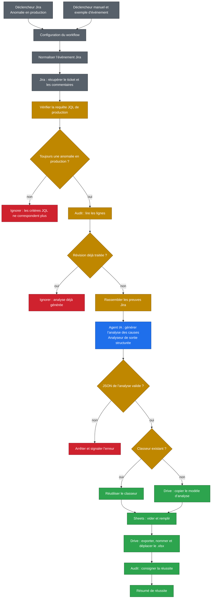

Three guards run before a single token is spent: the JQL re-check (the label may have
been removed since the trigger fired), the audit-table dedup (same issue, same revision,
already done), and the structured-output validation (a malformed RCA stops the run
instead of writing garbage into the template).

`03_RCA_AI_Agent.prompt.md` is the 1019-line meta-prompt that produced this workflow. It
specifies the config Set node, the template requirement, every node in the required
workflow, the RCA agent system prompt, the structured output schema, the human review
rule, and the acceptance tests. The workflow JSON is the output; the prompt is the spec.

**Q&A - why use this?**
- **Q: Why not let the agent call Jira and Sheets itself, like workflow 04?** A: Because an RCA writes into a shared template that people sign off on. You do not want the model deciding whether to copy a file. Agentic where judgment is needed, deterministic everywhere else.
- **Q: What does the audit table buy me?** A: Idempotency. Jira fires on every update; without the audit row you would generate a fresh RCA workbook on every comment.
- **Q: Why copy a template instead of building the sheet?** A: The template carries formatting, formulas, dropdowns and named worksheets. Copying preserves all of it; generating from scratch loses it.

<a name="social-media-content-chain-06"></a>

#### Chaîne de création de contenu pour les réseaux sociaux (06)

Two independent pipelines in one file, both on schedule triggers. The main chain is a
sequence of specialised agents rather than one agent with many tools:

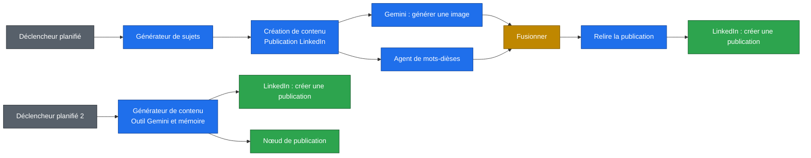

**Q&A - why use this?**
- **Q: Why five agents instead of one?** A: Each one has a single job and a short prompt, so you can read its output and fix the one that is wrong. A single mega-agent asked to pick a topic, write, illustrate, tag and review will quietly do the last step badly.
- **Q: What is the Review node for?** A: It is the quality gate before anything reaches a real audience. Swap it for a manual approval node if you are not ready to auto-post.
- **Q: How does this relate to chapter 06?** A: Chapter 06 is the voice and hook system as a Claude skill. This is the same idea running unattended on a schedule.

<a name="scheduled-post-generator-with-human-approval-07"></a>

#### Génération de publications planifiées avec validation humaine (07)

**Concept:** a fully unattended LinkedIn poster that runs every morning at 10:00, writes
the post, generates its own illustration, and then **stops** and asks a human on Telegram
to approve before anything is published.

**Why:** workflow 06 gates its output with another agent. An LLM reviewing an LLM catches
tone problems but will never catch the one that matters, which is a post you simply did
not want to go out under your name. This chain puts a person in that seat without
re-introducing the manual work of writing.

Two vendors sit in one chain on purpose. Gemini Flash picks the topic (cheap, high volume,
low stakes) and GPT writes the post (the step whose quality you actually feel). The image
comes from the Gemini image endpoint via a raw HTTP Request node, is converted to a binary
PNG, and rides along as the LinkedIn share media.

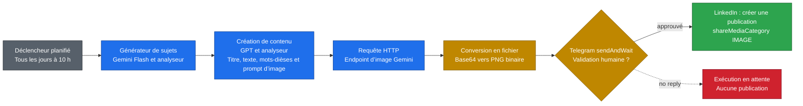

The whole gate is one node. `sendAndWait` suspends the execution and resumes it only when
the reply arrives, so no approval means no post rather than a default-yes:

```json
{
  "name": "Send a text message",
  "type": "n8n-nodes-base.telegram",
  "parameters": {
    "operation": "sendAndWait",
    "chatId": "859100842",
    "message": "={{ $('Content Creator (Linkedin Post)').item.json.output.post_body }}"
  }
}
```

```json
{
  "name": "Create a post",
  "type": "n8n-nodes-base.linkedIn",
  "parameters": {
    "text": "={{ $('Content Creator (Linkedin Post)').item.json.output.post_body }}",
    "shareMediaCategory": "IMAGE",
    "additionalFields": {
      "title": "={{ $('Content Creator (Linkedin Post)').item.json.output.post_title }}",
      "visibility": "PUBLIC"
    }
  }
}
```

| | 06: agent review | 07: human approval |
|---|---|---|
| Gate | `Review the Post` agent | Telegram `sendAndWait` |
| Blocks on | Model judgment | A real reply |
| Failure mode | Approves a bad post confidently | Nothing posts until you answer |
| Use when | Volume matters more than any single post | Your name is on it |

**Q&A - why use this?**
- **Q: Why `sendAndWait` instead of a Telegram send plus an IF node?** A: `sendAndWait` parks the execution and resumes on reply. A plain send would fire the message and continue straight into the LinkedIn node, which is exactly the thing the gate exists to prevent.
- **Q: Why does the image go through an HTTP Request node instead of the Gemini node?** A: The image endpoint returns base64 inside a nested `steps[1].content[0].data` path, so the response needs a `Convert to File` step to become the PNG binary LinkedIn wants. That also means the key lives in a header parameter, not a credential. Swap `YOUR_GEMINI_API_KEY` for a **Header Auth** credential (`authentication: genericCredentialType`) if you would rather it never touched the JSON.
- **Q: What's the gotcha?** A: The topic-generator's output parser is set to `manual` with no schema, so the second agent's prompt reads `$json.output.properties.topic.type` and picks up the literal string `"string"` out of the JSON Schema envelope instead of the topic. Fill in the first parser's `inputSchema` (as the second one does) and the expression shortens to `$json.output.topic`. It is a good illustration of the real hazard in visual pipelines: a wrong expression does not crash, it quietly feeds plausible garbage forward.

<a name="screenshot-to-bug-reporter-08"></a>

#### Rapport d’anomalie à partir d’une capture d’écran (08)

**Concept:** a hosted upload form takes a screenshot plus optional error logs, a vision
model drafts a complete structured bug report from what it can actually see, and the
workflow files it into Jira with the original PNG attached to the ticket.

**Why:** the visual detail is the part testers summarise away. The red banner, the
overlapping div, the truncated error string: all of it is in the screenshot and almost
none of it survives being retyped into a ticket by hand.

This is the first workflow in the chapter with a **human file-upload intake**. Nothing in
01-07 ingests a user-supplied file, and the string `base64` appears nowhere else in the
chapter.


Note what is **not** here: no AI Agent node. The model gets exactly one bounded job, and
every other step is a plain deterministic node. This is workflow 05's shape, not workflow
01's. An agent node would also hand the tool-calling loop the decision of whether to look
at the image at all.

The whole model call is one HTTP node, and the key never enters the file:

```json
{
  "method": "POST",
  "url": "https://api.groq.com/openai/v1/chat/completions",
  "authentication": "predefinedCredentialType",
  "nodeCredentialType": "groqApi",
  "jsonBody": "={{ JSON.stringify({ model: 'qwen/qwen3.6-27b', response_format: { type: 'json_object' }, messages: [ { role: 'system', content: $('Normalize Intake').first().json.system_prompt }, { role: 'user', content: [ { type: 'text', text: $('Normalize Intake').first().json.user_prompt }, { type: 'image_url', image_url: { url: 'data:' + $('Normalize Intake').first().json.mime_type + ';base64,' + $json.screenshot_b64 } } ] } ] }) }}"
}
```

`Agents/Plan.md` carries the full model research. The short version is that Groq's vision
lineup contracted through 2026: `llama-3.2-11b-vision` was decommissioned and Llama 4
Scout and Maverick left the supported list, so the only image-capable models left are
`qwen/qwen3.6-27b` and `qwen/qwen3.8-27b`, both Preview.

| | Groq `qwen3.6-27b` | OpenRouter `glm-5.3-flash` |
|---|---|---|
| Input / output per M | $0.60 / $3.00 | $0.075 / $0.25 |
| Per bug report | ~$0.0036 | ~$0.0004 |
| Status | Preview | Production |
| JSON | `response_format` honoured | No server-side schema enforcement |
| Pick it for | Speed | Cost, and stability |

**Q&A - why use this?**
- **Q: Why is the binary re-attached twice?** A: Because it does not survive the HTTP hop, and Jira's create response carries none either. Nodes 5 and 7 both pull it back from `$('Normalize Intake').first().binary`. Forgetting this is the single most common way a file-handling n8n workflow silently posts a ticket with no attachment.
- **Q: Why resolve the uploaded file by `Object.keys(item.binary)[0]` instead of by name?** A: The Form Trigger derives the binary property name from the field label, and the exact form has changed between n8n versions. Taking the first key and re-keying it to a stable `screenshot` property means the rest of the workflow depends on our name, not n8n's.
- **Q: What's the gotcha?** A: A vision model asked for a bug report will always produce one. Upload a screenshot of a perfectly healthy page and a careless prompt invents a defect to fill the schema. The system prompt therefore forbids inventing anything not visible and requires a `confidence` field, and that unbroken-page run is the test worth doing first.

<a name="screenshot-to-bug-reporter-ui-09"></a>

#### Interface de signalement d’anomalies à partir d’une capture d’écran (09)

**Concept:** workflow 08 with its Form Trigger swapped for a **Webhook** and a **Respond to
Webhook** node bolted on the end, so a custom front end can call it as a JSON API and get
the filed ticket back instead of an n8n-hosted HTML page.

**Why:** an n8n form is fine for a demo, but the moment you want your own branding, a paste
-from-clipboard upload, or the Jira key rendered back to the reporter, you need a real API
and a real UI in front of it.

The front end lives in [`ui_screenshotbugAIAgent/`](ui_screenshotbugAIAgent/) (Vite + React
+ Tailwind) and is deployed on Vercel. A real run, end to end:


Note what the model read off that screenshot: the exact banner text, the email in the input
(`opg73@singleuseemail.site`), the empty password field, the unchecked reCAPTCHA. That is
the detail a tester would never retype by hand.

```mermaid
flowchart LR
    UI["Interface Vercel<br/>Coller ou déposer une capture"] --> PX["/api/report<br/>Proxy sans serveur"]
    PX --> WH["Webhook n8n<br/>POST screenshot-bug-report"]
    WH --> NI["Normaliser la saisie"]
    NI --> GV["Vision Groq<br/>qwen3.8-27b, mode JSON"]
    GV --> JC["Jira : créer le ticket et joindre la capture"]
    JC --> RW["Répondre au webhook<br/>jira_key, summary, confidence"]
    RW --> UI

    classDef src fill:#57606a,stroke:#24292f,color:#fff
    classDef ai fill:#1f6feb,stroke:#0b3d91,color:#fff
    classDef gate fill:#bf8700,stroke:#7a5600,color:#fff
    classDef out fill:#2da44e,stroke:#0f5323,color:#fff
    class UI src
    class GV ai
    class PX,WH,NI gate
    class JC,RW out
```

The browser never calls n8n. It posts to a same-origin serverless function, which forwards
the raw multipart body server-side:

```js
// ui_screenshotbugAIAgent/api/report.js
export const config = { api: { bodyParser: false } };  // keep the multipart boundary intact

export default async function handler(req, res) {
  const target = process.env.N8N_WEBHOOK_URL;          // never reaches the browser
  const chunks = [];
  for await (const chunk of req) chunks.push(chunk);

  const upstream = await fetch(target, {
    method: 'POST',
    headers: { 'content-type': req.headers['content-type'] },
    body: Buffer.concat(chunks),
  });
  return res.status(200).json(JSON.parse(await upstream.text()));
}
```

**Q&A - why use this?**
- **Q: Why a proxy instead of calling n8n from the browser?** A: Two reasons. CORS, which a same-origin request sidesteps entirely, and secrecy: a webhook URL in client-side JavaScript is readable in devtools, and anyone who finds it can file tickets into your project.
- **Q: Why does `bodyParser` have to be off?** A: The payload is `multipart/form-data` carrying an image. Parsing and re-serialising it destroys the boundary, and n8n then receives no file. Forward the raw bytes and set `content-type` from the incoming request.
- **Q: How long have I got?** A: The proxy caps at 55s and the Vercel function at 60s. A Groq run plus two Jira calls lands around 6-30s, so it fits, but a cold start on a slow run can crowd it. The UI walks five stage labels on a timer so the wait reads as progress, not a hang.
- **Q: What's the gotcha?** A: The `/form/<uuid>` URL n8n shows you belongs to the **Form Trigger** and serves HTML. Workflow 09 uses a Webhook node, so its address is `/webhook/screenshot-bug-report`. Point the proxy at the form URL and it half-works in the worst way: the bug gets filed, but the reply is an HTML page, so the UI reports a non-JSON response and you never see the key.

<a name="the-failure-worth-teaching"></a>

#### Un échec dont on peut tirer une leçon

The first live run submitted a screenshot of a **perfectly healthy page**. The model
returned `"confidence": "high"` and invented a layout defect, claiming the heading was
truncated to "File a bug from a screens". None of it was in the image.

The cause was the prompt, in two places:

| Mistake | Fix |
|---|---|
| The task framing presupposed a bug: "Analyze the screenshot and **draft the bug report**" | Reframed so the **first** instruction is to decide whether a defect exists at all, with "Nothing is wrong here" named as a correct answer |
| The reporter's severity hint (`S4 - cosmetic`) primed it, and it duly found a cosmetic issue | Told explicitly that the severity guess is not evidence, and neither is being asked for a report |

**A generator asked for X will produce X.** If "nothing to report" is a valid outcome, the
prompt has to make it an explicit first-class branch, not a caveat buried in a rule list.
Which is why the negative case, uploading a screenshot of a normal page and expecting low
confidence, is the **first** test to run after any prompt or model change, not the last.

<a name="cross-chapter-takeaway"></a>

#### À retenir pour la suite

Workflows 01-04 and 06 are **agentic**: the model chooses which tool to call. Workflows 05,
07, 08 and 09 are **deterministic with bounded LLM steps**, the same shape as chapter 07's
B.L.A.S.T. agent. The chapter is arranged so you feel the difference: agentic is faster to build and
easier to demo, deterministic is what survives contact with a template your team signs off on.

<a name="chapter-09-langflow"></a>

### Chapitre 09 — Langflow

**Concept:** LangFlow is a visual low-code canvas for building AI pipelines, similar to
n8n but purpose-built for LLM workflows. Drag nodes onto a canvas, connect them, and
export a runnable Python pipeline or a JSON file.

**Why:** n8n is general-purpose automation. LangFlow is LLM-native: vector stores,
prompt templates, chains, agents, and retrievers are first-class nodes, not HTTP
workarounds. It is the tool you reach for when the pipeline is mostly AI reasoning
rather than API orchestration.

```mermaid
flowchart LR
    INSTALL["pip install langflow"] --> RUN["langflow run"]
    RUN --> UI["Interface web sur :7860"]
    UI --> CANVAS["Glisser les nœuds<br/>et les relier"]
    CANVAS --> EXPORT["Exporter en Python<br/>ou en JSON"]
    EXPORT --> DEPLOY["Exécuter où l’on veut<br/>ou héberger comme API"]

    classDef src fill:#57606a,stroke:#24292f,color:#fff
    classDef ai fill:#1f6feb,stroke:#0b3d91,color:#fff
    classDef out fill:#2da44e,stroke:#0f5323,color:#fff
    class INSTALL,RUN src
    class UI,CANVAS ai
    class EXPORT,DEPLOY out
```

```bash
# Démarrage rapide
mkdir langflow-qa && cd langflow-qa
python3 -m venv venv
source venv/bin/activate
pip install langflow
langflow run          # opens http://localhost:7860
```

**Q&A - why use this?**
- **Q: When do I reach for LangFlow over n8n?** A: When the pipeline is mostly LLM reasoning (chains, RAG, agents) rather than API orchestration. LangFlow's vector-store and retriever nodes are native; n8n's are HTTP calls.
- **Q: What does it replace?** A: Hand-writing LangChain Python scripts and debugging chain wiring in code. The canvas makes the flow visible.
- **Q: What's the gotcha?** A: LangFlow is a development tool, not a production scheduler. For scheduled, unattended runs with approval gates, n8n (chapter 08) is the better fit.

<a name="the-bug-triage-flows"></a>

#### Les workflows de tri des anomalies

Four flows, each a step further than the last. All four fetch a Jira issue over REST,
parse it, and hand it to DeepSeek with a triage prompt.

| Flow | Ticket source | Callable from a UI? |
|---|---|---|
| `01_LangFlow_Simple_HelloWorld` | none, ChatInput to GroqModel | the hello-world |
| `03_AI4X_003_..._Agentic` | **hardcoded** `VWO-49` in the URL | no, input is ignored |
| `004_AI4X_004_..._Via_UI` | **ChatInput** feeds `{issue_key}` into the URL | yes |

Flow 03 has no ChatInput at all, so `input_value` has nowhere to land and every call
returns the same VWO-49 triage. Flow 004 fixes that by routing the chat input into a
Prompt Template that builds the URL:

```
ChatInput ──► Prompt Template  https://<site>.atlassian.net/rest/api/3/issue/{issue_key}
                 └──► APIRequest ──► Parser ──► Prompt Template (triage) ──► DeepSeek ──► ChatOutput
```

<a name="calling-a-flow-from-your-own-ui"></a>

#### Appeler un workflow depuis sa propre interface

**Concept:** every LangFlow flow is already an HTTP endpoint at
`POST /api/v1/run/<flow-id>`, so a front end only has to send JSON and render the reply.

**Why:** the LangFlow canvas is a building tool, not something you hand a tester. A
15-line fetch turns the same flow into an app your batch can actually use.

[`chapter_09_LangFlow/ui_bugtriage/`](chapter_09_LangFlow/ui_bugtriage/) is that front
end: React plus `react-markdown`, no CSS framework, a Run button, and the model's markdown
tables rendered properly.

```js
const res = await fetch('/api/run', {            // vite proxy locally, Vercel function in prod
  method: 'POST',
  headers: { 'Content-Type': 'application/json' },
  body: JSON.stringify({
    output_type: 'chat',
    input_type: 'chat',        // MUST be "chat" - see the gotcha below
    input_value: 'VWO-51',     // the ticket key; there is no "issue_key" field
    session_id: 'ui-1a2b3c',
  }),
});
const data = await res.json();
const text = data.outputs[0].outputs[0].results.message.data.text;
```

```mermaid
flowchart LR
    B["Navigateur<br/>Saisir VWO-51"] --> PX["Proxy<br/>vite dev / fonction Vercel"]
    PX -->|en-tête x-api-key ajouté| LF["LangFlow<br/>/api/v1/run/&lt;flow&gt;"]
    LF --> JIRA["Jira REST<br/>issue/{issue_key}"]
    JIRA --> DS["DeepSeek<br/>Prompt de tri"]
    DS --> B

    classDef src fill:#57606a,stroke:#24292f,color:#fff
    classDef ai fill:#1f6feb,stroke:#0b3d91,color:#fff
    classDef gate fill:#bf8700,stroke:#7a5600,color:#fff
    classDef out fill:#2da44e,stroke:#0f5323,color:#fff
    class B src
    class DS ai
    class PX,LF gate
    class JIRA out
```

**Q&A - why use this?**
- **Q: Why `input_type: "chat"` and not `"text"`?** A: Because the flow's entry node is a **ChatInput**. `"text"` targets a *TextInput*, which this flow does not have, so the value is dropped and the ticket key never reaches the URL. This is the single most important line in the request.
- **Q: Why a proxy instead of calling LangFlow straight from the browser?** A: The `x-api-key` header. In client-side JavaScript anyone can read it in devtools and then run your flows, which in this case means reading your Jira. The proxy injects it server-side and the browser posts same-origin, so CORS never arises either.
- **Q: What's the gotcha?** A: **A wrong request still returns HTTP 200 with a confident report.** Send `input_type: "text"` and the key is empty, so Jira gets `GET /rest/api/3/issue/`, answers **405 Method Not Allowed**, and DeepSeek dutifully triages *the error response* as though it were a bug (`Severity: High`). Nothing in the status code tells you. The tell is token count: **~150 input tokens means it read a 405; ~2,200 means it read a real ticket.**

> **Deploying the UI.** A Vercel function cannot reach `localhost:7860` - there, `localhost`
> is its own container. Either host LangFlow somewhere public or tunnel it
> (`cloudflared tunnel --url http://localhost:7860`) and set that URL as `LANGFLOW_URL`.
> Remember the flow's `APIRequest` node stores a Jira `Authorization: Basic` header, so a
> public tunnel means anyone holding the API key can read your Jira through it. The flow
> JSONs in this repo ship that header redacted to a placeholder.

<a name="chapter-10-rag-basics"></a>

### Chapitre 10 — Les bases du RAG

**Concept:** RAG (Retrieval Augmented Generation) is how you get an LLM to answer from
*your* documents instead of its training data: split the document into chunks, turn each
chunk into a vector, and at question time retrieve the closest chunks and paste them into
the prompt.

**Why:** fine-tuning a model on a 7-page PRD is absurd, and pasting the whole document
into every prompt gets expensive and hits context limits. Retrieval sends only the 3
paragraphs that matter.

`01_RAG_Explorer` is a RAG pipeline you can *watch happen*. Every stage is on screen: the
raw extraction, the repair, the chunks, the 768-number vectors, the similarity scores, and
the verbatim prompt that reaches the model.

**Live demo: [rag-explorer-tta.vercel.app](https://rag-explorer-tta.vercel.app)**

```bash
cd chapter_10_RAG_Basics/01_RAG_Explorer
./run.sh            # http://localhost:5190
```


<a name="the-five-stages"></a>

#### Les cinq étapes

```mermaid
flowchart LR
    PDF["PDF<br/>7 pages"] --> EX["Extraire<br/>pypdf"]
    EX --> NM["Normaliser<br/>Corriger le texte"]
    NM --> CH["Découper<br/>180 mots et chevauchement de 40"]
    CH --> EM["Vectoriser<br/>nomic · 768 dimensions"]
    EM --> ST["Stocker<br/>Chroma · similarité cosinus"]
    Q["Question"] --> QE["Vectoriser la requête"]
    QE --> SR{"Similarité<br/>cosinus"}
    ST --> SR
    SR --> T3["3 segments les plus pertinents"]
    T3 --> LLM["gpt-oss-120b<br/>Réponse fondée sur le contexte seul"]

    classDef src fill:#57606a,stroke:#24292f,color:#fff
    classDef ai fill:#1f6feb,stroke:#0b3d91,color:#fff
    classDef gate fill:#bf8700,stroke:#7a5600,color:#fff
    classDef out fill:#2da44e,stroke:#0f5323,color:#fff
    class PDF,Q src
    class EM,QE,LLM ai
    class EX,NM,CH,SR gate
    class ST,T3 out
```

Retrieval is the whole trick, and it is just arithmetic:

```js
// Both vectors are unit-normalised, so the dot product IS the cosine similarity.
const dot = (a, b) => { let s = 0; for (let i = 0; i < a.length; i++) s += a[i] * b[i]; return s; };

const top3 = chunks
  .map((c) => ({ ...c, similarity: dot(queryVector, c.vector) }))
  .sort((a, b) => b.similarity - a.similarity)
  .slice(0, 3);

// similarity = 1 - cosine_distance. No keyword matching happens anywhere:
// "how do users sign in" retrieves the chunk about *authentication*.
```

<a name="the-step-everyone-skips"></a>

#### L’étape souvent oubliée

The bundled PRD was exported from Google Docs, and pypdf returns **one word per line**:

```
Product\n \nRequirements\n \nDocument:\n \nVWO\n \nLogin\n \nDashboard
```

Chunk that as-is and every chunk is a column of disconnected words, which embeds into
noise, which makes retrieval useless. The normaliser detects the pattern (more than 60% of
lines holding a single token) and rejoins the text, stripping 2,432 characters of junk from
this file. The UI shows raw and normalised side by side, because this is the step most
likely to quietly ruin a RAG demo and nobody ever shows it.

<a name="running-it-two-ways"></a>

#### Deux modes d’exécution

The same UI detects where it is and switches engines. Everything on screen is genuinely
computed in both; only the model and its location change.

| | Local (`./run.sh`) | Hosted (Vercel) |
|---|---|---|
| Extract + chunk | pypdf, live, sliders re-run it | pre-computed at build time |
| Embeddings | `nomic-embed-text`, 768d, **Ollama** | MiniLM, 384d, **in the browser** |
| Vector search | ChromaDB | cosine in JavaScript |
| Answer | `openai/gpt-oss-120b` on Groq | same, via a rate-limited function |

Vercel cannot reach a local Ollama, and 79 vectors do not need a vector database, so the
hosted build bakes the chunk vectors at build time and embeds the query client-side.

**Q&A - why use this?**
- **Q: Where does my document actually go?** A: Locally, nowhere. Extraction, embedding and the Chroma index all run on your machine, so you can demo the entire ingest half with nothing on the wire. Only the 3 retrieved chunks reach Groq, and only when you use the Chat tab. For a confidential document that distinction is the whole argument for local embeddings.
- **Q: Why does 60% similarity count as a good match?** A: Because scores are relative, not absolute. Nomic on prose rarely passes ~0.7 for a short question against a 180-word chunk. Judge hits by their ranking against each other, never against a fixed threshold, and never show students a bare percentage without that caveat.
- **Q: What's the gotcha?** A: Chunk size is a real trade-off with no right answer. At 60 words you get sharper scores but answers truncated mid-thought; at 400 each chunk holds full context but retrieval blurs because one vector now averages too many ideas. The slider exists so you can watch it break in both directions.

> **Grounding is a prompt, not a property of the model.** Ask the explorer something the
> PRD does not cover ("what is the pricing?") and it answers *"the provided document
> excerpts do not contain any information about pricing"* instead of inventing a number.
> That comes from one line in the system prompt in `server/app.py`, not from the model
> being careful. Delete the line and it will happily make something up.

<a name="chapter-11-rag-implementation"></a>

### Chapitre 11 — Mise en œuvre du RAG

**Concept:** naive RAG built on hosted infrastructure instead of local parts: a CSV of
100 Jira test cases goes into a **Pinecone** index through OpenAI embeddings, and an n8n
AI Agent queries it as a retrieval tool.

**Why:** chapter 10 explains the mechanics on a single 7-page PRD. This chapter moves to a
corpus that is awkward in the way real corpora are awkward, a hundred short near-identical
records, and that awkwardness changes how you have to chunk.

```
chapter_11_RAG_Implementation/00_NAIVE_RAG/
├── Prompt.md                                       # the thread that generated the corpus
├── data/Wingify_Login_100_Jira_Test_Cases.csv      # 100 cases, 18 fields, ~30k words
└── n8n/
    ├── 01_Naive_RAG.json                           # 15 nodes: blind text splitting
    └── 01_Naive_RAG - Complete Test Cases.json     # 20 nodes: one document per row
```

The corpus is evenly spread across six categories at 10 cases each (Authentication, Email
validation, Password and boundaries, Navigation and usability, Password recovery, Sessions
and Remember me), 56 negative scenarios to 44 positive.

Stack: Pinecone index `airagnew`, namespace `wingify-login-v2`, embeddings from
`text-embedding-3-large`, answers from `gpt-5-mini`.

<a name="two-workflows-one-lesson"></a>

#### Deux workflows, une même leçon

Both files have the same two halves: a form upload that ingests, and a chat trigger whose
agent retrieves. The difference is entirely in how the CSV becomes documents.

```mermaid
flowchart LR
    F["Envoi par formulaire<br/>Chemin des cas de test"] --> V1{"Comment transformer<br/>le CSV en documents ?"}
    V1 -->|"01_Naive_RAG<br/>15 nœuds"| SPL["Découpage récursif<br/>Paramètres par défaut"]
    V1 -->|"01_Naive_RAG -<br/>Cas de test complets<br/>20 nœuds"| EX["Extraire les lignes CSV<br/>enableBOM: true"]
    EX --> BLD["Créer les documents des cas de test<br/>Un document par ligne avec métadonnées"]
    BLD --> LOOP["Parcourir les cas un par un"]
    SPL --> PC[("Pinecone<br/>airagnew / wingify-login-v2")]
    LOOP --> PC
    C["Déclencheur de chat"] --> AG["Agent IA<br/>gpt-5-mini"]
    AG -->|outil de recherche| PC
    PC --> AG
    AG --> ANS["Réponse ancrée dans les sources"]

    classDef src fill:#57606a,stroke:#24292f,color:#fff
    classDef ai fill:#1f6feb,stroke:#0b3d91,color:#fff
    classDef gate fill:#bf8700,stroke:#7a5600,color:#fff
    classDef out fill:#2da44e,stroke:#0f5323,color:#fff
    class F,C src
    class AG ai
    class V1,SPL,EX,BLD,LOOP gate
    class PC,ANS out
```

<a name="why-one-document-per-row"></a>

#### Pourquoi créer un document par ligne

A test case is already a self-contained unit of about 765 characters. Turn the whole CSV
into one text blob and let a character splitter cut it every N characters, and the cuts
land mid-case: half of TC-014's expected result gets glued to the start of TC-015's
preconditions. The embedding for that fragment describes nothing real, and retrieval
returns it for neither case.

So the second workflow never splits text. It builds one document per row and attaches the
row's own fields as Pinecone metadata:

```js
// Build Test Case Documents - strips the BOM, then keeps each case whole
const fields = ['Test Case ID', 'Summary', 'Category', 'Scenario Type', 'Priority',
  'Preconditions', 'Test Data', 'Test Steps', 'Expected Result',
  'Execution Status', 'Assumptions / Applicability'];

return $input.all().map((item) => {
  // Excel writes a UTF-8 BOM, so the first header is "Test Case ID"
  const row = Object.fromEntries(
    Object.entries(item.json).map(([k, v]) => [k.replace(/^/, '').trim(), v])
  );
  return { json: {
    text: fields.map((f) => `${f}: ${row[f] ?? ''}`).join('\n'),
    tc_id: row['Test Case ID'],
    category: row['Category'],
    scenario_type: row['Scenario Type'],
    priority: row['Priority'],
  }};
});
```

That metadata is the payoff. Once `category` and `scenario_type` are on every vector, you
can filter before you rank, which is what saves you when a hundred records all share the
same vocabulary.

**Q&A - why use this?**
- **Q: When do I reach for Pinecone over the local Chroma in chapter 10?** A: When the index has to outlive the process and be reachable from somewhere that is not your laptop. Chapter 10's Chroma file is perfect for one machine and useless to an n8n cloud workflow, which is exactly why this chapter switched.
- **Q: What does one-document-per-row replace?** A: The default Recursive Character Text Splitter, which is the right tool for prose and the wrong tool for records. If your rows are already atomic, splitting by character count can only damage them.
- **Q: What's the gotcha?** A: **A hundred near-identical records is the hard case for retrieval.** Every row says login, password, email, sign in, so the vectors cluster tightly and similarity scores compress into a narrow band where top-k barely discriminates. This is the point where metadata filtering, reranking, or hybrid keyword-plus-vector search stop being optional. Naive RAG is the baseline here, not the destination.

> **The CSV has a UTF-8 BOM.** The first column reads as `"Test Case ID"`, so
> `row["Test Case ID"]` throws a `KeyError` against a header that looks perfectly correct
> in every editor. Both workflows handle it, `Extract CSV Rows` with `enableBOM: true` and
> the Code node with `replace(/^/, '')`. In Python it is `encoding="utf-8-sig"`.

<a name="chapter-12-qabuddy-hybrid-rag-for-qa"></a>

### Chapitre 12 — QABuddy, un RAG hybride pour la QA

**Concept:** QABuddy.ai is a self-hosted RAG over everything a QA team owns: the Selenium
and Playwright frameworks, 500 test cases, Jira bugs, the PRD, meeting notes, Lucid charts
and Jenkins logs. One question gets one answer with numbered citations to the exact
ticket, log line or method.

**Why:** chapter 11 ended on its own gotcha: with near-identical records, pure vector
search stops discriminating. Real QA questions also name things that embeddings blur
(`VWO-33`, `testLoginPositiveVWO`, build `#142`), span several sources at once, and
sometimes ask about absence ("which features have no test cases?"), which top-k search
cannot answer at all.

**Live demo: [qabuddy-ai-nine.vercel.app](https://qabuddy-ai-nine.vercel.app)**

```bash
git clone --recurse-submodules https://github.com/PramodDutta/AITesterBlueprint4x
cd AITesterBlueprint4x/chapter_12_RAG_QA_BuddyAI
./run.sh            # Qdrant + Ollama, ingests on first run, http://localhost:8300
```

The two framework repos are git submodules; `run.sh` fetches them if you cloned without
`--recurse-submodules`.


<a name="five-decisions"></a>

#### Cinq décisions

| Decision | Choice | Why |
|---|---|---|
| Embedding model | Qwen3-Embedding-4B on Ollama, 1024 dims | Top-ranked family on MTEB multilingual, reads code, 32K-token input, Apache 2.0 |
| Vector database | Qdrant | Dense and BM25 sparse vectors plus RRF fusion in one request, payload filters, single binary |
| Chunking | Along the unit a QA engineer asks about | One row per test case, one chunk per Jira comment, heading-aware PRD sections, AST-aware code, failure windows in logs |
| Reranker | bge-reranker-v2-m3 | Re-reads the fused top 24 with the question and keeps the best |
| Answer LLM | gpt-oss-120b on Groq | Fast, cheap, follows "cite or refuse" rules |

Six modes shape both retrieval and the answer: Ask anything, Failure analysis (RCA), Test
design and gaps, Bug triage, Framework coding help, and Traceability (RTM). The chapter
[README](chapter_12_RAG_QA_BuddyAI/README.md) has the per-source chunk sizes, the
preprocessing rules and the deployment plan.

<a name="hybrid-retrieval-measured"></a>

#### Mesurer la recherche hybride

```mermaid
flowchart LR
    Q["Question + mode"] --> X["Recherche par identifiant exact<br/>VWO-33, LOGIN-002"]
    Q --> D["Qwen3 dense<br/>1024 dimensions"]
    Q --> B["BM25 adapté au code<br/>loginToVWO → login, vwo"]
    D --> F{"Qdrant<br/>Fusion RRF"}
    B --> F
    F --> R["bge-reranker-v2-m3<br/>24 premiers résultats"]
    X --> R
    R --> S["Sélection : quotas,<br/>limites par source et 3 500 tokens"]
    S --> L["gpt-oss-120b<br/>Citer les sources ou refuser"]
    L --> A["Réponse avec citations [n]<br/>et trace de recherche"]

    classDef src fill:#57606a,stroke:#24292f,color:#fff
    classDef ai fill:#1f6feb,stroke:#0b3d91,color:#fff
    classDef gate fill:#bf8700,stroke:#7a5600,color:#fff
    classDef out fill:#2da44e,stroke:#0f5323,color:#fff
    class Q src
    class D,R,L ai
    class X,B,F,S gate
    class A out
```

Dense search, BM25 and their fusion run as one batched Qdrant request. It also returns each
retriever's own ranking, which is how the UI can show why every candidate was kept or dropped:

```python
# qabuddy/store.py : un aller-retour, trois listes de résultats
reqs = [
    models.QueryRequest(query=dense, using="dense", limit=prefetch_k, filter=flt, with_payload=False),
    models.QueryRequest(query=sv, using="bm25", limit=prefetch_k, filter=flt, with_payload=False),
    models.QueryRequest(
        prefetch=[
            models.Prefetch(query=dense, using="dense", limit=prefetch_k, filter=flt),
            models.Prefetch(query=sv, using="bm25", limit=prefetch_k, filter=flt),
        ],
        query=models.FusionQuery(fusion=models.Fusion.RRF),
        limit=fused_k,
        with_payload=True,
    ),
]
dense_res, sparse_res, fused_res = client().query_batch_points(s.collection, requests=reqs)
```

On a 24-question golden set (`./run.sh eval`):

| Retriever | hit@6 | MRR |
|---|---|---|
| dense only (Qwen3) | 100% | 0.83 |
| BM25 only | 100% | 0.88 |
| hybrid (RRF) | 100% | 0.91 |
| full (ids + hybrid + rerank) | 100% | 0.91 |

Every retriever finds the answer somewhere in the top 6; they differ in how high they rank
it. "Is testLoginPositiveVWO flaky?" puts ticket QAB-102 at **#31 by meaning but #2 by
keyword**: a method name is a string, not a concept.


<a name="top-k-cannot-prove-absence"></a>

#### Pourquoi le top-k ne peut pas prouver une absence

"Which PRD features have no test cases?" retrieves the six most similar rows and never sees
the missing ones. The fix happens at ingest: QABuddy writes inventory chunks (one
repository summary, one chunk per test module listing every scenario, one outline per long
document), and the gap and RTM modes pin them into the context with per-source quotas.
With the inventory in view the model can say what is missing. On this data it reported
that **none of the 70 A/B testing cases are automated**.

**Q&A - why use this?**
- **Q: When is pure vector search enough?** A: For prose questions over prose. As soon as questions carry identifiers (ticket keys, test ids, method names, build numbers), keyword search and exact-id lookup earn their place, and fusion means you never have to pick one.
- **Q: What does the reranker add if hybrid already finds everything?** A: It decides which 6-8 chunks the LLM actually reads. Retrieval metrics tie here; answers do not, because a cross-encoder reads the question and the chunk together instead of comparing two precomputed vectors.
- **Q: What's the gotcha?** A: **Groq's on-demand tier allows 8,000 tokens per minute and counts the `max_tokens` reservation**, so one key serves about two answers a minute. QABuddy retries on a 429 and reports the wait separately from latency, but a team needs a paid tier or a self-hosted model.

> **The hosted demo is honest about what it is.** Vercel cannot reach a laptop's Qdrant,
> Ollama or reranker, so the example questions replay recorded runs of the full pipeline
> (traces included), and new questions run BM25 in the browser plus a rate-limited Groq
> function, labelled as such in the UI. The DigitalOcean deployment (Docker Compose plus
> Caddy for HTTPS and a login) is in [`deploy/DEPLOY.md`](chapter_12_RAG_QA_BuddyAI/deploy/DEPLOY.md):
> written, not yet run end to end.

What is left: [`Todo_List.md`](chapter_12_RAG_QA_BuddyAI/Todo_List.md) is the phase roadmap
(auto-ingestion, caching, pipeline tests, cloud deployment, then Figma and screenshots), and
[`PENDING_TASKS.md`](chapter_12_RAG_QA_BuddyAI/PENDING_TASKS.md) breaks the open work into 24
prioritised tasks, each with a "done when".

<a name="chapter-13-mcp-basics"></a>

### Chapitre 13 — Les bases du MCP

**Concept:** MCP (Model Context Protocol) is an open standard that connects AI applications
(Claude Code, Codex, Cursor, Windsurf, Kiro) to external systems (Jira, Slack, Playwright,
Selenium, GitHub, databases). An **MCP server** exposes tools, resources and prompts once, and
every MCP-capable app can use them.

**Why:** an LLM on its own is only a brain with knowledge. An AI agent is brain + memory +
tools, and MCP is how it gets the tools without a custom integration for every app and every
system.

The class notes are in [`MCP_Inspector.md`](chapter_13_MCP_Basics/MCP_Inspector.md): MCP vs API,
the host/client/server roles, how to install the Playwright MCP, two ways to build your own
(vibe coding with prompts, or Python with FastMCP), the TestCreator MCP plan, and 25+ MCP ideas.

```mermaid
flowchart LR
    subgraph HOST["Hôte MCP : Claude Code, Cursor, VS Code"]
        LLM["LLM<br/>Modèle de raisonnement"] --> CL["Client MCP<br/>Un par serveur"]
    end
    CL --> S["Serveur MCP"]
    S --> T["Outils<br/>Actions comme POST"]
    S --> R["Ressources<br/>Données comme avec GET"]
    S --> P["Prompts<br/>Modèles réutilisables"]
    T --> EXT["Systèmes externes<br/>Playwright, Jira, base de données"]

    classDef src fill:#57606a,stroke:#24292f,color:#fff
    classDef ai fill:#1f6feb,stroke:#0b3d91,color:#fff
    classDef gate fill:#bf8700,stroke:#7a5600,color:#fff
    classDef out fill:#2da44e,stroke:#0f5323,color:#fff
    class LLM ai
    class CL,S gate
    class T,R,P ai
    class EXT out
```

<a name="tools-resources-and-prompts"></a>

#### Outils, ressources et prompts

| Primitive | Think of it as | Example | API analogy |
|---|---|---|---|
| Tool | A verb the agent executes | create a Jira issue, run a test, click a button | POST |
| Resource | A read-only noun for context | a file list, today's test plan, a style guide | GET |
| Prompt | A reusable recipe on the server | `/test-review`, `/bug-triage` with arguments | none, user-triggered |

The fastest way to feel MCP is to add an existing server. The Playwright MCP gives an AI a real
browser:

```bash
# Claude Code
claude mcp add playwright -- npx @playwright/mcp@latest
```

```jsonc
// .vscode/mcp.json (VS Code)
{
  "servers": {
    "playwright": { "type": "stdio", "command": "npx", "args": ["@playwright/mcp@latest"] }
  }
}
```

<a name="25-mcp-ideas-for-qa"></a>

#### Plus de 25 idées d’applications du MCP en QA

The notes list 25 servers worth building, in three groups:
- **Manual tester wins:** test case generator, test repository search, bug report writer, requirement ambiguity checker, test data factory.
- **Automation tester wins:** flaky test intelligence, failure RCA, locator healer, API contract server, test impact analysis.
- **Team-level servers:** a test management bridge across TestRail, Zephyr, Xray and Qase; QA metrics; a shared QA prompt library.

Chapter 14 builds two of them.

**Q&A - why use this?**
- **Q: Why MCP and not just an API?** A: An API is for programs you write against it. MCP is for AI apps: one server works in Claude Code, Cursor and Codex unchanged, and the model discovers what it can do from the tool descriptions.
- **Q: Should my feature be a tool, a resource or a prompt?** A: A tool if it does something, a resource if it only provides context to read, a prompt if it is a recipe a person starts on purpose.
- **Q: What's the gotcha?** A: The model chooses tools by reading their names and descriptions. Vague or overlapping tools make it pick the wrong one, so tool design matters as much as the code behind it.

<a name="chapter-14-mcp-servers-by-vibe-coding"></a>

### Chapitre 14 — Développer des serveurs MCP avec le vibe coding

This chapter builds two MCP servers by talking to Claude Code, from first prompt to pushed code:
**TestCreator MCP** turns a 5,000-row test case CSV into 21 tools, and **TestSkill Finder MCP**
lets any LLM search and use a library of 100 QA agent skills. Every prompt is in
[`02_prompt.md`](chapter_14_MCP_Create_VIBE/02_prompt.md).


**Concept:** TestCreator MCP (TC MCP) is an MCP server, built with FastMCP 4.1, that turns a
5,000-row VWO test case CSV into 21 tools any MCP client can call. You can find tests by
module, priority, type, browser or device, rank what to run first, build smoke, sanity and
regression suites, find duplicates and coverage gaps, write new tests in the catalog format,
and export to Jira CSV, Markdown, Gherkin or Playwright stubs.

**Why:** a test catalog is too big to paste into a chat (about 950k tokens). Tools let the
assistant ask for exactly the 20 rows and the exact counts it needs, and any QA or dev can
share the same server.

The design, from data profile to phased build plan, is in
[`01_TestCreatorMCP.plan.md`](chapter_14_MCP_Create_VIBE/01_TestCreatorMCP.plan.md).

```bash
cd chapter_14_MCP_Create_VIBE/testcase-creator-mcp
uv sync && uv run pytest -q                        # 33 tests
uv run tc-mcp --transport http --port 8000        # http://127.0.0.1:8000/mcp
npx @modelcontextprotocol/inspector --transport http --server-url http://127.0.0.1:8000/mcp
```

<a name="data-first-then-tools"></a>

#### Les données avant les outils

The first prompt said "don't code", so the CSV was profiled before any tool was designed.
What it found shaped the server:

| Finding | Design response |
|---|---|
| Only 1,520 unique scenarios behind 5,000 rows, 466 exact duplicates | "Top N" keeps the best variant per scenario and spreads picks across features, so the top 10 is not 10 browser copies of one test. `find_duplicate_tests` lists them for cleanup |
| 415 Deprecated tests | Hidden by default in every tool, unless you ask for them |
| `A/B Testing` labels saved as `a`, `regression` doubled on Regression rows | Labels are repaired at load time. The source CSV is never edited |
| About 190 tokens per full row | Responses are capped at 100 compact rows or 25 full rows, with pagination |
| Users type `ab testing`, `sdk`, `safari`, `ios` | A resolver maps loose input to exact values and answers typos with "Did you mean 'Reports'?" |

```mermaid
flowchart LR
    C["Client MCP<br/>Inspector, Claude Code, VS Code"] --> T{"stdio ou<br/>HTTP sans état"}
    T --> TL["21 outils<br/>FastMCP 4.1"]
    TL --> RS["Résolveur<br/>'ab' → A/B Testing"]
    RS --> RP["Dépôt de données<br/>5 000 lignes en mémoire"]
    CSV["vwo_5000_test_cases.csv<br/>Lecture seule"] --> RP
    OV["tc_additions.csv<br/>Couche d’écriture"] --> RP
    RP --> RK["Classement<br/>Priorité, statut et type<br/>avec pénalité par fonctionnalité"]
    RK --> O["Lignes classées<br/>avec rank_reason"]

    classDef src fill:#57606a,stroke:#24292f,color:#fff
    classDef ai fill:#1f6feb,stroke:#0b3d91,color:#fff
    classDef gate fill:#bf8700,stroke:#7a5600,color:#fff
    classDef out fill:#2da44e,stroke:#0f5323,color:#fff
    class C,CSV,OV src
    class TL,RP ai
    class T,RS,RK gate
    class O out
```

A tool is a plain Python function. FastMCP turns the type hints into the JSON schema the
client sees, and the docstring into the description the LLM uses to choose the tool:

```python
# src/tc_mcp/tools/search.py (extrait)
@mcp.tool(annotations=READ_ONLY, tags={"search", "planning"})
def get_top_tests_for_module(
    module: Annotated[str, Field(description="Module name, e.g. 'Reports', 'A/B Testing'. Aliases like 'ab', 'sdk' work.")],
    count: Annotated[int, Field(ge=1, le=50, description="How many tests to return (1-50).")] = 10,
    browser: Annotated[str | None, Field(description="Only this browser, e.g. 'Safari 19'.")] = None,
) -> dict[str, Any]:
    """Answer 'which tests should I run first for <module>?'. Returns a ranked shortlist,
    each row with a score and a rank_reason."""
    r = repo()
    resolved = resolve_module(module, r.modules)
    flt = TestFilter(module=resolved, browser=browser, status=["Ready", "Automated"], include_duplicates=False)
    rows, applied = r.filter(flt)
    picks = ranking.rank(rows, count, unique_scenarios=True)
    return {"module": resolved, "results": [p.as_dict() for p in picks]}
```

<a name="the-21-tools"></a>

#### Les 21 outils

| Group | Tools |
|---|---|
| Discovery | `list_modules`, `get_filter_options`, `get_test_stats` |
| Find | `get_test_case`, `search_test_cases`, `search_by_keyword`, `get_top_tests_for_module`, `get_similar_test_cases` |
| Planning | `build_test_suite`, `get_browser_device_matrix`, `get_automation_candidates`, `estimate_execution_effort` |
| Quality | `find_duplicate_tests`, `find_coverage_gaps`, `validate_test_case` |
| Authoring | `get_test_case_template`, `add_test_cases`, `update_test_case` |
| Export | `export_test_cases`, `convert_to_gherkin`, `generate_automation_stub` |

There are also 4 resources (`tc://schema`, `tc://modules`, `tc://stats/summary`,
`tc://test/{issue_key}`) and 3 prompts (`generate_test_cases`, `plan_release_run`,
`review_module_coverage`). The two write tools are hidden unless the server starts with
`--allow-write`, and even then they default to `dry_run=true`.

<a name="connect-from-any-mcp-client"></a>

#### Se connecter depuis un client MCP

| Client | Connection |
|---|---|
| MCP Inspector | `npx @modelcontextprotocol/inspector --transport http --server-url http://127.0.0.1:8000/mcp` |
| Claude Code | `claude mcp add tc-mcp -- uv run --directory /ABS/PATH/chapter_14_MCP_Create_VIBE/testcase-creator-mcp tc-mcp` |
| VS Code (`.vscode/mcp.json`) | `{ "servers": { "tc-mcp": { "type": "http", "url": "http://127.0.0.1:8000/mcp" } } }` |
| No clone needed | `uvx --from "git+https://github.com/PramodDutta/AITesterBlueprint4x#subdirectory=chapter_14_MCP_Create_VIBE/testcase-creator-mcp" tc-mcp` |

Calling it from Python, with output from the real data:

```python
import asyncio
from fastmcp import Client

async def main():
    async with Client("http://127.0.0.1:8000/mcp") as client:
        top = await client.call_tool("get_top_tests_for_module", {"module": "Reports", "count": 3})
        for row in top.data["results"]:
            print(row["key"], row["rank_reason"])

asyncio.run(main())
# VWO-1029 Highest · Ready · Functional (score 56); 1st pick for feature 'scheduled email'
# VWO-3012 Highest · Ready · Functional (score 56); 1st pick for feature 'segment report'
# VWO-4898 Highest · Ready · Functional (score 56); 1st pick for feature 'report export'
```

The chapter [README](chapter_14_MCP_Create_VIBE/testcase-creator-mcp/README.md) has every
other option: Claude Desktop, Cursor, and a shared server with a bearer token.

<a name="sharing-it-with-students-over-a-tunnel"></a>

#### Partager le serveur avec les apprenants via un tunnel

A Cloudflare quick tunnel gives the local server a public HTTPS URL for as long as it runs:

```bash
uv run tc-mcp --transport http --port 8000        # read-only by default
cloudflared tunnel --url http://127.0.0.1:8000    # prints https://<random>.trycloudflare.com
```

In class, 14 students connected with MCP clients, and about 20 opened the link in a browser
and got `Bad Request: Missing session ID`. An MCP URL is not a web page: a browser sends a
plain `GET`, which the MCP transport rejects. There were two fixes. HTTP mode now runs
**stateless** (the tools keep no per-user state, so no session ID is needed), and a small ASGI
middleware ([`landing.py`](chapter_14_MCP_Create_VIBE/testcase-creator-mcp/src/tc_mcp/landing.py))
shows browsers a "how to connect" page. Stopping the tunnel takes the URL offline immediately.

**Q&A - why use this?**
- **Q: Why not just give the LLM the CSV?** A: 5,000 rows is about 950k tokens. Through tools, a question like "top 5 for Reports on Safari" costs one call and about 1k tokens, and counts come from code instead of the model's guess.
- **Q: Why does the server never call an LLM?** A: The client's model already reasons and writes. Keeping the server deterministic means it is free, works offline, needs no API keys to share, and gives the same answer every time.
- **Q: What's the gotcha?** A: Duplicates. Sorting 5,000 rows by priority gives you the same scenario on four browsers. Profile the data before designing tools: the 1,520 unique scenarios, not the 5,000 rows, are what the ranking has to work with.

<a name="testskill-finder-mcp-100-qa-skills-for-any-llm"></a>

#### TestSkill Finder MCP — 100 skills QA pour tout LLM


**Concept:** TestSkill Finder MCP serves a folder of 100 agent skills (each a `SKILL.md` with
YAML frontmatter and instructions) to any MCP client. It searches them by keyword or by a
plain-English task, chains them across the STLC, and exposes every skill as a prompt and a
resource. The [`skills/`](chapter_14_MCP_Create_VIBE/testskill-finder-mcp/skills/) folder is
the source of truth, and the server reloads whenever it changes.

**Why:** a skill library only helps if people can find the right skill at the moment they
need it, from whatever assistant they use. "Test case creator" should land on
`test-case-writer` even though no word matches exactly.

```bash
cd chapter_14_MCP_Create_VIBE/testskill-finder-mcp
uv sync && uv run pytest -q                                   # 42 tests
uv run testskill-finder-mcp --transport http                  # http://127.0.0.1:8110/mcp
npx @modelcontextprotocol/inspector --transport http --server-url http://127.0.0.1:8110/mcp
```

**Where the 100 skills come from:**
- **36 are synced** from [PramodDutta/skillmasterclass](https://github.com/PramodDutta/skillmasterclass/tree/main/skillmasterclass/skills) by the server's own `tsf-mcp sync`: 14 STLC skills, 11 Playwright and 11 Selenium.
- **64 were added** in the same format: 18 more STLC skills, plus packs for Cypress (8), API (6), performance (6), security (6), LLM evaluation (7), AI agents (5), MCP (5) and automation (3).
- The full list is in [`CATALOG.md`](chapter_14_MCP_Create_VIBE/testskill-finder-mcp/skills/CATALOG.md).


```mermaid
flowchart LR
    GH["skillmasterclass<br/>36 skills du projet d’origine"] -->|tsf-mcp sync| SK["Dossier skills/<br/>100 fichiers SKILL.md"]
    NEW["64 nouveaux skills<br/>Même format"] --> SK
    SK --> CAT["Catalogue<br/>Analyse et rechargement automatique"]
    CAT --> IDX["Index de recherche<br/>Racines, synonymes et poids des champs"]
    IDX --> T["15 outils"]
    CAT --> P["103 prompts<br/>Un par skill"]
    CAT --> R["Ressources<br/>skill://name"]
    T --> LLM["Tout LLM<br/>Claude, Copilot, Cursor"]
    P --> LLM
    R --> LLM

    classDef src fill:#57606a,stroke:#24292f,color:#fff
    classDef ai fill:#1f6feb,stroke:#0b3d91,color:#fff
    classDef gate fill:#bf8700,stroke:#7a5600,color:#fff
    classDef out fill:#2da44e,stroke:#0f5323,color:#fff
    class GH,NEW src
    class T,P,R ai
    class SK,CAT,IDX gate
    class LLM out
```

| Group | Tools |
|---|---|
| Discover | `list_categories`, `list_skills`, `get_catalog_stats` |
| Find | `search_skills`, `find_skill_for_task`, `get_skill`, `get_skill_file`, `get_related_skills`, `compare_skills` |
| Workflow | `suggest_skill_chain`, `get_stlc_pipeline`, `export_skill` (Claude Code, Copilot, Cursor) |
| Quality and write | `validate_skills`, plus `create_skill` and `sync_skills_from_github` when started with `--allow-write` |

Asking from Python, with output from the live server:

```python
import asyncio
from fastmcp import Client

async def main():
    async with Client("http://127.0.0.1:8110/mcp") as client:
        hits = await client.call_tool("find_skill_for_task", {"task": "evaluate my RAG chatbot answers with DeepEval", "top_k": 2})
        for row in hits.data["results"]:
            print(row["rank"], row["name"], "|", row["category"])

asyncio.run(main())
# 1 rag-evaluation-designer | LLM Evaluation
# 2 deepeval-test-writer | LLM Evaluation
```

<a name="how-skill-search-works"></a>

#### Fonctionnement de la recherche de skills

| Query | Top result | Why it matches |
|---|---|---|
| Playwright API | `pw-api-tester` | `pw` is expanded to playwright, and both words are in the name |
| test case creator | `test-case-writer` | creator, writer and generator are one synonym group after stemming |
| test plan creator | `test-plan-generator` | the same synonym group, plus "test plan" in the name |
| test strategy | `test-strategy-designer` | exact name match, which weighs 6x the body |
| k6 load test | `k6-load-test-generator` | `k6` and `load` are in the performance synonym group |

Each skill is scored as term weight x IDF x field weight. The field weights are:

| Field | Weight |
|---|---|
| Name | 6 |
| Title | 4 |
| Trigger phrases | 3 |
| Category | 3 |
| Description | 2 |
| When to use | 1.5 |
| Body | 0.5 |

That score is then scaled by how many of your own words matched. `find_skill_for_task` also
compares your sentence with each skill's quoted "Use when ..." phrases. The 17 golden queries
above are pinned in tests, so a change to the scoring that breaks them fails the build.

**Q&A - why use this?**
- **Q: Why an MCP server instead of copying skills into `~/.claude/skills`?** A: Installed skills live on one machine and work with one agent. The server gives one searchable catalog to Claude, Copilot, Cursor or any LLM. `export_skill` still produces the folder, Copilot prompt file or Cursor rule when you want a skill installed.
- **Q: How do I add my own skill?** A: Drop a folder with a `SKILL.md` into the right phase or `framework-packs/<pack>-pack/` and run `uv run tsf-mcp validate`, or call `create_skill` on a server started with `--allow-write`. The server picks it up without a restart, and the skill gets its own prompt.
- **Q: What's the gotcha?** A: Upstream skills don't all share one exact layout (`test-plan-generator` writes "Workflow (follow in order)" with `### 1.` steps), so the parser matches headings by prefix. Sync also downloads files from the internet: it only writes inside `skills/`, refuses path traversal, never touches local skills, and never runs the scripts it downloads.

<a name="files-in-this-chapter"></a>

#### Fichiers du chapitre

| File | What it is |
|---|---|
| [`00_Objective.md`](chapter_14_MCP_Create_VIBE/00_Objective.md) | The goal: tests by priority, module, min/max limits, top tests per module |
| [`01_TestCreatorMCP.plan.md`](chapter_14_MCP_Create_VIBE/01_TestCreatorMCP.plan.md) | Data profile, the 21-tool catalog, ranking formula, sharing options, phases |
| [`02_prompt.md`](chapter_14_MCP_Create_VIBE/02_prompt.md) | Every prompt used to build both servers, in order, with what happened |
| [`data/vwo_5000_test_cases.csv`](chapter_14_MCP_Create_VIBE/data/vwo_5000_test_cases.csv) | The catalog: 5,000 tests, 17 modules, 72 features |
| [`testcase-creator-mcp/`](chapter_14_MCP_Create_VIBE/testcase-creator-mcp/) | The FastMCP server: `src/tc_mcp/` (tools, repository, ranking, validation) and `tests/` |
| [`learnings/2026-10-10-csv-catalog-to-mcp-server.md`](learnings/2026-10-10-csv-catalog-to-mcp-server.md) | The approach and judgment calls, written down for reuse |
| [`testskill-finder-mcp/`](chapter_14_MCP_Create_VIBE/testskill-finder-mcp/) | The second server: `src/tsf_mcp/` (catalog, search, sync, tools, prompts) and `tests/` |
| [`testskill-finder-mcp/skills/`](chapter_14_MCP_Create_VIBE/testskill-finder-mcp/skills/) | The source of truth: 100 skills across 7 STLC phases and 10 packs, plus `CATALOG.md` |
| [`assets/`](chapter_14_MCP_Create_VIBE/assets/) | Three hand-drawn images rendered with Codex, with the briefs used to render them |
| [`learnings/2026-10-10-skill-library-mcp.md`](learnings/2026-10-10-skill-library-mcp.md) | How the skill finder was built: parallel writers, golden queries, sync safety |

<a name="chapter-15-python-and-pytest"></a>

### Chapitre 15 — Python et PyTest

**Concept:** Python foundations for testers, as small numbered scripts you run one by one:
printing, comments, keywords, identifiers, literals, variables, data types, user input,
operators, conditions, `match`, loops, functions, scope, decorators, type conversion,
lambdas, lists, tuples, sets, `map` and `filter`, dictionaries, classes, constructors,
encapsulation, inheritance, polymorphism, abstraction, static members, exceptions, the `os`
module and packages, then PyTest and installing packages with pip or uv.

**Why:** everything from here on (FastMCP in chapter 14, CrewAI, LangChain, LangGraph, DeepEval)
is Python, so the basics have to be automatic first.

```bash
cd chapter_15_Python_PyTest
python3 ex_01_Python_Basics/003_PrintCommand.py

# Pour exécuter sans interaction les scripts qui utilisent input(), transmettez les réponses sur l’entrée standard
printf '10\n12\n11\n' | python3 ex_06_Conditions/46.py     # prints 12
```

<a name="the-exercises-so-far"></a>

#### Les exercices abordés jusqu’ici

| Folder | Scripts | Covers |
|---|---|---|
| [`ex_01_Python_Basics/`](chapter_15_Python_PyTest/ex_01_Python_Basics/) | 001-003 | `print()`, comments, `sep` and `end` |
| [`ex_02_Keywords_Identifier/`](chapter_15_Python_PyTest/ex_02_Keywords_Identifier/) | 004-015 | keywords (`keyword.kwlist`), identifiers, variables, `type()`, dynamic typing, complex numbers, multiple assignment, operator precedence (BODMAS), `max()`/`min()`, string + int |
| [`ex_03_Literals/`](chapter_15_Python_PyTest/ex_03_Literals/) | 16-18 | literals, `#` comments, triple-quoted blocks |
| [`ex_04_Literals_DT_UI_BF/`](chapter_15_Python_PyTest/ex_04_Literals_DT_UI_BF/) | 19-30 | data types, user input (`input()`), built-in functions (`max`, `min`, `pow`, `abs`, `len`), strings and `+`, binary/octal/hex/complex literals, escape sequences, raw strings, two practice tasks |
| [`ex_05_Operators/`](chapter_15_Python_PyTest/ex_05_Operators/) | 31-43 | arithmetic, comparison, logical, power, `+=` and friends, ternary, membership (`in`), the `math` module |
| [`ex_06_Conditions/`](chapter_15_Python_PyTest/ex_06_Conditions/) | 44-46 | `if`/`else`, nested `if`, `if`/`elif`/`else` |
| [`ex_07_Match/`](chapter_15_Python_PyTest/ex_07_Match/) | 47-49 | `match`/`case`, `\|` alternatives, the `_` wildcard, tuple patterns that capture values |
| [`ex_08_Loops/`](chapter_15_Python_PyTest/ex_08_Loops/) | 50-54 | `for` loops, `range(start, stop, step)`, counting down, looping over test ids |
| [`ex_09_While_loop/`](chapter_15_Python_PyTest/ex_09_While_loop/) | 55-64 | `while`, `break`, `continue`, `pass`, the loop `else`, nested loops, even and odd filters |
| [`ex_10_Functions/`](chapter_15_Python_PyTest/ex_10_Functions/) | 64-79 | `def` and calling, parameters vs arguments, the four function types, `return`, default and keyword arguments, multiple return values, `*args` |
| [`ex_11_Functions_Global/`](chapter_15_Python_PyTest/ex_11_Functions_Global/) | 80-82 | local vs global scope, `NameError` outside a function, nested functions, shadowing |
| [`ex_12_Decorator_TypeConversion/`](chapter_15_Python_PyTest/ex_12_Decorator_TypeConversion/) | 83-89 | decorators: the wrapper pattern, `@` syntax, before and after steps around a UI test, a timing decorator, stacking two decorators; type conversion with `int()` and `type()` |
| [`ex_13_Lambda_Exp/`](chapter_15_Python_PyTest/ex_13_Lambda_Exp/) | 90-92 | `lambda` vs `def`, lambdas with one, two and three parameters, a ternary inside a lambda, calling a lambda on the spot |
| [`ex_14_LIST_TUPLE/`](chapter_15_Python_PyTest/ex_14_LIST_TUPLE/) | 93-102 | lists: indexing, mixed types, changing items, `append`, `extend`, `insert`, `remove`, `pop`, `clear`, `copy`, `index`, `count`, nested lists, `max`/`min`/`sum`; tuples: immutability, one-item tuples, converting with `list()` and `tuple()`, `len`, `in`, looping over a tuple |
| [`ex_15_SET/`](chapter_15_Python_PyTest/ex_15_SET/) | 103-109 | sets: duplicates removed, `set()` from a list or tuple, the empty set, `add`, `remove`, union `\|`, intersection `&`, difference `-`, set comprehensions, `frozenset` |
| [`ex_16_Map_Filters/`](chapter_15_Python_PyTest/ex_16_Map_Filters/) | 110-115 | `map()` with a named function and with a lambda, `filter()` for even numbers, PASS results and non-empty strings |
| [`ex_17_Dict/`](chapter_15_Python_PyTest/ex_17_Dict/) | 116-120 | dictionaries: read, change and `del` by key, `.items()`, `in`, nested dicts, a list of dicts, `dict(zip(keys, values))`, comparing dicts |
| [`ex_18_OOPs_Python/01_Class_Python/`](chapter_15_Python_PyTest/ex_18_OOPs_Python/01_Class_Python/) | 121-122 | classes: attributes and methods, `self`, the four method shapes (args or not, return or not), building objects, object vs object reference |
| [`ex_18_OOPs_Python/02_Construtor/`](chapter_15_Python_PyTest/ex_18_OOPs_Python/02_Construtor/) | 123-130 | constructors: `__init__`, why a method needs `self`, default vs parameterized, the `TypeError` for missing arguments, `input()` inside `__init__`, a `Calc` class |
| [`ex_18_OOPs_Python/03_Instance_Variables/`](chapter_15_Python_PyTest/ex_18_OOPs_Python/03_Instance_Variables/) | 131 | global, class and local names side by side: `g`, `self.i` and `l` |
| [`ex_18_OOPs_Python/04_Encapsulation/`](chapter_15_Python_PyTest/ex_18_OOPs_Python/04_Encapsulation/) | 132-138 | public, `_protected` and `__private`, name mangling, credentials from `.env` with `python-dotenv`, private data and private methods behind public methods |
| [`ex_18_OOPs_Python/05_Inheritance/`](chapter_15_Python_PyTest/ex_18_OOPs_Python/05_Inheritance/) | 139-145 | single, multiple, multilevel, hierarchical and hybrid inheritance, method resolution order (MRO), a `BaseTest` whose `__init__` and `setup()` every test class reuses |
| [`ex_18_OOPs_Python/06_Polymorphism/`](chapter_15_Python_PyTest/ex_18_OOPs_Python/06_Polymorphism/) | 146-151 | overloading (the last `def` wins, default parameters instead), overriding `run()` in `LoginTest` and `APITest` |
| [`ex_18_OOPs_Python/07_Abstraction/`](chapter_15_Python_PyTest/ex_18_OOPs_Python/07_Abstraction/) | 152-156 | `ABC` and `@abstractmethod`, abstract classes with a constructor and with a shared concrete method, a `Car` built from `Engine` and `GearBox`, a test case that must implement browser and Excel steps |
| [`ex_18_OOPs_Python/08_Static_Keyword/`](chapter_15_Python_PyTest/ex_18_OOPs_Python/08_Static_Keyword/) | 157-158 | class attributes shared by every object, `@staticmethod`, calling utilities like `ExcelReader.readExcelFile()` without building an object |
| [`ex_18_OOPs_Python/09_Exceptions/`](chapter_15_Python_PyTest/ex_18_OOPs_Python/09_Exceptions/) | 159-173 | the common errors (`NameError`, `ZeroDivisionError`, `TypeError`, `ValueError`, `IndexError`, `SyntaxError`), `try`/`except`, one `except` per error, a tuple of errors, `finally`, catching `requests` errors, `raise`, a custom exception class, `FileNotFoundError` while reading `test.json` |
| [`ex_18_OOPs_Python/10_OS_Module/`](chapter_15_Python_PyTest/ex_18_OOPs_Python/10_OS_Module/) | 174-176 | `os.name`, `getcwd`, `listdir`, `remove`, `rename`, a make, write, check and clean up script, reading `TOKEN` with `os.getenv` |
| [`ex_18_OOPs_Python/11_Package/`](chapter_15_Python_PyTest/ex_18_OOPs_Python/11_Package/) | 177 | a `package/` folder with `__init__.py` and two modules, `from package import ...`, next to a plain `normal_dir/` |
| [`ex_18_OOPs_Python/12_PyTest/`](chapter_15_Python_PyTest/ex_18_OOPs_Python/12_PyTest/) | test_178-179 | `test_` files and functions, `assert`, a passing and a failing test, `@pytest.mark.reg`, plus [`PyTest.cheatSheet.md`](chapter_15_Python_PyTest/ex_18_OOPs_Python/12_PyTest/PyTest.cheatSheet.md) |
| [`ex_18_OOPs_Python/13_PIP/`](chapter_15_Python_PyTest/ex_18_OOPs_Python/13_PIP/) | image | pip vs uv: installing, virtual environments, `requirements.txt` vs `pyproject.toml` and `uv.lock` |

```mermaid
flowchart LR
    A["ex_01<br/>print, commentaires,<br/>sep et end"] --> B["ex_02<br/>Mots-clés, identifiants,<br/>variables, type()"]
    B --> C["ex_03<br/>Littéraux et<br/>commentaires"]
    C --> D["ex_04<br/>Types, input(),<br/>fonctions intégrées et chaînes"]
    D --> E["ex_05<br/>Opérateurs"]
    E --> F["ex_06<br/>if, elif, else"]
    F --> H["ex_07<br/>match-case"]
    H --> I["ex_08<br/>for et range()"]
    I --> J["ex_09<br/>while, break,<br/>continue, pass"]
    J --> K["ex_10<br/>Fonctions, return,<br/>arguments, *args"]
    K --> L["ex_11<br/>Portée locale,<br/>globale et englobante"]
    L --> M["ex_12<br/>Décorateurs,<br/>conversion de types"]
    M --> N["ex_13<br/>lambda"]
    N --> O["ex_14<br/>Listes et tuples"]
    O --> P["ex_15<br/>Ensembles, frozenset"]
    P --> Q["ex_16<br/>map et filter"]
    Q --> R["ex_17<br/>Dictionnaires"]
    R --> S["ex_18<br/>Classes, constructeurs,<br/>encapsulation, héritage,<br/>polymorphisme, abstraction,<br/>membres statiques"]
    S --> T["ex_18<br/>Exceptions, module os,<br/>packages"]
    T --> G["ex_18<br/>Bases de PyTest,<br/>pip et uv"]

    classDef src fill:#57606a,stroke:#24292f,color:#fff
    classDef ai fill:#1f6feb,stroke:#0b3d91,color:#fff
    classDef gate fill:#bf8700,stroke:#7a5600,color:#fff
    classDef pack fill:#8250df,stroke:#4a1f8f,color:#fff
    classDef out fill:#2da44e,stroke:#0f5323,color:#fff
    class A,B src
    class C,D ai
    class E,F,H gate
    class I,J pack
    class K,L ai
    class M,N pack
    class O,P,R gate
    class Q pack
    class S ai
    class T gate
    class G out
```

Three ideas from the scripts, with the output they really print:

```python
# 003_PrintCommand.py : sep sépare les valeurs et end remplace le saut de ligne
print("Hello", "World", "TheTestingAcademy", sep="*")   # Hello*World*TheTestingAcademy
print("*", "*", sep="-", end="\t")                      # *-*  then a tab, no newline
print("*", "*", sep="_")                                # *_*  on the same line

# 008_Dynamic_Tye.py : un nom peut désigner une valeur de tout type. type() affiche le type courant
age = 98
print(type(age))        # <class 'int'>
age = "Pramod"
print(type(age))        # <class 'str'>

# 015_IQ.py : str + int provoque une erreur. Convertir d’abord la valeur
# print("Hello" + 15)   # TypeError: can only concatenate str (not "int") to str
print("Hello" + str(15))  # Hello15
```

`013_MathIQ.py` ends with `"PRAMOD" + 10 + 20` on purpose, to show that `TypeError`.

<a name="identifier-rules"></a>

#### Règles de nommage des identifiants

[`00_RULE.md`](chapter_15_Python_PyTest/ex_02_Keywords_Identifier/00_RULE.md) covers the
7 rules plus PEP 8 naming:
- Use only letters, digits and `_`, and never start with a digit.
- A name can't be a keyword, and names are case sensitive.
- There's no length limit, and `_` on its own is a valid name.
- Don't shadow built-ins such as `list`.
- Use `snake_case` for variables, `UPPER_SNAKE_CASE` for constants and `PascalCase` for classes.

**Q&A - why use this?**
- **Q: Why can `age` hold 98 and then "Pramod"?** A: Python is dynamically typed. A variable is just a name for the last value assigned, and `type()` tells you what it holds right now.
- **Q: How do I know if a name is allowed?** A: Letters, digits and underscore, not starting with a digit, and not a keyword. `keyword.iskeyword("class")` returns `True`, so `class_name` is the usual workaround.
- **Q: What's the gotcha?** A: Python never converts types for you in `+`. `"PRAMOD" + 10` raises `TypeError`, so convert with `str()` first. Naming a variable `list` also silently breaks `list()` for the rest of the file.

<a name="literals-and-comments-ex_03"></a>

#### Littéraux et commentaires (ex_03)

**Concept:** A literal is a fixed value written straight into the code, like `20`, `"Pramod"`
or `True`. A comment is text Python skips: `#` for one line, and a triple-quoted block for
several lines.

**Why:** literals are how test data gets into a script, and comments are where you leave the
author, the intent, or switch code off while you debug.

```mermaid
flowchart LR
    L["Une ligne de code"] --> H{"Commence par # ?"}
    H -->|oui| C1["Commentaire<br/>Ignoré"]
    H -->|non| T{"Chaîne autonome<br/>entre triples guillemets ?"}
    T -->|oui| C2["Littéral de chaîne<br/>Créé puis abandonné"]
    T -->|non| R["Exécution<br/>age = 65"]

    classDef src fill:#57606a,stroke:#24292f,color:#fff
    classDef ai fill:#1f6feb,stroke:#0b3d91,color:#fff
    classDef gate fill:#bf8700,stroke:#7a5600,color:#fff
    classDef out fill:#2da44e,stroke:#0f5323,color:#fff
    class L src
    class H,T gate
    class C1,C2 ai
    class R out
```

```python
# 16_Literal.py : trois littéraux, trois types
age = 20          # int
name = "Pramod"   # str
b = True          # bool

# 18_MC.py : un commentaire de fin de ligne avec #, puis un bloc entre triples guillemets que Python ignore
age = 65  # int
"""
This is multi comment
1. Author- Pramod Dutta
2. Information
3. Print the age of pramod
"""
print(age)        # 65
```

**Q&A - why use this?**
- **Q: When do I use `#` and when triple quotes?** A: `#` for a short note on its own line or at the end of one. Triple quotes for a block, like the author header in `18_MC.py`, or to switch off several lines at once, as `17_Multi_Commnet.py` does with `age = 65` and `print(type(age))`.
- **Q: Is a triple-quoted block really a comment?** A: Not quite. It is a string literal that nothing stores, so Python builds it and drops it. As the first line of a function it becomes the docstring that `help()` shows.
- **Q: What's the gotcha?** A: A triple-quoted block has to respect indentation. Put one at column 0 inside an `if` body and the next indented line raises `IndentationError: unexpected indent`. A `#` comment can sit at any indent.

<a name="data-types-input-and-built-ins-ex_04"></a>

#### Types de données, saisie et fonctions intégrées (ex_04)

**Concept:** Every value has a type (`int`, `float`, `str`, `bool`, `complex`) and `type()`
tells you which one. `input()` reads what the user types, and built-in functions such as
`max()`, `min()`, `pow()`, `abs()` and `len()` ship with Python, no import needed. (The folder
name is short for Literals, Data Types, User Input, Built-in Functions.)

**Why:** test data arrives as text from users, files and APIs, so you have to know which type
you are holding and convert it before you do math with it.

```mermaid
flowchart LR
    U["L’utilisateur saisit 4 et 5"] --> I["input()<br/>Renvoie toujours un str"]
    I --> S["'4', '5'"]
    S --> C["int()"]
    C --> N["4, 5"]
    N --> OK["num1 + num2<br/>9"]
    S -.->|"Omettre int()"| X["'4' + '5'<br/>'45'"]

    classDef src fill:#57606a,stroke:#24292f,color:#fff
    classDef ai fill:#1f6feb,stroke:#0b3d91,color:#fff
    classDef gate fill:#bf8700,stroke:#7a5600,color:#fff
    classDef out fill:#2da44e,stroke:#0f5323,color:#fff
    classDef bad fill:#cf222e,stroke:#82071e,color:#fff
    class U src
    class I,C gate
    class S,N ai
    class OK out
    class X bad
```

| Literal in `26_Literals.py` | Value | `type()` |
|---|---|---|
| `89` | 89 | `int` (base 10) |
| `0b1010` | 10 | `int` (binary, base 2) |
| `0o130` | 88 | `int` (octal, base 8) |
| `0x12c` | 300 | `int` (hex, base 16) |
| `3.14` | 3.14 | `float` |
| `"Pramod"` | Pramod | `str` |
| `True` | True | `bool` |
| `1 + 7j` | (1+7j) | `complex` |

```python
# 22_UI_IQ.py : input() renvoie un str. Convertir avant d’additionner
num1 = int(input("Enter num 1 -> "))   # 4
num2 = int(input("Enter num 2 -> "))   # 5
print(num1 + num2)                     # 9 (without int() you get "45")

# 19.py et 20_Built.py : fonctions intégrées, utilisables sans import
print(max(45, 65), min(45, 65))        # 65 45
print(pow(2, 3), abs(-10))             # 8 10

# 23_String.py : les chaînes ont des méthodes
name = "Pramod"
print(len(name), name.upper())         # 6 PRAMOD

# 27_Literal._ESCAPE.py et 28_String.py : séquences d’échappement et chaînes brutes qui les ignorent
print("Hello\tWorld")                  # Hello   World (a tab)
print("Hello\bWorld")                  # HellWorld in a terminal: \b steps back one char
print(r"C:\pramod\n.txt")              # C:\pramod\n.txt, the \n stays as text
```

Two practice tasks close the folder. Both files hold only the brief:
[`29_Task1.py`](chapter_15_Python_PyTest/ex_04_Literals_DT_UI_BF/29_Task1.py) (read 3 numbers,
print the sum, difference, product and quotient) and
[`30_Task.py`](chapter_15_Python_PyTest/ex_04_Literals_DT_UI_BF/30_Task.py) (read 2 numbers,
print quotient and remainder: 15 and 2 give 7 and 1). The `//` and `%` operators in ex_05
solve the second one.

**Q&A - why use this?**
- **Q: Why does adding two inputs give "45" instead of 9?** A: `input()` always returns a `str`, and `+` on strings joins them. Wrap each call in `int()`, as `22_UI_IQ.py` does.
- **Q: Single or double quotes?** A: No difference: `'C'` and `"C"` are both `<class 'str'>`, and Python has no separate char type. Use the other kind when the text contains a quote: `"it's"`.
- **Q: What's the gotcha?** A: Backslashes in Windows paths. In `"C:\pramod\n.txt"` the `\n` turns into a newline, so use a raw string `r"C:\pramod\n.txt"`. Conversion has limits too: `int("90")` works, `int("9.5")` raises `ValueError`.

<a name="operators-ex_05"></a>

#### Opérateurs (ex_05)

**Concept:** Operators combine values. Python has arithmetic (`+ - * / // % **`), comparison
(`== != > < >= <=`), logical (`and or not`), assignment (`= += -= *=`), membership
(`in`, `not in`), and a one-line ternary: `a if condition else b`.

**Why:** every test assertion is an operator underneath: `actual == expected`,
`"Welcome" in title`, `status >= 200 and status < 300`.

```mermaid
flowchart LR
    V["Valeurs<br/>a, b = 10, 3"] --> AR["Arithmétique<br/>+ - * / // % **"]
    V --> CO["Comparaison<br/>== != > < >= <="]
    V --> ME["Appartenance<br/>in, not in"]
    AR --> NUM["Un nombre<br/>13, 3, 1, 1000"]
    CO --> B["True ou False"]
    ME --> B
    B --> LO["Logique<br/>and, or, not"]
    LO --> USE["if / ternaire / assert"]

    classDef src fill:#57606a,stroke:#24292f,color:#fff
    classDef ai fill:#1f6feb,stroke:#0b3d91,color:#fff
    classDef gate fill:#bf8700,stroke:#7a5600,color:#fff
    classDef out fill:#2da44e,stroke:#0f5323,color:#fff
    class V src
    class AR,CO,ME,LO ai
    class NUM,B gate
    class USE out
```

With `a, b = 10, 3` (the commented block in `31_Arth_Op.py`):

| Expression | Result | What it does |
|---|---|---|
| `a + b`, `a - b`, `a * b` | 13, 7, 30 | add, subtract, multiply |
| `a / b` | 3.3333333333333335 | true division, always a `float` |
| `a // b` | 3 | floor division: the quotient |
| `a % b` | 1 | modulus: the remainder |
| `a ** b` | 1000 | power |

```python
# 35_IQ.py : / renvoie toujours un float et // effectue une division entière
print(5 // 2)   # 2
print(5 / 2)    # 2.5

# 40.py : utiliser une affectation augmentée en Python, par exemple += ou -=
x = 5
x += 1          # 6
x -= 1          # 5
x *= 3          # 15

# 33_Logic_Op.py: and, or, not
a, b = 5, 10
print(a > 0 and b > 0)   # True
print(not (a > 0))       # False

# 41_TP.py : l’opérateur ternaire permet d’écrire if-else sur une ligne
x, y = 10, 20
print("x is greater than y" if x > y else "x is less than y")   # x is less than y

# 43_Memship.py : le test d’appartenance renvoie un bool
print('a' in 'apple')        # True
print('b' not in 'apple')    # True
```

**Q&A - why use this?**
- **Q: Where will I use these in tests?** A: In every assertion. `assert actual == expected`, `assert "Welcome" in page_title`, `assert status >= 200 and status < 300`: comparison, membership and logical operators, each producing the `True` or `False` that `assert` checks.
- **Q: Why doesn't `x++` work?** A: Python has no `++` or `--`, so write `x += 1` (`40.py`). `++x` is legal but is just two unary pluses, so it changes nothing.
- **Q: What's the gotcha?** A: `//` is the quotient and `%` is the remainder (the commented block in `31_Arth_Op.py` labels them the other way round). Also `math.sin(90)` in `43_Memship.py` prints 0.894, not 1, because `math` works in radians: use `math.sin(math.radians(90))`.

#### Conditions (ex_06)

**Concept:** `if`, `elif` and `else` run a block only when its condition is `True`. The
indentation (4 spaces) marks where the block ends, and an `if` can sit inside another `if`.

**Why:** tests branch too: skip on the wrong browser, take a path based on a status code, fail
when a value is out of range.

```mermaid
flowchart TD
    IN["num1, num2, num3<br/>int(input())"] --> A{"num1 >= num2<br/>et num1 >= num3 ?"}
    A -->|oui| P1["print(num1)"]
    A -->|non| B{"num2 >= num3<br/>et num2 >= num1 ?"}
    B -->|oui| P2["print(num2)"]
    B -->|non| P3["print(num3)"]

    classDef src fill:#57606a,stroke:#24292f,color:#fff
    classDef gate fill:#bf8700,stroke:#7a5600,color:#fff
    classDef out fill:#2da44e,stroke:#0f5323,color:#fff
    class IN src
    class A,B gate
    class P1,P2,P3 out
```

```python
# 45_IfElseIfElse.py : un if imbriqué vérifie la parité des nombres positifs ou nuls
num = int(input("Enter a number").strip())   # 7

if num >= 0:
    if num % 2 == 0:
        print("Even")
    else:
        print("Odd")              # Odd
else:
    print("Negative Number!")

# 46.py : elif est évalué uniquement si toutes les conditions précédentes valent False
num1 = int(input("Enter the num1\n"))   # 10
num2 = int(input("Enter the num2\n"))   # 12
num3 = int(input("Enter the num3\n"))   # 11

if num1 >= num2 and num1 >= num3:
    print(num1)
elif num2 >= num3 and num2 >= num1:
    print(num2)                   # 12
else:
    print(num3)
```

**Q&A - why use this?**
- **Q: When do I use `elif` and when a nested `if`?** A: `elif` when the branches are one list of alternatives, like the largest of three in `46.py`. Nest when the second question only makes sense after the first, like even or odd only for non-negative numbers in `45_IfElseIfElse.py`.
- **Q: Is there a shortcut for the largest of three?** A: Yes, the built-in `max(num1, num2, num3)` from ex_04. It is left commented out in `46.py` so you write the logic by hand first.
- **Q: What's the gotcha?** A: Ties. Swap `>=` for `>` in `46.py` and the inputs 5, 5, 1 print 1: neither 5 beats the other, so both checks fail and `else` prints `num3`. `>=` handles the tie.

<a name="match-case-ex_07"></a>

#### Structure match-case (ex_07)

**Concept:** `match` compares one value against a list of `case` patterns and runs the first
one that fits. `|` joins alternatives, `_` catches everything else, and a pattern such as
`(x, 0)` can unpack a tuple into names. It needs Python 3.10 or newer.

**Why:** a long `if`/`elif` chain that checks one variable against fixed values (a day number,
an HTTP status code) reads better as a table of cases.

```mermaid
flowchart TD
    S["status = 900"] --> M{"match status"}
    M -->|"200 ou 201"| OK["Requête réussie"]
    M -->|400| BR["Requête incorrecte"]
    M -->|401| UA["Non autorisé"]
    M -->|500| SE["Erreur du serveur"]
    M -->|"_ autre cas"| UN["Statut inconnu<br/>900 aboutit ici"]

    classDef src fill:#57606a,stroke:#24292f,color:#fff
    classDef ai fill:#1f6feb,stroke:#0b3d91,color:#fff
    classDef gate fill:#bf8700,stroke:#7a5600,color:#fff
    classDef out fill:#2da44e,stroke:#0f5323,color:#fff
    classDef bad fill:#cf222e,stroke:#82071e,color:#fff
    class S src
    class M gate
    class OK out
    class BR,UA,SE bad
    class UN ai
```

```python
# 48.py : comparer une valeur à des cas précis. | signifie « ou » et _ capture les autres cas
status = 900

match status:
    case 200 | 201:
        print("Request successful")
    case 400:
        print("Bad request")
    case 401:
        print("Unauthorized")
    case 500:
        print("Server error")
    case _:
        print("Unknown status")     # Unknown status

# 49_Multiple.py : les motifs peuvent décomposer un tuple et x et y capturent les valeurs
point = (10, 20)

match point:
    case (0, 0):
        print("Origin")
    case (0, y):
        print("Y-axis:", y)         # (0, 7) would print Y-axis: 7
    case (x, 0):
        print("X-axis:", x)
    case (x, y):
        print("Point:", x, y)       # Point: 10 20
```

| | `if` / `elif` | `match` |
|---|---|---|
| Best for | ranges and mixed conditions (`age >= 21`, `a and b`) | one value against fixed values or shapes |
| "Either of" | `day == 6 or day == 7` | `case 6 \| 7:` (`47.py`) |
| Default branch | `else:` | `case _:` |
| Unpacking | by hand: `point[0]`, `point[1]` | in the pattern: `case (x, y):` |
| Python version | any | 3.10+ |

**Q&A - why use this?**
- **Q: When do I reach for `match` instead of `if`/`elif`?** A: When one variable is compared with fixed values, like the day number in `47.py` or the status code in `48.py`. For a range such as `age >= 21`, stay with `if`, or add a guard to the case: `case n if n >= 21:`.
- **Q: What does `case _:` do?** A: It is the wildcard: it matches anything, so it plays the part of `else`. Python checks cases from top to bottom and stops at the first match, so `_` goes last.
- **Q: What's the gotcha?** A: A bare name in a case captures, it does not compare. `case code:` matches every value and stores it in `code`, and if other cases follow, Python refuses to run: `SyntaxError: name capture 'code' makes remaining patterns unreachable`. To compare with a constant, write the literal (`case 200:`) or a dotted name (`case HTTPStatus.OK:`).

<a name="for-loops-and-range-ex_08"></a>

#### Boucles for et range() (ex_08)

**Concept:** A `for` loop runs its block once for each item in a sequence.
`range(start, stop, step)` makes a sequence of numbers: it begins at `start`, stops before
`stop`, and moves by `step`.

**Why:** testing is full of "do this N times": run test cases 1 to 5, try every browser, feed
every row of test data.

```mermaid
flowchart LR
    R["range(1, 6, 2)"] --> N{"Valeur suivante<br/>inférieure à 6 ?"}
    N -->|"Oui : i = 1, 3, 5"| B["print(i)"]
    B -->|"i + 2"| N
    N -->|"Non : 7 dépasse la limite"| E["Fin de la boucle"]

    classDef src fill:#57606a,stroke:#24292f,color:#fff
    classDef ai fill:#1f6feb,stroke:#0b3d91,color:#fff
    classDef gate fill:#bf8700,stroke:#7a5600,color:#fff
    classDef out fill:#2da44e,stroke:#0f5323,color:#fff
    class R src
    class N gate
    class B ai
    class E out
```

| Call | Values | Where |
|---|---|---|
| `range(10)` | 0 to 9 | `53_For_Negative.py`, prints "Hello World!" 10 times |
| `range(0, 10, 1)` | 0 to 9 | `51_Loop.py`, the same with every argument spelled out |
| `range(3, 5)` | 3, 4 | `51_For_Variants.py` |
| `range(1, 6, 2)` | 1, 3, 5 | `50_Loop.py` |
| `range(10, 1, -1)` | 10 down to 2 | `53_For_Negative.py`, commented out |
| `range(1, 10, -1)` | nothing | `53_For_Negative.py`, commented out |

```python
# 50_Loop.py : commencer à 1, s’arrêter avant 6, avancer par pas de 2
for i in range(1, 6, 2):
    print(i)            # 1, 3, 5

# 51_For_Variants.py : la borne de fin est toujours exclue
for i in range(3, 5):
    print(i)            # 3, 4

# 53_For_Negative.py : compter à rebours avec un pas négatif
for i in range(10, 1, -1):
    print(i)            # 10, 9, ... 2

# 54_Test.py : une boucle appliquée aux tests
for test_id in range(1, 6):
    print("Running the test case : ", test_id)   # Running the test case :  1 ... 5
```

**Q&A - why use this?**
- **Q: When do I use `for` and when `while`?** A: `for` when you know what to loop over: a count, a list, the rows of a file. `while` when you loop until something changes and can't know the number of rounds up front (ex_09).
- **Q: Why does `range(1, 6)` stop at 5?** A: The stop value is excluded, so `range(1, 6)` has exactly 6 - 1 = 5 values. That is what the "end-1" comment in `50_Loop.py` means.
- **Q: What's the gotcha?** A: The step direction. `range(1, 10, -1)` is empty, because you can't count down from 1 to 10, so the body never runs and you get no error either. To count down, start high: `range(10, 1, -1)`.

<a name="while-break-continue-and-pass-ex_09"></a>

#### While, break, continue et pass (ex_09)

**Concept:** A `while` loop repeats as long as its condition is `True`. Inside any loop,
`break` leaves the loop, `continue` jumps to the next round, `pass` does nothing (a
placeholder), and the loop's `else` block runs only when the loop ends without `break`.

**Why:** you don't always know the count up front: retry until a page loads, poll until a job
finishes, stop at the first failure.

```mermaid
flowchart TD
    C{"Condition vraie ?<br/>count < 5"} -->|oui| BODY["Corps de la boucle"]
    BODY --> K{"Quel mot-clé ?"}
    K -->|continue| C
    K -->|break| OUT["Quitter la boucle<br/>Sans exécuter else"]
    K -->|"Aucun, ou pass"| UPD["count = count + 1"]
    UPD --> C
    C -->|non| ELSE["Bloc else<br/>Exécuté en l’absence de break"]
    ELSE --> AFTER["Code après la boucle"]
    OUT --> AFTER

    classDef ai fill:#1f6feb,stroke:#0b3d91,color:#fff
    classDef gate fill:#bf8700,stroke:#7a5600,color:#fff
    classDef out fill:#2da44e,stroke:#0f5323,color:#fff
    classDef bad fill:#cf222e,stroke:#82071e,color:#fff
    class C,K gate
    class BODY,UPD,ELSE ai
    class OUT bad
    class AFTER out
```

Despite the folder name, most of these scripts use `for`: `break`, `continue`, `pass` and
`else` work the same way in both loops.

| Keyword | What it does | File | Output |
|---|---|---|---|
| `break` | leaves the loop now | `58_IQ.py`, stop at 3 | 1 2 |
| `continue` | skips the rest of this round | `59_IQ_Continue.py`, skip 3 | 1 2 4 5 |
| `pass` | nothing, it only fills a block | `62_Pass.py`, print only 5 or 6 | 5 6 |
| loop `else` | runs when no `break` happened | `61_Misc.py`, look for 5 in `[2, 4, 6]` | 5 not found |

```python
# 55_While.py : la condition est évaluée avant chaque itération
count = 0
while count < 5:
    print("Count is ", count)    # Count is  0 ... Count is  4
    count = count + 1            # remove this line and the loop never ends

# 58_IQ.py et 59_IQ_Continue.py : break arrête la boucle et continue passe à l’itération suivante
for i in range(1, 6):
    if i == 3:
        break
    print(i)                     # 1, 2

for i in range(1, 6):
    if i == 3:
        continue
    print(i)                     # 1, 2, 4, 5

# 61_Misc.py : le bloc else s’exécute si la boucle se termine sans break
for number in [2, 4, 6]:
    if number == 5:
        break
else:
    print("5 not found")         # 5 not found
```

The rest of the folder: `60_Loop.py` nests one `for` inside another (2 x 3 = 6 pairs, the
shape of browsers x test cases), `63_Even.py` prints the even numbers from 0 to 100 with `%`,
and `64_Continue.py` prints the odd numbers below 10 by skipping the even ones with `continue`.

**Q&A - why use this?**
- **Q: When do I need `while` instead of `for`?** A: When the number of rounds depends on something that changes inside the loop: retry until a page loads, poll until a job is done. `56_Whioe.py` runs test ids 0 to 9 with `while` only to show the pattern; a `for` over `range(10)` is shorter.
- **Q: Why would I ever write `pass`?** A: Python needs at least one statement in every block. `pass` fills an `else`, a function or a class you haven't written yet, as in `62_Pass.py`, without changing what the code does.
- **Q: What's the gotcha?** A: The infinite loop. If nothing in the body changes the condition (drop `count = count + 1` from `55_While.py`), `while` never stops; press Ctrl+C. And the loop `else` does not mean "the loop didn't run": it runs whenever the loop ends without `break`, even over an empty list.

<a name="functions-ex_10"></a>

#### Fonctions (ex_10)

**Concept:** A function is a named, reusable block of code: you define it once with `def` and
call it as often as you like. Parameters are the names in the `def` line, arguments are the
values you pass in the call, and `return` sends a result back to the caller.

**Why:** tests repeat the same steps (log in, build a payload, check a response), and a
function keeps each step in one place, so one fix lands everywhere.

`65_Fn.py` makes the split: `print()` and `input()` are functions too, built into Python;
everything you write with `def` is user-defined. `76.AllFn.py` walks through all four types
in one file.

```mermaid
flowchart TD
    Q1{"Reçoit des entrées ?<br/>Paramètres"} -->|non| Q2{"Renvoie une valeur ?<br/>return"}
    Q1 -->|oui| Q3{"Renvoie une valeur ?<br/>return"}
    Q2 -->|non| T1["Type 1 : greet()<br/>68_Type1.py affiche Hello"]
    Q2 -->|oui| T2["Type 2 : msg = greet()<br/>69_Type2.py renvoie 'Hi'"]
    Q3 -->|non| T3["Type 3 : sum_of_two(4, 5)<br/>70_Type3.py affiche 4 5"]
    Q3 -->|oui| T4["Type 4 : result = sum_of_two(4, 5)<br/>71_Type4.py renvoie 9"]

    classDef ai fill:#1f6feb,stroke:#0b3d91,color:#fff
    classDef gate fill:#bf8700,stroke:#7a5600,color:#fff
    classDef out fill:#2da44e,stroke:#0f5323,color:#fff
    class Q1,Q2,Q3 gate
    class T1,T3 ai
    class T2,T4 out
```

| Way to pass arguments | Definition | Call | Output | File |
|---|---|---|---|---|
| Positional | `def greet(name)` | `greet("pramod")` | Hi pramod | `67_Arg_Para.Fn.py` |
| Default | `def greet_with_default_param(name="QA")` | `greet_with_default_param()` | Hi, QA | `72_Default.Fn.py` |
| Keyword | `def display_information(name, role)` | `display_information(role="QA3", name="Pramod3")` | Name : Pramod3, role is QA3 | `74_Fn_Keyword_Arg.py` |
| Any number (`*args`) | `def make_pizza(*toppings)` | `make_pizza("tomato")` | ('tomato',) | `79_Ex.py` |
| From user input | `def say_your_name(name)` | `say_your_name(user_input)` | Hi, Pramod | `75_UI.Fn.py` |

```python
# 71_Type4.py : des paramètres en entrée, une valeur en sortie
def sum_of_two(a, b):
    return a + b

result = sum_of_two(4, 5)
print(result)                         # 9

# 77_IQ.py : les valeurs par défaut complètent les arguments omis
def sum_three(a=1, b=1, c=1):
    return a + b + c

print(sum_three())                    # 3
print(sum_three(1, 2))                # 4
print(sum_three(b=67, a=10, c=45))    # 122, keyword order doesn't matter

# 73_Fn_Mul_Returb.py : renvoyer plusieurs valeurs et les décomposer en une ligne
def math_operations(a, b):
    return a + b, a - b, a * b

sum_result, diff_result, mul_result = math_operations(3, 4)   # 7, -1, 12

# 78_Infinite_Arg.py et 79_Ex.py : *args regroupe un nombre variable d’arguments dans un tuple
def make_pizza(*toppings):
    print(toppings)

make_pizza("cheese", "corn")          # ('cheese', 'corn')
make_pizza("tomato")                  # ('tomato',)
```

**Q&A - why use this?**
- **Q: Parameter or argument, which is which?** A: The parameter is the name in the `def` line (`name` in `def greet(name)`), the argument is the value in the call (`"pramod"` in `greet("pramod")`). `67_Arg_Para.Fn.py` also passes `3.14`: Python doesn't check types, the function takes whatever you send.
- **Q: When do I `return` instead of `print`?** A: `print` shows a value and throws it away. `return` hands it back so the caller can store, compare or assert on it. Test helpers almost always return: `assert sum_of_two(4, 5) == 9` only works because Type 4 returns.
- **Q: What's the gotcha?** A: A function without `return` gives back `None`. In `79_Ex.py`, `pramod = make_pizza("cheese", "corn")` prints the tuple, but `pramod` itself is `None`. The order rules are strict too: in a call, keyword arguments come after positional ones (`f(a=1, 2)` is a `SyntaxError`), and in a `def`, parameters with defaults come after those without.

<a name="scope-local-global-and-nested-ex_11"></a>

#### Portée locale, globale et englobante (ex_11)

**Concept:** Scope decides where a name can be seen. A variable created inside a function is
local and disappears when the function returns. One created at the top of the file is global,
so every function can read it. A nested function can read the variables of the function
around it.

**Why:** scope stops one function's temporary variables from clobbering another's, which is
what lets every function have its own `result` or `count`.

When Python meets a name, it searches four places in order and uses the first hit (the LEGB
rule):

```mermaid
flowchart LR
    L["Locale<br/>Fonction actuelle"] -->|introuvable| E["Englobante<br/>Fonction externe"]
    E -->|introuvable| G["Globale<br/>Niveau du fichier"]
    G -->|introuvable| B["Intégrée<br/>print, len, max"]
    B -->|introuvable| X["NameError"]

    classDef src fill:#57606a,stroke:#24292f,color:#fff
    classDef ai fill:#1f6feb,stroke:#0b3d91,color:#fff
    classDef gate fill:#bf8700,stroke:#7a5600,color:#fff
    classDef pack fill:#8250df,stroke:#4a1f8f,color:#fff
    classDef bad fill:#cf222e,stroke:#82071e,color:#fff
    class L ai
    class E pack
    class G gate
    class B src
    class X bad
```

`81_ScopreFn.py` puts it as an analogy: `public_toilet` is global, so both `home()` and
`stranger()` can use it, while `private_toilet` is local to `home()`, so `stranger()` can't.
The file only defines the two functions; add `home()` and `stranger()` calls at the bottom to
see the output.

```python
# 80_Fn.py : une fonction peut lire les variables globales. Les variables locales restent dans la fonction
pb_global_b = 12

def my_function():
    pb_a = 10
    print(pb_a)          # 10
    print(pb_global_b)   # 12

print(pb_global_b)       # 12
# print(pb_a)            # NameError: name 'pb_a' is not defined
my_function()

# 82_Nested_Fn.py : une fonction imbriquée accède à la portée englobante, sauf si elle masque le nom
def outer_function():
    var1 = 30

    def inner_function():
        print(var1)      # 30, found in outer_function

    def inner_function2():
        var1 = 100       # a new local var1; outer's var1 is still 30
        print(var1)      # 100

    inner_function()
    inner_function2()

outer_function()
```

| Inside a function you... | A global name | An enclosing function's name |
|---|---|---|
| read it | works | works |
| assign to it | creates a new local, the outer one is untouched | creates a new local, the outer one is untouched |
| assign and change the outer one | declare `global count` first | declare `nonlocal n` first |

**Q&A - why use this?**
- **Q: Why can a function read a global but not change it?** A: Reading searches outward through LEGB. Assigning creates a local in the current function instead, so the global stays as it was. To change the global, declare `global count` first; for the enclosing function's variable, use `nonlocal`.
- **Q: Should I use globals in test code?** A: For read-only constants such as `BASE_URL`, yes. Shared values that tests change make the result depend on run order. Pass values in as arguments and return results instead; PyTest fixtures, coming next, do that for you.
- **Q: What's the gotcha?** A: `UnboundLocalError`. With `count = 0` at the top of the file, `def bump(): count = count + 1` fails with `cannot access local variable 'count' where it is not associated with a value`. The assignment makes `count` local for the whole function, so the read on the right finds nothing yet. Add `global count`, or better, pass the value in and return it.

<a name="decorators-ex_12"></a>

#### Décorateurs (ex_12)

**Concept:** A decorator is a function that takes another function and hands back a new one,
`wrapper`, which runs extra steps before and after the original. Writing `@before_after_ui_test`
above `def test_ui()` is short for `test_ui = before_after_ui_test(test_ui)`.

**Why:** the same setup and teardown (start the browser, log, time the test, quit) surrounds
every test, and a decorator writes it once instead of calling `start()` and `end()` by hand
around each test, the way `86_No_Decp.py` does.

```mermaid
flowchart LR
    D["@before_after_ui_test<br/>def test_ui()"] -->|"test_ui = before_after_ui_test(test_ui)"| W["test_ui désigne maintenant<br/>la fonction d’enrobage"]
    W -->|"test_ui()"| B["Before the TC<br/>code execute!"]
    B --> F["func()<br/>Le test_ui d’origine"]
    F --> A["After the TC Done"]

    classDef src fill:#57606a,stroke:#24292f,color:#fff
    classDef ai fill:#1f6feb,stroke:#0b3d91,color:#fff
    classDef gate fill:#bf8700,stroke:#7a5600,color:#fff
    classDef pack fill:#8250df,stroke:#4a1f8f,color:#fff
    class D src
    class W gate
    class B,A pack
    class F ai
```

| File | Shows | Output |
|---|---|---|
| `83_Deco.py` | a plain function, before any decorator | Hi |
| `86_No_Decp.py` | the problem: `start()`, `test_ui()` and `end()` called by hand | 5 lines, the test in the middle |
| `84_Deco_Imp.py` | `@add_security` puts on the helmet before `drive_ola_scooter()` and takes it off after | 5 lines, the ride in the middle |
| `85_Dec_New.py` | the same pattern around a UI test | Before the TC code execute! / Hi, I am testing a UI Test / After the TC Done |
| `87_Time_Log.py` | `@time_decorator` stacked on `@print_logs` | Total Time Take by Func ->  2.005... (the `time.sleep(2)` plus the logging) |
| `88_Multip_Decor.py` | two decorators on one function | Decorator 1 / Decorator 2 / Hello! |

```python
# 85_Dec_New.py : la fonction d’enrobage exécute des étapes autour du test
def before_after_ui_test(func):
    def wrapper():
        print("Before the TC code execute!")
        func()
        print("After the TC Done")
    return wrapper          # the function itself: no (), and not inside wrapper

@before_after_ui_test       # same as: test_ui = before_after_ui_test(test_ui)
def test_ui():
    print("Hi, I am testing a UI Test")
test_ui()                   # Before the TC code execute! / Hi, I am testing a UI Test / After the TC Done

# 88_Multip_Decor.py : avec plusieurs décorateurs, celui du haut enveloppe tous les autres
def decorator1(func):
    def wrapper():
        print("Decorator 1")
        func()
    return wrapper
def decorator2(func):
    def wrapper():
        print("Decorator 2")
        func()
    return wrapper

@decorator1
@decorator2
def say_hello():
    print("Hello!")
say_hello()                 # Decorator 1 / Decorator 2 / Hello!
```

[`Decorators as Gift Wrap.pdf`](chapter_15_Python_PyTest/ex_12_Decorator_TypeConversion/Decorators%20as%20Gift%20Wrap.pdf)
tells the same story as a picture book: the function is the gift, the decorator is the wrapping.

**Q&A - why use this?**
- **Q: When do I reach for a decorator?** A: When the same steps wrap many functions: open and close a browser, log the start and end, time a test, retry a flaky call. PyTest is full of them: `@pytest.fixture` and `@pytest.mark.smoke` are decorators.
- **Q: In what order do stacked decorators run?** A: Top to bottom. Python applies them bottom-up (`say_hello = decorator1(decorator2(say_hello))`), so the top one is the outermost wrapper and prints first. In `87_Time_Log.py` that is why the timer also counts the logging around the test.
- **Q: What's the gotcha?** A: `return wrapper` belongs to the outer function, with no parentheses. Indent it into `wrapper` and the decorator returns `None`, so `test_ui()` fails with `TypeError: 'NoneType' object is not callable`; write `return wrapper()` and the test runs once while it is being decorated. Also, these wrappers take no arguments: decorate `def test_login(user)` and the call fails with `TypeError: before_after_ui_test.<locals>.wrapper() takes 0 positional arguments but 1 was given`. Real decorators use `def wrapper(*args, **kwargs)` and `@functools.wraps(func)`.

<a name="type-conversion-ex_12"></a>

#### Conversion de types (ex_12)

**Concept:** Type conversion turns a value of one type into another: `int("10")` gives the
number 10, `str(10)` gives the text `'10'`. `89_TypeConversion.py` shows `type()` before and
after, and lists the converters: `int()`, `str()`, `float()`, `bool()`, `list()`, `tuple()`,
`set()`, `dict()` and `complex()`.

**Why:** `input()`, CSV files, environment variables and command-line arguments all hand you
text, so you convert before you do math or compare with a number.

```mermaid
flowchart LR
    S["'10'<br/>str"] -->|"int()"| I["10<br/>int"]
    S -->|"float()"| F["10.0<br/>float"]
    I -->|"str()"| S
    S -->|"bool()"| B["True<br/>Toute chaîne non vide"]
    T["'3.7'<br/>str"] -->|"int()"| X["ValueError"]
    T -->|"float() puis int()"| I3["3"]

    classDef src fill:#57606a,stroke:#24292f,color:#fff
    classDef ai fill:#1f6feb,stroke:#0b3d91,color:#fff
    classDef gate fill:#bf8700,stroke:#7a5600,color:#fff
    classDef out fill:#2da44e,stroke:#0f5323,color:#fff
    classDef bad fill:#cf222e,stroke:#82071e,color:#fff
    class S,T src
    class I,F,I3 ai
    class B gate
    class X bad
```

| Call | Result | Why |
|---|---|---|
| `int("10")` | `10` | text that looks like a whole number |
| `int(3.9)` | `3` | `int()` chops the decimals, it never rounds; `round(3.9)` is 4 |
| `int("3.7")` | `ValueError: invalid literal for int() with base 10: '3.7'` | go through float first: `int(float("3.7"))` is 3 |
| `float("10")` | `10.0` | |
| `str(10)` | `'10'` | anything can become text |
| `bool("")`, `bool(0)` | `False` | empty and zero are False |
| `bool("False")` | `True` | any non-empty text is True |
| `list("abc")` | `['a', 'b', 'c']` | text splits into characters |
| `tuple([1, 2, 3])` | `(1, 2, 3)` | |
| `set([1, 1, 2, 2])` | `{1, 2}` | duplicates drop out |
| `dict([("a", 1), ("b", 2)])` | `{'a': 1, 'b': 2}` | pairs become key: value |
| `complex(2, 3)` | `(2+3j)` | |

```python
# 89_TypeConversion.py : même nom, nouveau type
a = "10"
print(type(a))          # <class 'str'>
a = int(a)
print(type(a))          # <class 'int'>

# Conversion implicite ou explicite : Python combine les types numériques automatiquement. Le mélange de texte et de nombres exige une conversion
print(10 + 2.5)         # 12.5, the 10 becomes 10.0 on its own
# print("10" + 5)       # TypeError: can only concatenate str (not "int") to str
print(int("10") + 5)    # 15

# En test : toute valeur lue dans un fichier CSV est une chaîne
row = {"qty": "5"}
print(row["qty"] == 5)  # False, no error, the assert just fails
assert int(row["qty"]) == 5
```

**Q&A - why use this?**
- **Q: When do I convert?** A: Whenever a value comes from outside your code. `input()`, CSV files, `os.environ` and `sys.argv` always give a `str`, so convert before math or comparison.
- **Q: Implicit or explicit, what's the difference?** A: Implicit is Python converting for you, and it only does that between numbers: `10 + 2.5` turns 10 into 10.0. Explicit is you calling `int()`, `str()` and friends. Python never converts between text and numbers by itself.
- **Q: What's the gotcha?** A: Comparing text with a number doesn't crash: `"5" == 5` is just `False`, so the assert fails with no hint about types. And `bool("False")` is `True`, because `bool()` only asks whether the value is empty.

<a name="lambda-expressions-ex_13"></a>

#### Expressions lambda (ex_13)

**Concept:** A lambda is a one-line function without a name: `lambda num: num*3` does the same
job as `def triple_number(num): return num*3`. The parameters go before the colon, and the one
expression after it is the return value.

**Why:** some functions are too small to deserve a `def`, mostly when you hand a function to
another one, like the `key` for `sorted()` or the rule for `filter()`.

```mermaid
flowchart LR
    D["def triple_number(num):<br/>return num*3"] -->|"Même résultat"| L["lambda num: num*3"]
    L --> P["num<br/>Paramètres avant les deux-points"]
    L --> E["num*3<br/>Expression renvoyée"]
    L --> U["sorted(key=...)<br/>filter(), map()"]

    classDef src fill:#57606a,stroke:#24292f,color:#fff
    classDef ai fill:#1f6feb,stroke:#0b3d91,color:#fff
    classDef gate fill:#bf8700,stroke:#7a5600,color:#fff
    classDef out fill:#2da44e,stroke:#0f5323,color:#fff
    class D src
    class L gate
    class P,E ai
    class U out
```

| File | Lambda | Call | Output |
|---|---|---|---|
| `90_Lambda.py` | `lambda num: num*3` | `result(3)` | 9 |
| `91_Ex.py` | `lambda a, b: a * b` | `mul_l(3, 4)` | 12 |
| `91_Ex.py` | `lambda a, b, c: a + b + c` | `op_f(3, 4, 5)` | 12 |
| `92_UI_Lambda.py` | `lambda num: "Even" if num % 2 == 0 else "Odd"` | you type 7 | Odd |
| `92_UI_Lambda.py` | `lambda: math.pow(int(input(...)), 2)` | you type 3 | 9.0 |

```python
# 90_Lambda.py : deux façons d’écrire la même fonction
def triple_number(num):
    return num*3

result = lambda num: num*3
print(triple_number(3), result(3))                          # 9 9

# 92_UI_Lambda.py : un ternaire dans une lambda et une lambda appelée immédiatement
check_even_odd_f = lambda num: "Even" if num % 2 == 0 else "Odd"
print(check_even_odd_f(7))                                  # Odd
print((lambda num: "Even" if num % 2 == 0 else "Odd")(8))   # Even

# Une lambda est pratique comme argument d’une autre fonction
tests = [{"id": "TC2", "priority": 3}, {"id": "TC1", "priority": 1}, {"id": "TC3", "priority": 2}]
ordered = sorted(tests, key=lambda t: t["priority"])
print([t["id"] for t in ordered])                           # ['TC1', 'TC3', 'TC2']
print(list(filter(lambda n: n % 2 == 0, [1, 2, 3, 4])))     # [2, 4]
```

**Q&A - why use this?**
- **Q: When do I use a lambda instead of `def`?** A: When the function is one expression and you pass it straight to another function: `sorted(key=...)`, `filter()`, `map()`. If you give it a name and reuse it, as `90_Lambda.py` does to compare the two styles, a `def` is clearer, and PEP 8 says the same.
- **Q: What can go inside a lambda?** A: Exactly one expression, which is also the return value. A ternary fits (`"Even" if num % 2 == 0 else "Odd"`), but assignments, loops, `return` and several statements don't.
- **Q: What's the gotcha?** A: `math.pow()` always returns a float, so `92_UI_Lambda.py` prints 9.0 for 3, not 9; use `num ** 2` to keep an int. And an `input()` prompt with no trailing space or `\n` runs into the answer, which is why its output reads `Enter the numberOdd`.

<a name="lists-ex_14"></a>

#### Listes (ex_14)

**Concept:** A list is an ordered collection you can change, written in square brackets:
`[1, 2, 3]`, or mixed like `[1, True, "Pramod", 12.34]` in `93_List.py`. Every item has an
index that starts at 0, and list methods add, remove, find and reorder items in place.

**Why:** test data comes in groups (test ids, URLs, CSV rows, the items expected in a cart),
and a list keeps them in order and lets you loop over them.

```mermaid
flowchart LR
    L["my_list = [1, 2, 3]<br/>Indices 0, 1, 2"] --> ADD["Ajouter<br/>append, extend, insert"]
    L --> REM["Retirer<br/>remove, pop, clear"]
    L --> FIND["Rechercher<br/>index, count, in"]
    L --> ORD["Réordonner<br/>sort, reverse"]
    L --> CP["Copier<br/>copy()"]

    classDef src fill:#57606a,stroke:#24292f,color:#fff
    classDef ai fill:#1f6feb,stroke:#0b3d91,color:#fff
    classDef gate fill:#bf8700,stroke:#7a5600,color:#fff
    classDef pack fill:#8250df,stroke:#4a1f8f,color:#fff
    classDef out fill:#2da44e,stroke:#0f5323,color:#fff
    classDef bad fill:#cf222e,stroke:#82071e,color:#fff
    class L src
    class ADD out
    class REM bad
    class FIND ai
    class ORD gate
    class CP pack
```

| Method | Example from the files | Result | Gives back |
|---|---|---|---|
| `append(x)` | `my_list.append(4)` | `[1, 2, 3, 4]` | `None` |
| `extend(xs)` | `my_list.extend([7, 8, 10, 9])` | `[1, 2, 3, 4, 5, 7, 8, 10, 9]` | `None` |
| `insert(i, x)` | `my_list.insert(1, "Dutta")` | `[1, 'Dutta', 2, ...]`, length 10 | `None` |
| `remove(x)` | `my_list.remove("Amit")` | the first `'Amit'` is gone | `None` |
| `pop()`, `pop(i)` | `squares.pop()`, then `squares.pop(1)` | removes 25, then 4 | the item |
| `clear()` | `squares.clear()` | `[]` | `None` |
| `copy()` | `my_copy_list = my_list.copy()` | a separate list | the new list |
| `index(x)` | `numbers.index(20)` | `1`, the first match | a number |
| `count(x)` | `numbers.count(20)` | `2` | a number |

`sort()` and `reverse()` work the same way: they change the list in place and give back `None`.

```python
# 95_List_All_Fn.py : append ajoute un élément et extend ajoute chaque élément d’une liste
my_list = [1, 2, 3]
my_list.append(4)
my_list.append(5)
my_list.extend([7, 8, 10, 9])
print(my_list)                  # [1, 2, 3, 4, 5, 7, 8, 10, 9]
my_list.insert(1, "Dutta")
print(len(my_list))             # 10

# copy() crée une deuxième liste. Modifier cette liste préserve la liste d’origine
my_copy_list = my_list.copy()
my_copy_list.remove("Dutta")
print(my_list)                  # [1, 'Dutta', 2, 3, 4, 5, 7, 8, 10, 9]
print(my_copy_list)             # [1, 2, 3, 4, 5, 7, 8, 10, 9]

# 96_List_Ex.py : pop() renvoie l’élément retiré
squares = [1, 4, 9, 16, 25]
print(squares.pop())            # 25
print(squares.pop(1))           # 4
print(squares)                  # [1, 9, 16]

# 97_IQ.py : recherche, comptage, liste imbriquée et fonctions numériques intégrées
numbers = [10, 20, 30, 20, 40]
print(numbers.index(20), numbers.count(20))       # 1 2
matrix = [[1, 2, 3], [4, 5, 6], [7, 8, 9]]
print(matrix[1][2])                               # 6: row 1, then column 2
print(max(numbers), min(numbers), sum(numbers))   # 40 10 120
```

**Q&A - why use this?**
- **Q: `append` or `extend`?** A: `append` adds its argument as one item, `extend` adds each item inside it. `[1, 2, 3].append([7, 8])` gives `[1, 2, 3, [7, 8]]` (length 4), while `extend([7, 8])` gives `[1, 2, 3, 7, 8]` (length 5). The comment in `95_List_All_Fn.py` says extend appends a new list, but it really unpacks it.
- **Q: Why `copy()` instead of `b = my_list`?** A: `=` only adds a second name for the same list, so `b.append(4)` changes `my_list` too. `copy()` builds a separate list, which is why removing `"Dutta"` from `my_copy_list` leaves `my_list` alone.
- **Q: What's the gotcha?** A: Methods that change the list give back `None` (only `pop()` returns something), so `x = my_list.append(4)` leaves `x` as `None`. Indexes stop at `len - 1`: `my_list[6]` in `93_List.py` raises `IndexError: list index out of range`. And despite the comment in `94_List_IQ.py`, `range()` gives a `range` object, not a list: `list(range(1, 5))` is `[1, 2, 3, 4]`.

#### Tuples (ex_14)

**Concept:** A tuple is like a list in round brackets, `(1, 2, 3)`, except it can't change once
it's made: no assigning, appending or removing. A one-item tuple needs a trailing comma: `(3,)`.

**Why:** values that must stay fixed for the whole run, like the base URLs in
`100_LIST_TUPle.py`, are safer in a tuple, because code that tries to change one fails loudly.

```mermaid
flowchart LR
    T["API_URLSs<br/>Tuple immuable"] -->|"list(t)"| L["list<br/>Modifiable"]
    L -->|"tuple(l)"| T
    T -.->|"t[0] = 12"| X["TypeError<br/>Impossible de modifier un élément du tuple"]

    classDef ai fill:#1f6feb,stroke:#0b3d91,color:#fff
    classDef gate fill:#bf8700,stroke:#7a5600,color:#fff
    classDef bad fill:#cf222e,stroke:#82071e,color:#fff
    class T gate
    class L ai
    class X bad
```

| | List | Tuple |
|---|---|---|
| Brackets | `[1, 2, 3]` | `(1, 2, 3)` |
| Change an item | `my_list[0] = "Pramod"` works (`94_List_IQ.py`) | `my_tuple[0] = 12` raises `TypeError` (`98_Tuple.py`) |
| Methods | 11, from `append` to `sort` | 2: `count` and `index` |
| One item | `[3]` | `(3,)`; `(3)` is just the int 3 |
| Empty | `list()` or `[]` | `tuple()` or `()` |
| Use for | data that grows or changes | fixed values: URLs, browser names, expected rows |

```python
# 98_Tuple.py : un tuple est immuable. Le fichier s’arrête volontairement à cette ligne
my_tuple = (1, 2, 3)
# my_tuple[0] = 12    # TypeError: 'tuple' object does not support item assignment

# 99_Mix_Tuple.py : types mixtes et virgule obligatoire pour un tuple à un élément
info = ("Pramod", 34, True, 9.8)
single = (3,)
print(type(single))   # <class 'tuple'>; without the comma, (3) is an int

# 100_LIST_TUPle.py : URL fixes dans un tuple, converti en liste pour permettre les modifications
API_URLSs = ("https://sdet.live/python0x", "https://awesomeqa.com", "https://thetestingacademy.com")
print(API_URLSs[0])   # https://sdet.live/python0x

# 101_Tuple.py reprend cette conversion dans un exemple distinct
my_tuple = ("tta.com", "sdet.live")
my_api_list = list(my_tuple)
my_api_list.append("awesomeqa.com")
print(my_api_list)    # ['tta.com', 'sdet.live', 'awesomeqa.com']
print(tuple(), list())  # () []

# 102_Example.py : len, in et for s’utilisent avec un tuple comme avec une liste
cities = ("London", "Paris", "Los Angeles", "Tokyo")
print(len(cities), "Paris" in cities, "New Delhi" in cities)   # 4 True False
ENV_API_URLS = tuple(["abc.com/get", "xyz.com/post", "qwe.com/put"])
for c in ("red", "green", "blue"):
    print(c)          # red, green, blue, one per line
```

**Q&A - why use this?**
- **Q: When do I pick a tuple over a list?** A: When the values are fixed for the whole run: base URLs, supported browsers, a row of expected data. A tuple says "don't change this", and Python enforces it.
- **Q: How do I change a tuple if I really have to?** A: Convert it: `list(my_tuple)` gives a list you can edit, as `100_LIST_TUPle.py` does, and `tuple(my_list)` turns it back.
- **Q: What's the gotcha?** A: `(3)` is not a tuple, it's the int 3 in brackets; the comma makes the tuple: `(3,)`. And `98_Tuple.py` never reaches its second `print`, because the assignment raises `TypeError: 'tuple' object does not support item assignment` first.

<a name="sets-and-frozensets-ex_15"></a>

#### Ensembles et ensembles immuables (ex_15)

**Concept:** A set is an unordered collection of unique items in curly braces: `{1, 2, 3, 3}`
prints `{1, 2, 3}`. It has no index, so instead of asking "what's at position 0?" you ask "is
this in it?" and combine sets with each other. A `frozenset` is a set that can't change.

**Why:** removing duplicates and comparing two groups (the tests you expected vs the tests that
ran, the browsers required vs the browsers covered) are one line each with a set.

```mermaid
flowchart LR
    A["a = {1, 2, 3}"] & B["b = {3, 4, 5}"] --> U["Union<br/>Tous les éléments des deux ensembles<br/>{1, 2, 3, 4, 5}"]
    A & B --> I["Intersection<br/>Éléments communs aux deux ensembles<br/>{3}"]
    A & B --> D["Différence a - b<br/>Éléments propres à a<br/>{1, 2}"]
    A & B --> S["Différence symétrique<br/>Éléments propres à chacun des ensembles<br/>{1, 2, 4, 5}"]

    classDef src fill:#57606a,stroke:#24292f,color:#fff
    classDef ai fill:#1f6feb,stroke:#0b3d91,color:#fff
    classDef gate fill:#bf8700,stroke:#7a5600,color:#fff
    classDef pack fill:#8250df,stroke:#4a1f8f,color:#fff
    classDef out fill:#2da44e,stroke:#0f5323,color:#fff
    class A,B src
    class U out
    class I ai
    class D gate
    class S pack
```

| Operation | Operator | Method | `a = {1, 2, 3}`, `b = {3, 4, 5}` |
|---|---|---|---|
| Union | `a \| b` | `a.union(b)` | `{1, 2, 3, 4, 5}` |
| Intersection | `a & b` | `a.intersection(b)` | `{3}` |
| Difference | `a - b` | `a.difference(b)` | `{1, 2}` |
| Symmetric difference (not in the files yet) | `a ^ b` | `a.symmetric_difference(b)` | `{1, 2, 4, 5}` |

```python
# 103_SET.py et 104_SET.py : set() convertit une liste en ensemble et supprime les doublons
print({1, 2, 3, 3})                    # {1, 2, 3}
print(set([45.2, 33, 33, 45, 21]))     # {33, 21, 45, 45.2}: no promised order

# 105_IQ.py : créer un ensemble vide avec set(). add() et remove() le modifient sur place
empty = set()
print(type(empty))                     # <class 'set'>; {} would be a dict
mixed = {1, "QA", True, 3.5}
print(len(mixed))                      # 3: True == 1, so True counts as a duplicate
mixed.add(10)
mixed.remove(10)

# 106_SET_UNION_Intersection.py : combiner deux ensembles
a = {1, 2, 3}
b = {3, 4, 5}
print(a | b, a & b, a - b)             # {1, 2, 3, 4, 5} {3} {1, 2}

# 108_IQ.py : une compréhension d’ensemble
print({x ** 2 for x in range(5)})      # {0, 1, 4, 9, 16}

# 109_FrozenSET.py : un ensemble immuable
fset = frozenset([1, 2, 3, 3])
print(fset)                            # frozenset({1, 2, 3})
# fset.add(4)    # AttributeError: 'frozenset' object has no attribute 'add'

# En test : quels tests attendus n’ont jamais été exécutés ?
expected = {"TC1", "TC2", "TC3"}
ran = {"TC1", "TC3"}
print(expected - ran)                  # {'TC2'}
```

**Q&A - why use this?**
- **Q: When do I reach for a set?** A: To drop duplicates (`set(list1)` in `104_SET.py`) or to compare two groups: `expected - ran` lists the tests that never ran, `a & b` the items in both. `x in my_set` also stays fast on big collections, where `x in my_list` checks every item.
- **Q: Set or frozenset?** A: `frozenset` when the group must stay fixed, or when it has to be a dict key or an item inside another set. A normal set can't be either, because it can change: `{{1, 2}: "x"}` raises `TypeError: unhashable type: 'set'`.
- **Q: What's the gotcha?** A: `{}` is an empty dict, not a set (and the comment in `104_SET.py` calls `{}` parenthesis; they're curly braces), which is why `105_IQ.py` uses `set()`. Sets have no index and no promised order: `my_set[0]` raises `TypeError`, and sets of strings, like the ones in `105_IQ.py` and `107_IQ.py`, can print in a different order on each run. `107_IQ.py` keeps both `"TheTestingAcademy"` and `"TheTestingAcademy."`, because the trailing dot makes them different strings. And `remove()` raises `KeyError` for a missing item, while `discard()` does nothing.

<a name="map-and-filter-ex_16"></a>

#### Fonctions map et filter (ex_16)

**Concept:** `map(fn, items)` calls `fn` on every item and gives back the results; `filter(fn, items)`
keeps only the items where `fn` returns something truthy. Both hand back a lazy iterator, which is
why every file wraps them in `list()`.

**Why:** turning one list into another (milliseconds into seconds) or narrowing it down (only the
PASS results) takes one line instead of a loop with an `append`.

```mermaid
flowchart LR
    IN["response_times_ms<br/>[1200, 1500, 1800]"] -->|"map(lambda x: x/1000, ...)"| M["[1.2, 1.5, 1.8]<br/>Même nombre, nouvelles valeurs"]
    R["test_results<br/>PASS, FAIL, PASS, SKIP, FAIL"] -->|"filter(lambda x: x == 'PASS', ...)"| F["['PASS', 'PASS']<br/>Moins d’éléments, valeurs intactes"]

    classDef src fill:#57606a,stroke:#24292f,color:#fff
    classDef ai fill:#1f6feb,stroke:#0b3d91,color:#fff
    classDef out fill:#2da44e,stroke:#0f5323,color:#fff
    class IN,R src
    class M ai
    class F out
```

| File | Call | Output |
|---|---|---|
| `110_Map.py` | `list(map(sq, numbers))` | `[1, 4, 9, 16, 25]` |
| `111_IQ.py` | `list(map(upper_case, name))` | `['PRAMOD', 'DUTTA', 'QA', 'LUCKY']` |
| `112_IQ.py` | `list(map(lambda x:x/1000, response_times_ms))` | `[1.2, 1.5, 1.8]` |
| `113_Filter.py` | `list(filter(even_num, nums))` | `[2, 4, 6]` |
| `114_REAL.py` | `list(filter(lambda x: x == "PASS", test_results))` | `['PASS', 'PASS']` |
| `115_REAL_IQ.py` | `list(filter(non_empty, names))` | `['QA', 'Automation', 'Tester']` |

```python
# 110_Map.py : map appelle sq pour chaque nombre et évite d’écrire la boucle
numbers = [1, 2, 3, 4, 5]
def sq(x):
    return x**2
print(list(map(sq, numbers)))                            # [1, 4, 9, 16, 25]

# 112_IQ.py : utiliser une lambda comme fonction anonyme
response_times_ms = [1200, 1500, 1800]
print(list(map(lambda x: x/1000, response_times_ms)))    # [1.2, 1.5, 1.8]

# 113_Filter.py : garder les éléments pour lesquels la fonction renvoie True
nums = [1, 2, 3, 4, 5, 6]
def even_num(x):
    return x%2==0
print(list(filter(even_num, nums)))                      # [2, 4, 6]

# 114_REAL.py : application aux tests
test_results = ["PASS", "FAIL", "PASS", "SKIP", "FAIL"]
print(list(filter(lambda x: x == "PASS", test_results))) # ['PASS', 'PASS']

# 115_REAL_IQ.py utilise une fonction auxiliaire. Avec None comme fonction, filter garde les valeurs évaluées à vrai et retire donc la chaîne vide
names = ["QA", "", "Automation", "", "Tester"]
print(list(filter(None, names)))                         # ['QA', 'Automation', 'Tester']

# Les mêmes opérations avec des compréhensions de listes
print([x/1000 for x in response_times_ms])               # [1.2, 1.5, 1.8]
print([r for r in test_results if r == "PASS"])          # ['PASS', 'PASS']
```

**Q&A - why use this?**
- **Q: `map` or `filter`?** A: `map` when every item turns into a new value (as many out as in), `filter` when you keep some items unchanged (the same number or fewer out). `112_IQ.py` maps 3 times into 3 seconds; `114_REAL.py` filters 5 results down to 2.
- **Q: What does it replace?** A: The loop-and-append pattern that `110_Map.py` keeps as a comment. A list comprehension does the same job and reads left to right, so many Python developers prefer it: `[x/1000 for x in response_times_ms]` or `[r for r in test_results if r == "PASS"]`.
- **Q: What's the gotcha?** A: Both return a one-shot iterator, not a list: `print(map(...))` shows `<map object at 0x...>`, and a second `list()` over the same object gives `[]`. In `115_REAL_IQ.py`, `return None` only works because `None` is falsy (`return False` says what it means), and `non_empty = list(...)` reuses the function's name, so the function is gone after that line.

<a name="dictionaries-ex_17"></a>

#### Dictionnaires (ex_17)

**Concept:** A dictionary stores key-value pairs in curly braces: `{"name": "Aman", "role": "SDET"}`.
You read and change a value by its key, not by position, and a value can be anything, including
a list or another dict.

**Why:** JSON API responses, config files and test-data rows are all key-value data, so a dict is
the shape most of your test data arrives in.

```mermaid
flowchart LR
    SL["student_list<br/>Une liste"] -->|"[0]"| S1["student_infor1<br/>Un dictionnaire"]
    S1 -->|"['name']"| N["'Pramod'"]
    S1 -->|"['address']"| AD["address<br/>Un dictionnaire imbriqué"]
    AD -->|"['office_address']"| O["'KA'"]

    classDef src fill:#57606a,stroke:#24292f,color:#fff
    classDef ai fill:#1f6feb,stroke:#0b3d91,color:#fff
    classDef gate fill:#bf8700,stroke:#7a5600,color:#fff
    classDef out fill:#2da44e,stroke:#0f5323,color:#fff
    class SL src
    class S1 ai
    class AD gate
    class N,O out
```

| Job | Code from the files | Result |
|---|---|---|
| Read | `my_dict["age"]` | `34` |
| Change | `my_dict["role"] = "Manual Tester"` | the old value is replaced |
| Delete | `del my_dict["age"]` | the pair is gone |
| Check a key | `"age" in my_dict` | `False` after the `del` |
| Loop | `for key, value in my_dict.items():` | `name Aman`, `role Manual Tester`, `exp 3` |
| Build from two lists | `dict(zip(keys, values))` | pairs up to the shorter list |
| Compare | `dict1 == dict2` | `True`: the order of keys doesn't matter |

```python
# 116_Dict.py : lire, modifier, supprimer, parcourir et vérifier une clé
my_dict = {"name": "Aman", "age": 34, "role": "SDET", "exp": 3}
print(my_dict["age"])               # 34
my_dict["role"] = "Manual Tester"
del my_dict["age"]
for key, value in my_dict.items():
    print(key, value)               # name Aman / role Manual Tester / exp 3
print("age" in my_dict)             # False: in checks keys, not values

# 118_Dict_Multiple.py : une liste de dictionnaires contenant chacun un dictionnaire
student_list = [
    {"name": "Pramod", "age": 67, "address": {"home_address": "ND", "office_address": "KA"}},
    {"name": "Amit", "age": 69, "address": {"home_address": "GOA", "office_address": "KA"}},
]
print(student_list[0]["name"])                       # Pramod
print(student_list[0]["address"]["office_address"])  # KA

# 120_Dcit.py : zip associe les valeurs de deux listes et s’arrête à la fin de la plus courte
keys = ["name", "role", "experience", "abc"]
values = ["Aman", "SDET", 3, 67, 90]
print(dict(zip(keys, values)))      # {'name': 'Aman', 'role': 'SDET', 'experience': 3, 'abc': 67}
print({"a": 1, "b": 2} == {"b": 2, "a": 1})          # True

# Lecture sûre : en l’absence de la clé, get() renvoie None ou la valeur par défaut fournie
print(my_dict.get("age"), my_dict.get("age", 0))     # None 0
```

**Q&A - why use this?**
- **Q: When do I reach for a dict?** A: Whenever the data has names: an API response, a config, one row of test data. `student_list[0]["address"]["office_address"]` in `118_Dict_Multiple.py` is the same path you walk through a parsed JSON response later.
- **Q: What happens with a duplicate key?** A: The last one wins, with no error. `117.py` keeps a second `"age"` line commented out; with both live, `{"age": 65, "age": 67}` is just `{'age': 67}`. Assigning to a key that exists, as `student_infor["age"] = 100` does, replaces the value the same way.
- **Q: What's the gotcha?** A: A missing key raises `KeyError`: reading `my_dict["age"]` after the `del` in `116_Dict.py` fails, while `my_dict.get("age")` gives `None`. `zip()` drops extras silently: `120_Dcit.py` passes 5 values for 4 keys and `90` disappears without a warning (Python 3.10+ raises instead with `zip(keys, values, strict=True)`). And `in` checks keys only: `"Aman" in my_dict` is `False`, `"Aman" in my_dict.values()` is `True`.

<a name="classes-and-objects-ex_18"></a>

#### Classes et objets (ex_18)

**Concept:** A class is a blueprint that groups data (attributes such as `name` and `breed`) with
behaviour (methods such as `bark()` and `talk()`). An object is one thing built from it:
`chow = Dog()` builds a `Dog` object, and `chow` is the reference that points to it, as the
comment at the end of `122.py` says.

**Why:** Page Object Model pages, API clients and PyTest test classes are all classes, so every
framework from here on starts with `class`.

```mermaid
flowchart LR
    P["class Person<br/>Attributs : name, id, age, email, etc.<br/>Méthodes : talk(), sleep(name), walk()"] -->|"Person()"| G["geeta"]
    P -->|"Person()"| A["amit"]
    P -->|"Person()"| N["navita"]
    D["class Dog<br/>A: name, breed, height, weight<br/>B: bark(), talk()"] -->|"Dog()"| O["Un objet Dog<br/>en mémoire"]
    CH["chow<br/>Référence à l’objet"] -.->|"pointe vers"| O

    classDef src fill:#57606a,stroke:#24292f,color:#fff
    classDef ai fill:#1f6feb,stroke:#0b3d91,color:#fff
    classDef gate fill:#bf8700,stroke:#7a5600,color:#fff
    classDef out fill:#2da44e,stroke:#0f5323,color:#fff
    class P,D src
    class G,A,N,O out
    class CH gate
```

The methods in `121_OOps.py` follow the same four shapes as the function types in ex_10:

| Method | Takes | Gives back | Comment in the file |
|---|---|---|---|
| `talk(self)` | nothing | nothing, it prints | |
| `sleep(self, name)` | `name` | nothing, it prints | Arg with No Return |
| `sleep2(self, name)` | `name` | `None`, written out | Arg with Return |
| `method_walk_return(self)` | nothing | `"I am walking"` | No Arg with Return |

```python
# 122.py : A = attributs, B = comportement (méthodes)
class Dog:
    name = None
    breed = None
    height = None
    weight = None
    def bark(self):
        print("Barking")
        # print(name)    # NameError: name 'name' is not defined
        print(self.name)

    def talk(self):
        print("Talking")

chow = Dog()        # Dog() builds the object, chow is the reference to it

# Le fichier s’arrête ici sans affichage. Appelez une méthode pour observer son exécution
chow.bark()         # Barking, then None: name is still the class default
chow.name = "Chow"
chow.bark()         # Barking, then Chow
print(Dog.name)     # None: setting chow.name changed chow only

# 121_OOps.py (extrait) : une classe, plusieurs objets et des données propres à chacun
class Person:
    def method_walk_return(self):   # No Arg with Return
        return "I am walking"

geeta = Person()
amit = Person()
print(geeta is amit, geeta.method_walk_return())    # False I am walking
```

**Q&A - why use this?**
- **Q: What is `self`?** A: The object the method was called on. `chow.bark()` really runs `Dog.bark(chow)`, so inside `bark`, `self` is `chow`. That's why every method takes `self` first (the comment in `121_OOps.py` calls it Python's `this`), and why `Dog.bark()` with no object fails with `TypeError: Dog.bark() missing 1 required positional argument: 'self'`.
- **Q: Why `self.name` and not `name` inside a method?** A: Attributes in the class body are not variables the method can see. The commented-out `print(name)` in `122.py` would raise `NameError: name 'name' is not defined`; `self.name` looks the name up on the object first, then on the class.
- **Q: What's the gotcha?** A: Both files only build objects and never call a method, so they run and print nothing. And `name = None` in the class body is a class attribute, one default shared by every object: `chow.name = "Chow"` gives `chow` its own value and leaves `Dog.name` as `None`. Values that belong to each object usually get set in an `__init__` method instead.

<a name="constructors-ex_18"></a>

#### Constructeurs (ex_18)

**Concept:** A constructor is the method Python calls for you when an object is built. In Python
it is `__init__`: `Dog("chow", "mastiff")` builds the object, then runs `__init__` with `self`
pointing at it, so each object starts with its own values.

**Why:** Without one you set every attribute by hand after building the object (`ipone.model = ...`
in `123_Create_Class.py`), and a forgotten line only shows up later as a `None`.

```mermaid
flowchart LR
    C["Dog('chow', 'mastiff')"] --> N["Python crée<br/>un objet vide"]
    N --> I["Le constructeur s’exécute<br/>self désigne le nouvel objet"]
    I --> S["self.name = nameGiven<br/>self.breed = breedGiven"]
    S --> R["chow pointe vers<br/>l’objet initialisé"]
    M["Dog() sans argument"] --> E["TypeError<br/>2 arguments positionnels requis manquants"]

    classDef src fill:#57606a,stroke:#24292f,color:#fff
    classDef ai fill:#1f6feb,stroke:#0b3d91,color:#fff
    classDef gate fill:#bf8700,stroke:#7a5600,color:#fff
    classDef out fill:#2da44e,stroke:#0f5323,color:#fff
    class C,M src
    class N,I,S ai
    class R out
    class E gate
```

| File | Constructor | What running it does |
|---|---|---|
| `123_Create_Class.py` | none, and `def talk():` has no `self` | `TypeError: MobilePhone.talk() takes 0 positional arguments but 1 was given` |
| `124_Cons.PY` | `__init__(self)` | prints `I will be called, when obj is created!` |
| `125_Default_Const.py` | default: no parameters except `self` | prints nothing, the file never builds a `Dog` |
| `126_Param_Const.py` | parameterized: `nameGiven`, `breedGiven` | two dogs bark, then the last line raises `TypeError` |
| `127_IQ.py`, `130_REAL.py` | one parameter | each object prints its own name: `bobby`, `ruks` and `gugu`, `sema` |
| `128_IQ.user_input.py` | `__init__` asks for the values with `input()` | `Name is  Amit Age is  30 Phone is 999 occupation QA`, for those answers |
| `128_REAL_Example.py` | default, prints `DC`; `sum`, `sub`, `mul`, `div` do the work | `12.0 8.0 20.0 5.0`, for 10 and 2 |

```python
# 126_Param_Const.py (extrait) : les arguments sont transmis directement à __init__
class Dog:
    def __init__(self, nameGiven, breedGiven):
        print("Param C")
        self.name = nameGiven
        self.breed = breedGiven

    def bark(self):
        print("Barking! -> ", self.name)

chow = Dog("chow", "mastiff")   # Param C
chow.bark()                     # Barking! ->  chow
desi = Dog("rancho", "desi")    # Param C
desi.bark()                     # Barking! ->  rancho

# Dernière ligne du fichier : cette classe exige des arguments lors de l’instanciation
# straydog = Dog()   # TypeError: Dog.__init__() missing 2 required positional arguments: 'nameGiven' and 'breedGiven'

# Une classe définit un seul __init__. Les valeurs par défaut permettent les deux formes d’appel
class Stray:
    def __init__(self, nameGiven="stray", breedGiven="desi"):
        self.name = nameGiven
        self.breed = breedGiven

print(Stray().name, Stray("chow", "mastiff").name)   # stray chow
```

**Q&A - why use this?**
- **Q: When do I reach for a constructor?** A: When an object can't work without certain values. A Page Object Model page is the usual case: `__init__(self, driver)`, because the page can do nothing without a browser.
- **Q: Can I have a default and a parameterized constructor together?** A: Not as two methods. There's no overloading as in Java: a second `__init__` replaces the first. Use default values, as `Stray` does above. If you write no `__init__` at all, Python supplies an empty one, which is why `MobilePhone()` works in `123_Create_Class.py`.
- **Q: What's the gotcha?** A: `name : None` with a colon, in `130_REAL.py` and `132.Normal_Class.py`, is not `name = None`. The colon is a type annotation and creates no attribute, so `Baby.name` raises `AttributeError`; the object only gets a `name` when `__init__` sets `self.name`. And a method without `self` fails only when called: `123_Create_Class.py` builds its object fine, then `ipone.talk()` fails because Python passes the object in as the first argument.

<a name="variables-in-a-class-ex_18"></a>

#### Variables dans une classe (ex_18)

**Concept:** `131_IV.py` puts three kinds of name side by side: `g` lives in the module (global),
`i` lives in the class (a class attribute, read through `self`), and `l` lives inside one method
(local). The fourth kind, `self.name = nameGiven` in the constructors above, lives on the object
(an instance attribute).

**Why:** Where you write a name decides who can see it and how long it lives, and a wrong guess
only shows up as an error at run time.

```mermaid
flowchart LR
    T["talk(self)"] -->|"self.i"| OBJ["L’objet<br/>ne contient aucun i"]
    OBJ -->|"se reporte sur"| CLS["class Person<br/>i = 11"]
    T -->|"g, sans self"| GLB["Le module<br/>g = 10"]
    P["print_infor(self)"] -->|"l"| LOC["Variable locale<br/>l = 10"]
    P -->|"self.l"| ERR["AttributeError<br/>Aucun l dans l’objet ou la classe"]

    classDef src fill:#57606a,stroke:#24292f,color:#fff
    classDef ai fill:#1f6feb,stroke:#0b3d91,color:#fff
    classDef gate fill:#bf8700,stroke:#7a5600,color:#fff
    classDef out fill:#2da44e,stroke:#0f5323,color:#fff
    class T,P src
    class OBJ ai
    class CLS,GLB,LOC out
    class ERR gate
```

| Kind | Written as | Lives on | Read it with | Lasts until |
|---|---|---|---|---|
| Global | `g = 10` at the top of the file | the module | `g` | the program ends |
| Class attribute | `i = 11` in the class body | the class, shared by all objects | `self.i` or `Person.i` | the program ends |
| Instance attribute | `self.name = nameGiven` | one object | `self.name` | the object is gone |
| Local | `l = 10` in a method | one method call | `l`, in that method only | the method returns |

```python
# 131_IV.py : le fichier définit uniquement la classe. Les appels de fin ont été ajoutés pour illustrer le résultat
g = 10 # Global

class Person:
    i = 11 # Instance, Class , Attribute...property
    def print_infor(self):
        l = 10 # local l varaible
        print(self.l)

    def talk(self):
        print(self.i)
        print(g)

p = Person()
p.talk()                # 11, then 10
p.i = 99                # p gets its own i
print(p.i, Person.i)    # 99 11
p.print_infor()         # AttributeError: 'Person' object has no attribute 'l'
```

**Q&A - why use this?**
- **Q: When do I use a class attribute and when an instance attribute?** A: A class attribute for one value every object shares, such as a base URL. An instance attribute, set in `__init__`, for anything that differs per object, such as the name in `127_IQ.py`.
- **Q: Is `i = 11` an instance variable?** A: No, although the comments in `131_IV.py` and `125_Default_Const.py` use that name for attributes in the class body. It lives on the class, and `self.i` finds it because Python checks the object first, then the class. An object gets its own copy only when you assign through it: `p.i = 99` leaves `Person.i` at 11.
- **Q: What's the gotcha?** A: `l` and `self.l` are different names. `print_infor` sets the local `l` and then reads `self.l`, so calling it raises `AttributeError`, while `print(l)` would print 10. The file never calls that method, so it runs clean: a method's errors only appear when the method runs.

#### Encapsulation (ex_18)

**Concept:** Encapsulation keeps an object's data behind its own methods, so outside code asks
`show_me_account_number()` instead of reading `__account_number` directly. Python marks the access
level in the name: no underscore is public, `_name` is protected by convention, `__name` is private.

**Why:** Anything public can be read from anywhere, which is how a password ends up on screen:
`134_WEcap_Secure.py` loads its credentials safely, then `print(vwo_object_ref.password)` still works.

```mermaid
flowchart TD
    OUT["Code extérieur à la classe<br/>obj = TestExample()"] -->|"obj.driver"| PUB["self.driver<br/>public"]
    OUT -->|"obj._config"| PRO["self._config<br/>Protégé par convention<br/>Le préfixe _ indique un usage interne"]
    OUT -.->|"obj.__api__key<br/>AttributeError"| PRI["self.__api__key<br/>Privé : stocké sous<br/>_TestExample__api__key"]
    OUT -->|"obj.show()"| SHOW["show()<br/>S’exécute dans la classe"]
    SHOW --> PRI

    classDef src fill:#57606a,stroke:#24292f,color:#fff
    classDef ai fill:#1f6feb,stroke:#0b3d91,color:#fff
    classDef gate fill:#bf8700,stroke:#7a5600,color:#fff
    classDef pack fill:#8250df,stroke:#4a1f8f,color:#fff
    classDef out fill:#2da44e,stroke:#0f5323,color:#fff
    class OUT src
    class PUB out
    class PRO gate
    class PRI pack
    class SHOW ai
```

| Level | From `138_PPP.py` | From outside the class | What really happens |
|---|---|---|---|
| Public | `self.driver` | `obj.driver` works | a plain attribute |
| Protected | `self._config` | `obj._config` works, but you shouldn't | nothing is enforced, the `_` is a convention |
| Private | `self.__api__key` | `obj.__api__key` raises `AttributeError` | Python renames it to `_TestExample__api__key` |

The folder builds up one step at a time:

| File | What it adds | What's still open |
|---|---|---|
| `132.Normal_Class.py` | a `Car` with everything public | anyone can read or change `lambo.name` |
| `133_WEcap.py` | a login check with the email and password written in the code | the password sits in the source and in git history |
| `134_WEcap_Secure.py` | the same check, with the expected values read from `.env` by `load_dotenv()` | `self.password` is public, and the file prints it |
| `135_Ecap_Better.py` | `public_pramod`, `_protected_baby`, `__private_baby`; `wife()` and `mother()` read the private one from inside | line 19 reads it from outside, so the script stops there with `AttributeError` |
| `136_Ecap.py` | a `Bank` whose `__account_number` comes out only through a method | the caller passes `is_auth` itself, so `True` always gets in |
| `137_REAL.py` | a `Home` with the same three levels | `mom` and `__wife` are indented inside `__init__`, so they are local functions, not methods |
| `138_PPP.py` | private methods behind one public `work()` | `__api__key` is still a hardcoded value |

To run `134_WEcap_Secure.py`, copy the template first. `.env` is git-ignored, `.env-sample` is the
committed template, and `load_dotenv()` looks for `.env` from the script's folder upward:

```bash
# À la racine du dépôt, après un nouveau clonage
cp .env-sample .env
pip install python-dotenv
printf 'sample\nsample_password\n' | python3 chapter_15_Python_PyTest/ex_18_OOPs_Python/04_Encapsulation/134_WEcap_Secure.py
# Enter the vwo login email Enter the vwo login password Allowed, Login Sucess
# sample_password
# posix
```

```python
# 138_PPP.py (extrait) : trois niveaux de visibilité
class TestExample:
    def __init__(self):
        self.driver = "Chrome"          # public
        self._config = "STAG"           # protected, by convention only
        self.__api__key = "ABC12345"    # private
    def show(self):
        print(f"API Key: {self.__api__key}")    # inside the class, the short name works

obj = TestExample()
print(obj.driver, obj._config)      # Chrome STAG
obj.show()                          # API Key: ABC12345
# print(obj.__api__key)             # AttributeError: 'TestExample' object has no attribute '__api__key'
print(obj._TestExample__api__key)   # ABC12345: renamed, not locked

# 136_Ecap.py (extrait) : accéder à la valeur privée via une méthode
class Bank:
    def __init__(self, account_number, balance):
        self.balance = balance                  # public
        self.__account_number = account_number  # private
    def show_me_account_number(self, is_auth):
        if is_auth == True:
            print(self.__account_number)
        else:
            print("Not Allowed!")

icici = Bank(9876543210, 100)
icici.show_me_account_number(False)     # Not Allowed!
icici.show_me_account_number(True)      # 9876543210
```

**Q&A - why use this?**
- **Q: When do I reach for `__private`?** A: For values outside code shouldn't touch (an account number, an API key) and for helper steps that only make sense inside the class, such as `__private_method1` and `__private_method2` behind the public `work()` in `138_PPP.py`.
- **Q: Is `__private` really private?** A: No. Python renames it, which is called name mangling, so `obj._TestExample__api__key` still returns `ABC12345`. It prevents accidents, not determined access, so a real secret belongs in `.env` or a secret store, not in a class attribute.
- **Q: What's the gotcha?** A: `load_dotenv()` does not overwrite variables that already exist, and Windows already sets `USERNAME`. So on Windows `134_WEcap_Secure.py` compares against your Windows login name and prints `Login Failed` even with the right input. Use `load_dotenv(override=True)`, or pick a key name the system doesn't use, such as `VWO_USERNAME`.

<a name="inheritance-ex_18"></a>

#### Héritage (ex_18)

**Concept:** Inheritance lets a class reuse another class's attributes and methods:
`class LoginTest(BaseTest)` gets `setUp()` from `BaseTest` without writing it again. The class
in brackets is the parent (base) class, the new one is the child.

**Why:** Every test needs the same setup (open a browser, log in, connect to a DB), and writing it
once in a base class means one place to fix it.

```mermaid
flowchart TB
    subgraph SI["Simple : 139"]
        B1["BaseTest"] --> L1["LoginTest"]
    end
    subgraph MI["Multiple : 140, 141"]
        A2["APIBase"] --> T2["TestHybrid"]
        D2["DBBase"] --> T2
    end
    subgraph ML["Multiniveau : 142"]
        S3["TestSuite"] --> B3["BaseTest"] --> U3["UITest"]
    end
    subgraph HI["Hiérarchique : 143, 145"]
        B4["BaseTest"] --> L4["LoginTest"]
        B4 --> G4["SignupTest"]
    end
    subgraph HY["Hybride : 144"]
        B5["Base"] --> A5["A"]
        B5 --> X5["B"]
        A5 --> C5["C"]
        X5 --> C5
    end
    SI ~~~ MI ~~~ ML ~~~ HI ~~~ HY

    classDef src fill:#57606a,stroke:#24292f,color:#fff
    classDef ai fill:#1f6feb,stroke:#0b3d91,color:#fff
    classDef out fill:#2da44e,stroke:#0f5323,color:#fff
    class B1,A2,D2,S3,B4,B5 src
    class B3,A5,X5 ai
    class L1,T2,U3,L4,G4,C5 out
```

| Type | File | Shape | In a test framework |
|---|---|---|---|
| Single | `139_SI.py` | one parent, one child | `LoginTest(BaseTest)` |
| Multiple | `140_MI.py`, `141_MI_002.py` | two parents, one child | a test that needs both `APIBase` and `DBBase` |
| Multilevel | `142_ML.py` | grandparent, parent, child | `TestSuite` -> `BaseTest` -> `UITest` |
| Hierarchical | `143_HI.py`, `145_REAL.py` | one parent, many children | `LoginTest` and `SignupTest` share `BaseTest` |
| Hybrid | `144_Hybrid.py` | a mix: `C(A, B)`, both from `Base` | the diamond shape |

```python
# 145_REAL.py : les classes filles réutilisent __init__ et setup() de leur classe mère
class BaseTest:
    def __init__(self, browser):
        self.browser = browser
    def setup(self):
        print(f"Launching {self.browser}")

class LoginTest(BaseTest):
    def run_test(self):
        self.setup()
        print("Running login test...")

LoginTest("chrome").run_test()      # Launching chrome / Running login test...

# 141_MI_002.py : les deux classes mères ont une méthode money(). La première de la liste est prioritaire
class Father1:
    def money(self):
        print("F1 Money")
class Father2:
    def money(self):
        print("F2 Money")
class Child(Father2, Father1):
    def give_money(self):
        print("Son")
        self.money()

Child().give_money()                                # Son / F2 Money
print([c.__name__ for c in Child.__mro__])          # ['Child', 'Father2', 'Father1', 'object']
```

**Q&A - why use this?**
- **Q: When do I reach for inheritance?** A: When several classes share the same steps. `145_REAL.py` writes the browser launch once in `BaseTest`, and `LoginTest` and `SignupTest` only add their own `run_test()`. PyTest base classes and Page Object Model base pages work the same way.
- **Q: With two parents, whose method runs?** A: Python follows the method resolution order (MRO): the child first, then the parents left to right, then `object`. `Child(Father2, Father1)` prints `F2 Money`; swap the order and it prints `F1 Money`. In `144_Hybrid.py` the order is `C, A, B, Base, object`, so `Base` is checked once, after both `A` and `B`.
- **Q: What's the gotcha?** A: Private names don't carry over by their short name. `139_SI.py` gives `BaseTest` a `__driver2`; `LoginTest().driver` returns `chrome`, but `LoginTest().__driver2` raises `AttributeError`, because Python stored it as `_BaseTest__driver2`. Use a single underscore for anything child classes should use.

<a name="polymorphism-overloading-and-overriding-ex_18"></a>

#### Polymorphisme, surcharge et redéfinition (ex_18)

**Concept:** Polymorphism means one method name doing different work. Overriding: a child class
writes its own `run()`, replacing the parent's. Overloading: one method accepting different
numbers of arguments, which Python does with default values, not with several `def`s.

**Why:** A runner can call `t.run()` on any test object and get the right behaviour, without
`if` checks on what kind of test it is.

```mermaid
flowchart LR
    CALL["t.run()"] --> Q{"De quelle classe<br/>est issu t ?"}
    Q -->|"BaseTest()"| BR["BaseTest.run<br/>Exécution du test de base"]
    Q -->|"LoginTest()"| LGR["LoginTest.run<br/>Exécution du test de connexion"]
    Q -->|"APITest()"| AR["APITest.run<br/>Exécution du test d’API"]

    O1["def add(self, a, b)"] -.->|"remplacée par"| O2["def add(self, a, b, c=10)<br/>La dernière définition prévaut"]

    classDef src fill:#57606a,stroke:#24292f,color:#fff
    classDef ai fill:#1f6feb,stroke:#0b3d91,color:#fff
    classDef gate fill:#bf8700,stroke:#7a5600,color:#fff
    classDef out fill:#2da44e,stroke:#0f5323,color:#fff
    class CALL,O1 src
    class Q gate
    class BR,LGR,AR out
    class O2 ai
```

| | Overloading | Overriding |
|---|---|---|
| Where | two methods with one name in the same class | the same method in a parent and a child |
| Python's answer | the last `def` replaces the earlier one; use default values | the child's version runs for child objects |
| Files | `146`-`149` | `150_MOderride.py`, `151_MOverride.py` |
| Example | `make_http_request(url, auth=None)` in `149_IQ.py` | `LoginTest.run()` over `BaseTest.run()` |

```python
# 148_REAL_Mloading.py : la seconde définition de add remplace la première. c=10 rend les deux appels possibles
class MathClass:
    def add(self, a, b):
        return a + b

    def add(self, a, b, c=10):
        return a + b + c

obj_ref = MathClass()
print(obj_ref.add(3, 4, 5))         # 12
print(obj_ref.add(3.14, 4.14))      # 17.28: c is 10, not missing

# 151_MOverride.py (extrait) : même appel, une version de run() par classe
class BaseTest:
    def run(self):
        print("Base test execution")

class LoginTest(BaseTest):
    def run(self):  # overriding
        print("Login test execution")

class APITest(BaseTest):
    def run(self):  # overriding
        print("API test execution")

for t in [BaseTest(), LoginTest(), APITest()]:
    t.run()     # Base test execution / Login test execution / API test execution
```

**Q&A - why use this?**
- **Q: When do I override?** A: When a child needs the same step done differently. Every test class has a `run()`, so the runner just calls `t.run()`. The files switch between classes by commenting lines in and out (`# t = LoginTest()` in `150_MOderride.py`); the loop above runs all three.
- **Q: Does Python support overloading?** A: Not as Java does. A second `def add` replaces the first, which is why `146_MLoading.py` keeps its second version commented out. Defaults give the same effect: `say_name(self, name, lastname="Dutta")` in `147_MLoading_Default_Params.py` takes one or two names, and `make_http_request(url, auth=None)` in `149_IQ.py` works with or without auth.
- **Q: What's the gotcha?** A: The earlier `def` is gone, not hidden. In `147_MLoading_Default_Params.py`, `say_name("Dutta")` prints `Hi, Dutta Dutta`, because the second version ran with its default last name. And an override replaces the parent's code entirely: to keep it, call `super().run()` inside the child's `run()` first.

#### Abstraction (ex_18)

**Concept:** Abstraction shows what a class must do and hides how. An abstract class inherits
from `ABC` and marks methods with `@abstractmethod`: it can't be built itself, and every child
must write those methods before it can be built.

**Why:** A framework can say "every browser has a `start()`" once, and Python refuses to build a
browser class that forgot it, instead of failing halfway through a test run.

```mermaid
flowchart TB
    BM["BrowserManger(ABC)<br/>start() : abstraite<br/>stop() : code partagé"] -->|"hérite de"| CB["ChromeBrowser<br/>Implémente start()"]
    BM -->|"hérite de"| NB["Une classe sans start()"]
    CB --> OK["ChromeBrowser() crée l’objet<br/>Puis start() et le stop() partagé s’exécutent"]
    NB --> ERR["TypeError à l’instanciation<br/>Impossible d’instancier une classe abstraite"]
    BM -.->|"BrowserManger()"| ERR

    classDef src fill:#57606a,stroke:#24292f,color:#fff
    classDef ai fill:#1f6feb,stroke:#0b3d91,color:#fff
    classDef gate fill:#bf8700,stroke:#7a5600,color:#fff
    classDef out fill:#2da44e,stroke:#0f5323,color:#fff
    class BM src
    class CB,NB ai
    class OK out
    class ERR gate
```

| File | Abstract class | What the child must write |
|---|---|---|
| `152_Abs.py` | `Animal(ABC)` with an `__init__` | `sound()`; `Dog` prints `Bark!` |
| `153_Abs_Part1.py` | `Father(ABC)` | `loan()`; `Amit` prints `Giving the 50K loan` |
| `154_REAL_Example.py` | `BrowserManger(ABC)`, with a shared `stop()` | `start()` only; `stop()` is inherited |
| `155_Hide_Abs.py` | `GearBox(ABC)` and `Engine` | `setGear()`, `start()`, `stop()`; `drive()` calls all three |
| `156_Ex.py` | `ExcelReader(ABC)` -> `Browser` | `readFromExcel()`, `startBrowser()`, `stopBrowser()` |

```python
# 154_REAL_Example.py : start() est une méthode abstraite et stop() fournit le code partagé
from abc import ABC, abstractmethod

class BrowserManger(ABC):
    @abstractmethod
    def start(self):
        pass

    def stop(self):
        print("Stop command, common")

class ChromeBrowser(BrowserManger):
    def start(self):
        # t = ChromeDriver()
        print("We are starting the chrome")

tc = ChromeBrowser()
tc.start()      # We are starting the chrome
tc.stop()       # Stop command, common

# Cas que cette règle empêche
# BrowserManger()   # TypeError: Can't instantiate abstract class BrowserManger without an implementation for abstract method 'start'
class FirefoxBrowser(BrowserManger):
    pass
# FirefoxBrowser()  # TypeError: the same error: start() was never written
```

**Q&A - why use this?**
- **Q: When do I reach for an abstract class?** A: When several classes must offer the same steps but do them differently: Chrome and Firefox both `start()`, every test case in `156_Ex.py` must read Excel and start and stop a browser. The abstract class is the checklist, and shared code like `stop()` lives there too.
- **Q: How is this different from inheritance?** A: Plain inheritance hands down working code; an abstract method hands down an obligation. `BrowserManger` gives `stop()` away but only names `start()`, so each child decides how to start.
- **Q: What's the gotcha?** A: `@abstractmethod` only works in a class that inherits `ABC`. In `155_Hide_Abs.py`, `Engine` doesn't, so its abstract methods aren't checked: a `Car` without `start()` and `stop()` still builds, and calling `start()` quietly returns `None`. The check runs when you build the object, not when you define the class.

<a name="static-members-ex_18"></a>

#### Membres statiques (ex_18)

**Concept:** A static member belongs to the class, not to any one object. In Python that's a class
attribute (`mentor = "PrrammodDutta"` in `157_Static.py`), shared by every object, or a
`@staticmethod`, a method with no `self` that you call on the class itself.

**Why:** Helpers like reading Excel or opening a DB connection need no per-object data, so
`ExcelReader.readExcelFile()` can be called from any test without building an object first.

```mermaid
flowchart LR
    CLS["class AITB<br/>mentor : un seul exemplaire<br/>display2() : statique, sans self"] --> S1["s1 = AITB('Amit')<br/>name: Amit"]
    CLS --> S2["s2 = AITB('Lucky')<br/>name: Lucky"]
    S1 -.->|"lit"| CLS
    S2 -.->|"lit"| CLS
    TC1["TC1.runTC()"] -->|"Aucun objet requis"| EX["ExcelReader.readExcelFile()"]
    TC1 --> DB["MYSQLDBConnection.readMySQLFile()"]

    classDef src fill:#57606a,stroke:#24292f,color:#fff
    classDef ai fill:#1f6feb,stroke:#0b3d91,color:#fff
    classDef out fill:#2da44e,stroke:#0f5323,color:#fff
    class CLS src
    class S1,S2,TC1 ai
    class EX,DB out
```

| | Instance method | `@staticmethod` |
|---|---|---|
| First parameter | `self`, the object | none |
| Can read `self.name` | yes | no |
| Call it as | `s1.display()` | `AITB.display2()` (or `s1.display2()`) |
| Good for | behaviour that depends on the object | utilities: reading files, DB calls, formatting |

```python
# 157_Static.py (extrait) : un mentor commun à tous les objets et une méthode sans self
class AITB:
    mentor = "PrrammodDutta"

    def __init__(self, name):
        self.name = name

    def display(self):
        print("Hi,", self.name, "Your Mentor is " + AITB.mentor)

    @staticmethod
    def display2():
        print("Static Method!")

s1 = AITB("Amit")
s2 = AITB("Lucky")
s1.display()        # Hi, Amit Your Mentor is PrrammodDutta
s2.display()        # Hi, Lucky Your Mentor is PrrammodDutta
AITB.display2()     # Static Method!

# 158_REAL.py : les cas de test appellent les méthodes utilitaires partagées sur la classe
class ExcelReader:
    @staticmethod
    def readExcelFile():
        print("Reading from Excel")

ExcelReader.readExcelFile()     # Reading from Excel
```

**Q&A - why use this?**
- **Q: When do I use `@staticmethod`?** A: For a helper that needs nothing from the object. `ExcelReader.readExcelFile()` and `MYSQLDBConnection.readMySQLFile()` in `158_REAL.py` are called by `TC1` and `TC2` alike, and nobody builds an `ExcelReader`.
- **Q: What does a class attribute replace?** A: Copying the same value into every object. `AITB.mentor = "New"` changes it for `s1` and `s2` at once, because both read the one copy on the class.
- **Q: What's the gotcha?** A: Assigning through an object doesn't change the shared value: `s1.mentor = "Own"` gives `s1` its own attribute, and `s2.mentor` and `AITB.mentor` stay as they were. That's why `display()` reads `AITB.mentor` rather than `self.mentor`. And in `158_REAL.py`, `tc2 = TC1()` builds a second `TC1`, so `TC2` is defined but never runs.

#### Exceptions (ex_18)


**Concept:** an exception is the error Python raises when a line can't run (`10/0`, `int("a")`,
`1 + "1"`). `try`/`except` catches it so the program carries on, `finally` runs whether or not
something failed, and `raise` throws an error of your own.

**Why:** one bad input, a dead URL or a missing file shouldn't crash the whole test run; you
catch the failure, report it and clean up.

| Script | Line | Error it shows |
|---|---|---|
| `159_Exceptions.py` | `print(a)` | `NameError: name 'a' is not defined` |
| `160_E1.py` | `print(10/0)` | `ZeroDivisionError` |
| `161_Ex.py` | `print(1 + "1")` | `TypeError: unsupported operand type(s) for +: 'int' and 'str'` |
| `162.py` | `print(int("a"))` | `ValueError: invalid literal for int() with base 10: 'a'` |
| `163.py` | `my_list[4]` | `IndexError: list index out of range` |
| `164.py` | `while True print(...)` | `SyntaxError: invalid syntax` |

```mermaid
flowchart LR
    T["try:<br/>Lignes susceptibles d’échouer"] -->|aucune erreur| F["finally:<br/>Toujours exécuté"]
    T -->|exception levée| M{"Un except<br/>correspondant ?"}
    M -->|"except ValueError"| H["Traiter l’exception<br/>et poursuivre"]
    M -->|aucun cas correspondant| C["Le programme s’arrête<br/>avec une trace d’erreur"]
    H --> F
    R["raise InvalidAgeException"] -.-> M

    classDef src fill:#57606a,stroke:#24292f,color:#fff
    classDef ai fill:#1f6feb,stroke:#0b3d91,color:#fff
    classDef gate fill:#bf8700,stroke:#7a5600,color:#fff
    classDef out fill:#2da44e,stroke:#0f5323,color:#fff
    class T,R src
    class M gate
    class H,F out
    class C ai
```

```python
# 169_Finally.py : un except par type d’erreur. finally s’exécute systématiquement
try:
    a = int(input("Enter num 1"))
    b = int(input("Enter num 2"))
    c = a / b
    print(c)
except ValueError:
    print("Value Error")              # typed abc
except ZeroDivisionError:
    print("Div Error")                # typed 0 for num 2
finally:
    print("I will always execute!")   # printed in every case

# 172_Exceptions.py : définir sa propre classe d’exception
class InvalidAgeException(Exception):
    pass

def can_you_drink(age):
    if age < 18:
        raise InvalidAgeException("You can't drink!")
    else:
        print("You can drink!")

can_you_drink(25)      # You can drink!
# can_you_drink(17)    # InvalidAgeException: You can't drink!
```

```bash
cd chapter_15_Python_PyTest/ex_18_OOPs_Python
printf '10\n0\n' | python3 09_Exceptions/169_Finally.py    # Div Error, then I will always execute!
python3 09_Exceptions/173_FIO.py                            # prints test.json
```

**Q&A - why use this?**
- **Q: When do I reach for `try`/`except`?** A: Around anything you don't control: user input, network calls (`170_REAL.py` catches `requests.exceptions.ConnectionError` and `Timeout`) and files (`173_FIO.py` catches `FileNotFoundError`).
- **Q: What does it replace?** A: Checking every value with an `if` before using it. One `try` covers all the risky lines, and `except (ZeroDivisionError, ValueError, TypeError, NameError):` in `167_Fix2py` handles several error types with one block.
- **Q: What's the gotcha?** A: Python uses the first `except` that matches, so the catch-all `except Exception as e` goes last, as in `170_REAL.py`. A `SyntaxError` (`164.py`) can't be caught at all, because the file never starts. And `173_FIO.py` opens `09_Exceptions/test.json` relative to where you run it, so run it from `ex_18_OOPs_Python/` or you get the `FileNotFoundError` it's there to catch.

<a name="the-os-module-ex_18"></a>

#### Le module os (ex_18)


**Concept:** `os` is Python's built-in bridge to the operating system: the current folder,
creating and deleting folders and files, building paths, reading environment variables and
asking about the machine. The full list of common functions, grouped with a table and an
example per group, is in
[`learnings/python-os-module-cheatsheet.md`](learnings/python-os-module-cheatsheet.md).

**Why:** test frameworks constantly touch the file system (test data, screenshots, reports)
and read config like `BASE_URL` or API keys from the environment, and `os` does both in a way
that works on Windows, macOS and Linux.

| Script | What it does |
|---|---|
| `174_OS.py` | `os.name`, `os.getcwd()`, `os.listdir()`, then `os.remove()` and `os.rename()` on a file |
| `175.py` | makes `demo_output/`, writes `hello.txt`, checks it exists and its size, then removes both |
| `176_Env.py` | reads `TOKEN` with `os.getenv()` (prints `None` when it isn't set) |

```mermaid
flowchart LR
    OS["import os"] --> D["Dossiers<br/>getcwd, listdir,<br/>makedirs, walk"]
    OS --> F["Fichiers<br/>remove, rename,<br/>stat"]
    OS --> P["os.path<br/>join, exists,<br/>abspath, splitext"]
    OS --> E["Environnement<br/>getenv, environ"]
    OS --> S["Système<br/>name, sep,<br/>cpu_count, getpid"]
    P --> T["testdata/login.json<br/>Accessible depuis tout dossier"]
    E --> C["BASE_URL, clés API<br/>Conservées en dehors du code"]

    classDef src fill:#57606a,stroke:#24292f,color:#fff
    classDef ai fill:#1f6feb,stroke:#0b3d91,color:#fff
    classDef out fill:#2da44e,stroke:#0f5323,color:#fff
    class OS src
    class D,F,P,E,S ai
    class T,C out
```

```python
# 175.py : créer un dossier, écrire un fichier, vérifier sa présence et nettoyer
import os

print("CWD:", os.getcwd())
print("OS:", os.name)                          # posix on macOS and Linux, nt on Windows

folder = os.path.join(os.getcwd(), "demo_output")
os.makedirs(folder, exist_ok=True)             # no error if it already exists

file_path = os.path.join(folder, "hello.txt")
with open(file_path, "w") as f:
    f.write("Hello from the os module")

print("Exists?", os.path.exists(file_path))    # Exists? True
print("Size:", os.path.getsize(file_path), "bytes")
print("Files:", os.listdir(folder))            # Files: ['hello.txt']

os.remove(file_path)
os.rmdir(folder)                               # only works on an empty folder
print("Cleaned up:", not os.path.exists(folder))
```

```bash
TOKEN=abc123 python3 10_OS_Module/176_Env.py    # abc123
```

**Q&A - why use this?**
- **Q: When do I reach for `os`?** A: Any time a test reads a data file, saves a screenshot or report, or needs config like `BASE_URL` or a `TOKEN` from the environment instead of hard-coding it.
- **Q: What does `os.path.join()` replace?** A: Gluing paths with `"folder" + "/" + "file"`, which breaks on Windows. `join` picks the right separator for the OS.
- **Q: What's the gotcha?** A: `os.getcwd()` is where you *ran* Python from, not where the script lives, so `open("testdata/x.json")` fails when you run from another folder. Use `os.path.dirname(os.path.abspath(__file__))`. And `os.remove()` or `os.rename()` on a file that isn't there raises `FileNotFoundError`, so check with `os.path.exists()` first.

<a name="modules-and-packages-ex_18"></a>

#### Modules et packages (ex_18)


**Concept:** a module is one `.py` file of functions; a package is a folder of modules with an
`__init__.py`, so you can import from it by folder name: `from package import util_module`.

**Why:** shared helpers (file readers, API clients, waits) live in one place and every test
imports them, instead of the same function being copied into ten scripts.

```mermaid
flowchart LR
    subgraph PKG["package/"]
        I["__init__.py"]
        M1["util_module.py<br/>def blah()"]
        M2["util_module2.py<br/>def blahblah()"]
    end
    U["177_Util.py"] -->|"from package import<br/>util_module, util_module2"| PKG
    U --> O["das<br/>das"]

    classDef src fill:#57606a,stroke:#24292f,color:#fff
    classDef ai fill:#1f6feb,stroke:#0b3d91,color:#fff
    classDef out fill:#2da44e,stroke:#0f5323,color:#fff
    class I,M1,M2 ai
    class U src
    class O out
```

```python
# package/util_module.py
def blah(name):
    print(name)

# package/util_module2.py
def blahblah(name):
    print(name)

# 177_Util.py : importer deux modules du package et appeler leurs fonctions
from package import util_module, util_module2

util_module2.blahblah("das")   # das
util_module.blah("das")        # das
```

```bash
cd chapter_15_Python_PyTest/ex_18_OOPs_Python/11_Package
python3 177_Util.py
```

| | `package/` | `normal_dir/` |
|---|---|---|
| Has `__init__.py` | yes | no |
| What it is | a regular package | a plain folder (Python 3 can still import it as a "namespace package") |
| Use it for | shared helpers your tests import | anything you don't import |

**Q&A - why use this?**
- **Q: When do I make a package?** A: The moment two test files need the same helper. Move it into a module inside a package and import it from both.
- **Q: What does it replace?** A: Copy-pasting the same function into every script, where fixing a bug means fixing it everywhere.
- **Q: What's the gotcha?** A: Python looks for `package/` in the folder of the script you run (plus `sys.path`), not in your current folder. `177_Util.py` works from anywhere because `package/` sits next to it, but the same import in a script under `12_PyTest/` fails with `ModuleNotFoundError: No module named 'package'`.

<a name="pytest-basics-ex_18"></a>

#### Les bases de PyTest (ex_18)


**Concept:** PyTest finds files named `test_*.py`, runs every `test_` function in them, and
reports each one as PASSED or FAILED based on its `assert`. The longer reference is in
[`12_PyTest/PyTest.cheatSheet.md`](chapter_15_Python_PyTest/ex_18_OOPs_Python/12_PyTest/PyTest.cheatSheet.md).

**Why:** it replaces print-and-eyeball scripts with one command that runs every check and
tells you exactly which one failed and what the values were.

```mermaid
flowchart LR
    F["test_178.py<br/>test_179.py"] --> C["Collecter chaque<br/>fonction test_"]
    C --> R["Exécuter chaque assert"]
    R -->|vrai| P["PASSED"]
    R -->|faux| X["FAILED<br/>Affiche les deux valeurs comparées"]
    P --> S["2 tests en échec, 2 réussis"]
    X --> S

    classDef src fill:#57606a,stroke:#24292f,color:#fff
    classDef ai fill:#1f6feb,stroke:#0b3d91,color:#fff
    classDef gate fill:#bf8700,stroke:#7a5600,color:#fff
    classDef out fill:#2da44e,stroke:#0f5323,color:#fff
    class F src
    class C,R ai
    class P,S out
    class X gate
```

```python
# test_179.py : deux tests réussissent et un échoue volontairement
def test_positive():
    assert 4 != 5

def test_positive2():
    assert 4 != 5

def test_negative():
    assert 4 == 5

# test_178.py : sélectionner le test marqué avec -m reg
import pytest

@pytest.mark.reg
def test_check():
    assert 3 == 4
```

```bash
cd chapter_15_Python_PyTest/ex_18_OOPs_Python/12_PyTest
uv run pytest -v
# FAILED test_178.py::test_check - assert 3 == 4
# FAILED test_179.py::test_negative - assert 4 == 5
# 2 failed, 2 passed, 1 warning
```

| Command | What it does |
|---|---|
| `pytest -v` | one line per test with its name and result |
| `pytest test_179.py` | run one file |
| `pytest -k negative` | run tests whose name contains `negative` |
| `pytest -m reg` | run only tests marked `@pytest.mark.reg` |
| `pytest -x` | stop at the first failure |

**Q&A - why use this?**
- **Q: When do I reach for PyTest?** A: From now on, every check you'd have written as a `print` becomes a `test_` function with an `assert`, and `pytest` runs them all.
- **Q: What does it replace?** A: `if result != expected: print("fail")`. A plain `assert` is enough: PyTest rewrites it to show both sides when it fails (`assert 4 == 5`).
- **Q: What's the gotcha?** A: Names matter: a file not called `test_*.py` (or `*_test.py`), or a function without the `test_` prefix, is skipped silently. And `@pytest.mark.reg` prints `PytestUnknownMarkWarning` until you register the marker, for example in `pyproject.toml` under `[tool.pytest.ini_options]` with `markers = ["reg: regression tests"]`.

<a name="pip-vs-uv-ex_18"></a>

#### Comparaison de pip et uv (ex_18)


**Concept:** pip installs packages from PyPI. uv (written in Rust) installs packages too, and also
creates the virtual environment, pins the Python version and writes a lock file, all from one
tool.

**Why:** everyone in the batch gets the same Python and the same package versions from one
command, instead of "works on my machine".

This repo is now a uv project: [`.python-version`](.python-version) pins Python 3.13,
[`pyproject.toml`](pyproject.toml) lists `openai`, `playwright`, `pytest` and `selenium`, and
[`uv.lock`](uv.lock) records the exact versions. `src/aitesterblueprin4x/` is the stub package
`uv init` creates.

```mermaid
flowchart LR
    subgraph PIP["Avec pip"]
        P1["python3 -m venv .venv"] --> P2["source .venv/bin/activate"]
        P2 --> P3["pip install -r requirements.txt"]
    end
    subgraph UV["Avec uv"]
        U1["uv sync<br/>Lit pyproject.toml et uv.lock"] --> U2["uv run pytest"]
    end

    classDef src fill:#57606a,stroke:#24292f,color:#fff
    classDef out fill:#2da44e,stroke:#0f5323,color:#fff
    class P1,P2,P3 src
    class U1,U2 out
```

```bash
# Avec pip : trois étapes distinctes
python3 -m venv .venv
source .venv/bin/activate
python -m pip install pytest

# Avec uv, dans ce dépôt
uv sync                 # creates .venv with Python 3.13 and every locked package
uv add requests         # adds a dependency to pyproject.toml and uv.lock
uv run pytest -v        # runs inside .venv, no activate needed
```

| | pip | uv |
|---|---|---|
| Installs packages | yes | yes, much faster |
| Creates the venv | no, `python -m venv` does | yes, `uv venv` or `uv sync` |
| Dependency file | `requirements.txt` | `pyproject.toml` + `uv.lock` |
| Pins the Python version | no | yes, `.python-version` |

**Q&A - why use this?**
- **Q: When do I use uv instead of pip?** A: For new projects and shared repos like this one. Use pip when a project only ships a `requirements.txt`, or when you're on a machine without uv.
- **Q: What does uv replace?** A: The `venv` + `pip install` + `requirements.txt` + `pip freeze` routine, and a separate tool for switching Python versions.
- **Q: What's the gotcha?** A: Commit `pyproject.toml`, `uv.lock` and `.python-version`, never `.venv/`. And the `python3` on your PATH isn't the project's Python: on a machine where `python3 -m pytest` says `No module named pytest`, `uv run pytest` still works, because it uses `.venv`.

<a name="chapters-16-21-coming-next"></a>

### Chapitres 16 à 21 — À venir

Les chapitres 13 à 15 figurent déjà ci-dessus. Les autres dossiers sont en place et contiennent chacun un fichier `.gitkeep`
dans l’attente de leur contenu. Après le RAG, la formation aborde les outils mis à disposition des LLM (MCP), puis les frameworks d’agents,
avant de passer à l’évaluation de leur fonctionnement.

```mermaid
flowchart LR
    RAG["Chapitres 10–12<br/>RAG"] --> MCP["Chapitres 13–14<br/>MCP"]
    MCP --> PY["Chapitre 15<br/>Python et PyTest"]
    PY --> AG["Chapitres 16–18<br/>Frameworks d’agents"]
    AG --> EV["Chapitres 19–21<br/>Évaluation des LLM"]

    classDef src fill:#57606a,stroke:#24292f,color:#fff
    classDef ai fill:#1f6feb,stroke:#0b3d91,color:#fff
    classDef gate fill:#bf8700,stroke:#7a5600,color:#fff
    classDef out fill:#2da44e,stroke:#0f5323,color:#fff
    class RAG src
    class MCP,AG ai
    class PY gate
    class EV out
```

| Chapitre | Sujet | Dossier |
|---|---|---|
| 16 | Agents IA avec CrewAI | `chapter_16_AI_Agent_Crew_AI/` |
| 17 | Agents IA avec LangChain | `chapter_17_AI_Agent_LangChain/` |
| 18 | Agents IA avec LangGraph | `chapter_18_AI_Agent_LangGraph/` |
| 19 | Évaluation des LLM | `chapter_19_LLM_Eval/` |
| 20 | Les bases de DeepEval | `chapter_20_DeepEval_Basics/` |
| 21 | Framework DeepEval | `chapter_21_DeepEval_Framework/` |

<a name="license"></a>

## Licence

MIT

